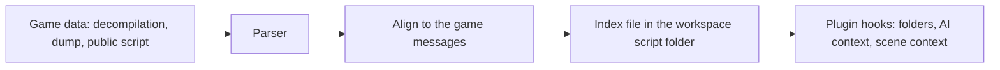

# Virtual folders and game scripts

A **virtual folder** groups the messages of a block by story place or scene. The editor shows it under the
block in the tree. A **game script** is a text that says which scene, speaker and place each message belongs to.
The plugin uses the script for folders and for the scene context in the AI prompt. Nothing in the engine knows a
game: the plugin fills the hooks in `plugins/base_game_rules.py`.

## The hooks

| Hook | Used by | What it gives |
|---|---|---|
| `get_virtual_folders(block_idx, text_of)` | Block tree | Folder nodes `{"title", "rows", "children"}`; rows are `(block, string)` |
| `get_ai_flow_context_for_string(block, string)` | AI prompt | One line of context for a message |
| `get_ai_flow_overview(block, indices)` | AI prompt | An outline for the messages of one request |
| `get_ai_flow_group_for_string(block, string)` | AI batching | Messages with one id travel in one request when they fit |
| `get_scene_context_for_string(block, string)` | Story Timeline window | Evidence: scene, candidate speakers, places (not the prompt) |

Folder rules: a node with `children` takes its rows from them; a leaf lists its own rows; a row may sit in
several folders. `text_of(string)` gives the current text (the translation, or the original when blank). Build
the nodes from data in memory: the call runs on the UI thread.

## Where the data comes from

Get a script from a public source, a decompilation or the game's own files. Keep the text out of the
repository: the script goes into the workspace `script` folder next to `source`, and the index holds ids,
positions and names only. A fan-written FAQ is data for local use; do not publish it.

## Aligning a script

Use a headless command, never a menu step, so the owner can rebuild it:

    python -m plugins.lunar_sssc.game_script --project-file <project.uiproj> --transcript <file>

The matcher works on the message text with tags removed:

1. A speech matches a message when its text equals the whole message or one page of it (pages split at
   `{page}`, `{clear}`, `{close}`, `{end}`).
2. A speech may cover several message boxes in a row: runs of two to four neighbours are matched too.
3. No exact match: the closest text at a similarity of 0.9 or more (`difflib`, the same cutoff as the Pokemon
   script module in `plugins/common/gamefaqs_script.py`).
4. A message takes a scene when its matches name one scene. Matches that name two scenes make it ambiguous:
   it is left out. Short texts (under 8 letters) are not matched on their own.

Quality metrics the build prints: messages placed, partial (only some pages matched), ambiguous, unplaced,
too short; and speech lines matched. Report them as numbers. Do not force a match to raise a count.

## Pitfalls

- A script paraphrases. Expect fuzzy matches, and lower coverage for a loose transcript.
- A speech can join boxes that the game shows apart; runs cover up to four boxes, not more.
- Stage directions, menus and battle text are often not in a fan script. Those messages stay unplaced.
- Block addresses come from the project's file numbering (`TEXT005/0/12`), not from the text, so a
  translation does not break the index. Keep the file numbering when a project is re-unpacked.
- The index is read on the UI thread the first time it is needed. Keep it small: ids and names only.
- Ambiguity is a result, not a failure. A repeated line from two scenes is left out on purpose.

## Checklist for a new game

1. Find a script: public FAQ, wiki, decompilation, or the game's own files. Keep it out of git.
2. Write or reuse a parser for its layout. Test it with a synthetic three-scene fixture; no real game text in tests.
3. Align it with the command above. Record the counts in the CHANGELOG and the report.
4. Implement the hooks in the plugin (`rules.py`, a separate module for the script).
5. Degrade to `{}`, `None` or `[]` when the index is missing.
6. Add the Ukrainian text of every new `tr("...")` to `locales/uk.json`.
7. Update the Plugin Developer Guide (EN and UK) and this page.

## Three references

| | Twilight Princess (`zelda_bmg`) | Wind Waker (`zelda_ww`) | Lunar (`lunar_sssc`) |
|---|---|---|---|
| Block-tree folders (`get_virtual_folders`) | No. Speaker folders come from the engine (`core/speaker_resolution.build_speaker_pool`) | No | Yes: place, then scene; unplaced messages in their own folder |
| Scene data | Stage arcs (`stage_scene_data.json`): stage, room, event, place names | None: one message file per block, speaker and balloon group from the message attributes | Game script index (`script/lunar_script_index.json`) |
| AI context | Dialogue flow (FLW1/FLI1): per-line context, outline, conversation group | Message chain (NextNo): per-line context, conversation group from the chain root | Scene line: place, position, speaker, speakers of the scene; scene group |
| Scene evidence for the timeline | Yes, candidate actors and locations | Yes, speaker and balloon group | Yes, scene, place, speaker |
| Script file | None (the flow is in the game files) | None | Yes, aligned to the messages |

Manual 3DS (`manual_3ds/folders.py`) is the only other plugin with `get_virtual_folders`. Pokemon Gen 1 and GSC
use a GameFAQs transcript for speaker and place only (`plugins/common/gamefaqs_script.py`); they have no folders.

Findings for the owner:

- Wind Waker is not built like Twilight Princess for the folder tree, and not like it for scene data. WW has
  no stage or room data, and no folders. Its AI context and speaker data are in the message files only.
- The "virtual folders" of TP are the engine's Speaker folders, which depend on the speaker pool. They are
  not a plugin hook.
- TP's stage data does not reach the AI prompt yet; only the Story Timeline window reads it.
