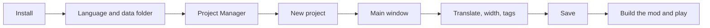
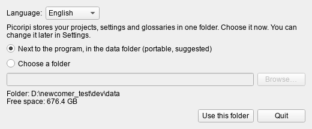
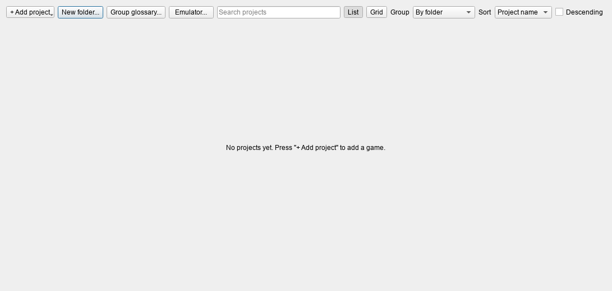
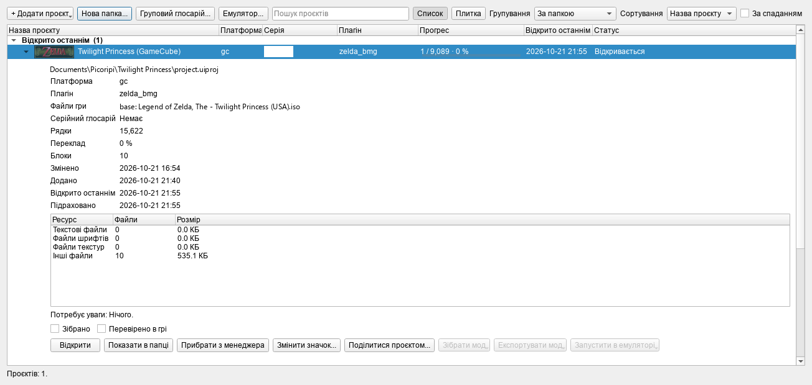
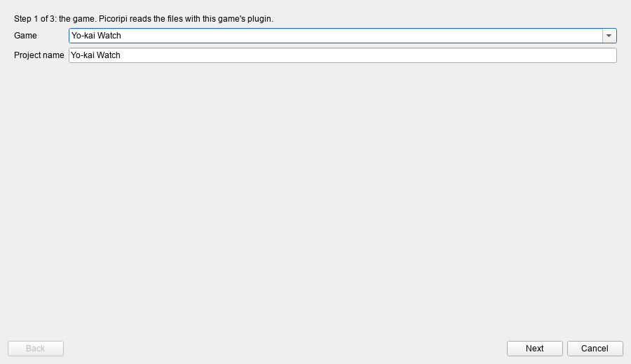
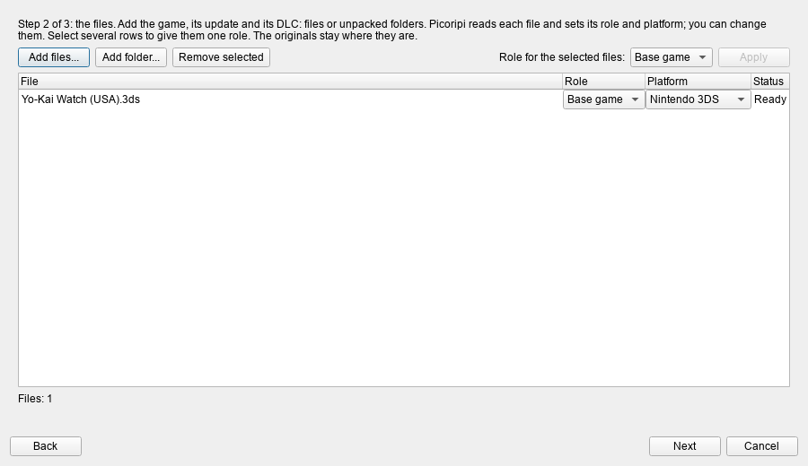
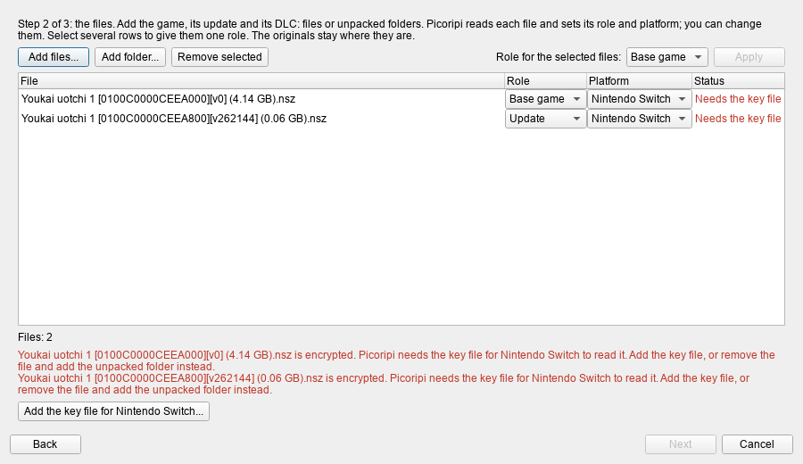
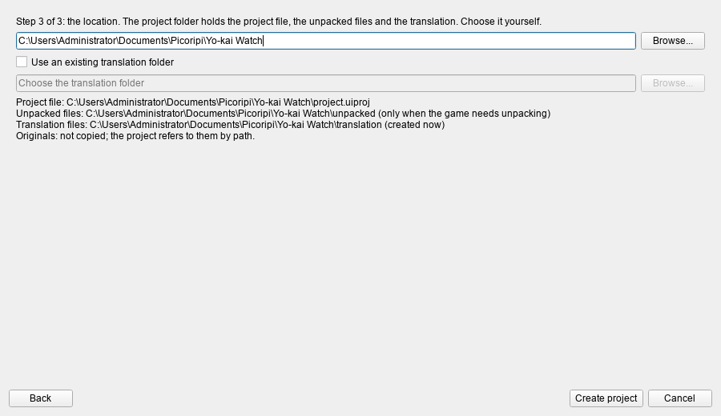
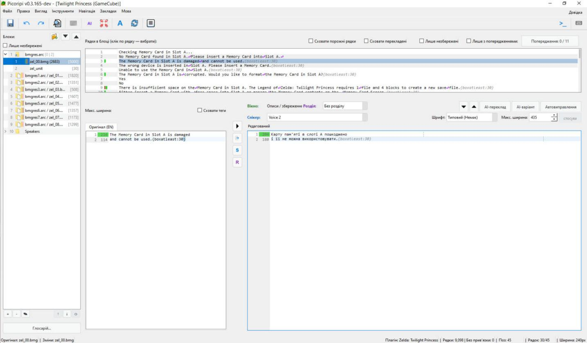
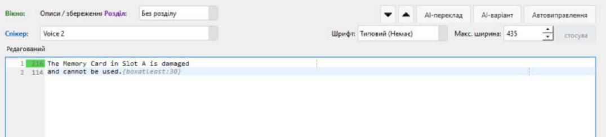

# Getting Started

**Language:** English · [Українська](uk/0_Getting_Started.md)

This page teaches you to work with Picoripi from the first start to a finished mod. It follows the order in which
you press the buttons. Each step says what you see, what to press and what happens next. The screenshots come from
real windows. They show the Ukrainian interface; pick English in the first dialog to see the English labels used
below.

**Contents.** 1 Install · 2 Language and data folder · 3 The Project Manager · 4 New project · 5 The main window ·
6 Your first translation · 7 Line width · 8 Tags · 9 Warnings and auto-fix · 10 Find and replace ·
11 Saving, undo, revert · 12 Bookmarks and navigation · 13 Preview · 14 AI translation · 15 Glossary ·
16 Where each setting is · 17 Build, export, run in the game · 18 Sharing a project · 19 When something goes wrong ·
20 What each game needs.

---

## 1. Install

You need Windows and Python 3.10 or newer (3.14 is the tested one). Windows also needs the Microsoft C++ Build Tools
once, because one package is built on your computer (see the [README](../../README.md)).

1. Download the program: `git clone https://github.com/rashevskyv/Picoripi.git`, or press **Code → Download ZIP** on
   GitHub and unpack the archive.
2. Open the program folder and double-click **`setup.bat`**. It makes a `.venv` folder and installs the packages. This
   takes one to three minutes and ends with "Setup completed successfully".
3. Double-click **`run.bat`**. The first window can take about 15 seconds to appear. Do not start it twice.

To update, run `git pull` in the program folder and run `setup.bat` again.

## 2. Language and data folder

The first window asks where Picoripi keeps your data: settings, project list, glossaries. It also asks for the
interface language. The language starts as the language of Windows when Picoripi has it, otherwise English. Change it
in the list at the top and the window changes at once.

- **Next to the program, in the data folder** is the default. The data sits beside the program: move the program
  folder and the data moves with it.
- **Choose a folder** keeps the data wherever you like.
- **My user profile** uses an older `~/.picoripi` folder. **Copy existing data** is off by default; tick it only to
  bring an older profile along.

Press **Use this folder**. Nothing is deleted.

You can change the data folder later: **File → Settings (Ctrl+P) → Global → Data location…**. Restart the program
afterwards. The interface language changes in the **Language** menu of the main window. The program offers a
restart: the language does not change on the fly.

## 3. The Project Manager

The Project Manager opens after the first start. All your games live here. It is empty for now.

You can open it later from the main window: **File → Project Manager...** (`Ctrl+Shift+M`). If no project is open
when you close the Manager, the program quits. If a project is open, you go back to it.

### The buttons at the top

| Button | What it does |
|---|---|
| **+ Add project** | Opens a menu with four items (below) |
| **New folder...** | Makes a folder inside the Manager to group projects. Nothing is made on disk |
| **Group glossary...** | Makes, changes or unlinks a glossary shared by all projects of a folder |
| **Emulator...** | Sets the emulator command for each platform (section 17) |
| **Search projects** | Filters by name, series, platform, plugin, folder and path. `Ctrl+F` puts the cursor here, `Esc` clears it |
| **List / Grid** | Switches the view. The grid shows each project as a large icon |
| **Group** | By folder, by platform, by readiness, by text amount, or no grouping |
| **Sort**, **Descending** | Order inside a group: by name, lines, platform, readiness or date changed |

The **+ Add project** menu:

1. **New project...** is the new-project wizard (section 4). After it creates the project, the project opens and the Manager closes.
2. **Add existing project...** adds a `project.uiproj` file that is already on disk.
3. **Import projects from a folder...** searches a folder for projects. Tick the ones you want and press **Import**.
4. **Import shared project...** opens a project that someone sent you (section 18).

### The project list

Columns: **Project name**, **Platform**, **Series**, **Plugin**, **Progress** (translated of needed, and percent),
**Last opened**, **Status**. The last opened project always comes first, above the groups. Double-click a row to open
the project. Click the arrow at the left of a row to expand its details.

The expanded row shows:

- the project path, platform, plugin, game files with their roles, and the series glossary;
- the number of lines, the translated percent, the number of blocks and the dates;
- a resource table (text, fonts, textures, other);
- a **Needs attention** line that lists problems, if any;
- the **Built** and **Verified in game** boxes. Only you set them; the program never changes them;
- the buttons **Open**, **Show in folder**, **Remove from manager**, **Change icon...**, **Share project...**,
  **Build mod**, **Export mod**, **Run in emulator**.

The project icon comes from the game itself when Picoripi can read it. To set your own, press **Change icon...** or
use the context menu. The program saves it as `icon.png` in the project folder.

Right-click a project for its menu: **Open**, **Show in folder**, **Share project...**, **Rename...**, **Move to
folder...**, **Change icon...**, **Clear icon**, **Remove from manager**. **Rename** changes the name in the list only.

**Remove from manager** only strikes the project from the list. The project files, the translation and the unpacked
files stay on disk. The program cannot delete a project from disk. Delete the project folder in Explorer.

## 4. New project

Press **+ Add project → New project...**. **File → New Project** (`Ctrl+N`) does the same. The wizard has three steps
and the buttons **Back**, **Next**, **Cancel**.

### Step 1: the game

Type a part of the game's name in **Game** and pick it from the list. **Project name** fills in by itself. You can
change it.

### Step 2: the files

Press **Add files...** and choose the game files: the game itself, its update and its DLC, in any order. If the game
is already unpacked, press **Add folder...** and choose the folder. **Remove selected** takes a file off the list. The
file dialog starts in your home folder, so it is easiest to paste the full path into the **File name** box.

Picoripi reads each file and sets its **Role** and **Platform** itself. The roles are **Base game** (the game),
**Update** and **DLC** (extra content). For Switch and 3DS, the game ID inside the file tells the roles apart. If the
guess is wrong, change it in the lists in the file's row.

To give many files one role, select their rows (`Shift` or `Ctrl`), pick the role in **Role for the selected files**
and press **Apply**. Only DLC can repeat. Base game and Update take one file each.

The **Status** column and the red text under the list tell you at once what stops the project:

| Message | What to do |
|---|---|
| Needs the key file | The file is encrypted. Press **Add the key file for ...** and choose your console's key file (Switch `prod.keys`, 3DS `aes_keys.txt`, Wii `keys.bin`). Picoripi only remembers where the file is. It never shows or copies the keys |
| Cannot read: add its folder | This game cannot unpack that kind of file by itself. Remove it and add the unpacked game with **Add folder...** |
| Two files have the role ... | Give each file its own role. Only DLC can repeat |

**Next** stays off until the list is fine.

### Step 3: the project folder

The project folder holds the project file `project.uiproj`, the unpacked files in `unpacked`, the translation in
`translation` and the build results in `build`. Picoripi suggests `Documents\Picoripi\<project name>`. Change it with
**Browse...** if you like. The window shows exactly where each file goes. The originals are not copied: the project
only remembers where they are.

Press **Create project**. A progress window shows the unpacking. The cancel button stops it and removes what the
wizard already made. Before unpacking, the program checks the free disk space. A big game takes a few minutes to
unpack and load. Then the Manager closes and the project opens in the editor.

## 5. The main window

This is the main window with a project open.

| Where | What it is |
|---|---|
| Menu bar | **File**, **Edit**, **View**, **Tools**, **Navigation**, **Bookmarks**, **Language**. The **Help** button (`F1`) is at the right |
| Toolbar | Save, undo, redo, find, preview, AI batch translation, AI chat, font editor, rescan all, settings. The `>_` button at the right runs your external script |
| Left, **Blocks** | The tree of the game's files and virtual folders. Below it: the block buttons and the **Glossary…** button |
| Top right, **Strings in block** | The lines of the selected block, read only. The filters are above it |
| Bottom left, **Original** | The source text, read only. It is the one place where you cannot type |
| Bottom right, **Editable** | You type the translation here |
| The narrow column between them | Buttons: copy the original into the translation, restore the translation, story context (`S`), markup studio (`R`) |
| Above **Editable** | **Window**, **Chapter**, **Speaker**, the buttons **AI Translate**, **AI Variation**, **Auto-fix**, and **Font**, **Max-width**, **Apply** |
| Under **Editable** | The preview: how the line looks in the game (section 13) |
| Status bar | Paths, plugin, number of lines, cursor position and width |

### The Blocks tree

- Click a block to open its lines. Double-click to rename it.
- The buttons under the tree: **+** adds a block, **−** removes a block from the project (the files on disk stay),
  **✎** renames, **↑** and **↓** reorder, **⟳** rebuilds the virtual folders from the story data. It does not touch
  the translation. `Ctrl` and the mouse wheel over the tree change the font size.
- **Show Unsaved Only** keeps the blocks with unsaved changes. It is off after a restart.
- Right-click a block for its menu: rename, remove, reveal in Explorer (original or translation), rescan the block,
  calculate widths, save the block's changes, revert the block to the original, restore the translation, AI
  translate the block. Right-click an empty place to make a folder.
- A strip sits at the left of each name. The green wash shows how much of the block is translated. The coloured strips
  at the right show the warning types in the block. A star before the number means unsaved changes.

### The Strings list

Click a line and it appears in **Original** and **Editable**. A green wash behind the number means the line is
translated. A star before the number means the changes are not saved. The coloured strips right of the number show
warnings. The filters above the list:

| Filter | What it does |
|---|---|
| **Hide empty strings** | Folds empty lines in a row into one |
| **Hide translated** | Keeps only what is not translated |
| **Show Overrides Only** | Keeps lines with their own font or their own width |
| **Show Unsaved Only** | Keeps lines with changes that are not saved |
| **Show Warnings Only** | Keeps lines with the chosen warning types |
| **Warnings: X / Y** | Opens the choice of warning types for the previous filter |

Filters can work together. If the list looks empty, check that no filter is still on.

## 6. Your first translation

1. In the **Blocks** tree on the left, pick a block with text, for example `zel_00.bmg`.
2. At the top, in **Strings in block**, click a line.
3. Below it, **Original** (read only) is on the left and **Editable** on the right. Click in **Editable** and type
   your translation.
4. Look at the numbers left of each line in **Editable**. They are the line width in game pixels (section 7).
5. Press `Ctrl+S` to save.

To start from the original, press the `→` arrow in the narrow column. It copies the original into **Editable**.

Move between lines like this:

| Action | Keys |
|---|---|
| Next or previous line with a problem | `Ctrl+↓`, `Ctrl+↑` or the arrows above **Editable** |
| Next or previous line | `Alt+↓`, `Alt+↑` |
| Next or previous block | `Alt+Shift+↓`, `Alt+Shift+↑` |
| Next or previous folder | `Alt+Shift+→`, `Alt+Shift+←` |

The **Speaker** field says who speaks the line. Type a name and press `Enter`: picking from the list without `Enter`
does not save. The **Chapter** field ties the line to a story chapter. The **Window** field shows the kind of message
window.

## 7. Line width

Width is the number of pixels a line takes in the game window. Picoripi counts it with the game's font: each letter
has its own width in pixels. So width is not the same as the number of letters. A line wider than the window runs out
of the box in the game. The program warns you in advance.

**Where you see the width.** The number right of a line's number in **Editable** is that line's width. The status bar
has a **Width** field: the width of the text up to the cursor (or of the selection). Above **Original** there is the
**Max-width** number: the width of the widest line of the original.

### Width for one line

These are the fields above **Editable**: **Font**, **Max-width**, **Apply**.

1. Select a line.
2. In **Max-width**, type a number of pixels. Zero means "the plugin default".
3. Press **Apply**. The button is on only while a change is not yet applied.

Right-click the **Max-width** field for two items:

- **Reset to Plugin Default** removes the line's own width;
- **Set Width from Original** measures the widest line of the original and types the number. Then press **Apply**.

Click the **Max-width** number above **Original** to copy it into the width field. The **Font** field works the same way: the
font you pick applies to this line only.

To change width or font for many lines, select them in **Strings in block**, right-click and choose **Set Width for
Multiple Lines** or **Set Font for Multiple Lines**. The **Auto-width from original** box takes the width from each
line's original. The **Default** button resets the value.

The **Show Overrides Only** filter shows every line with its own values. A purple mark beside the number shows them too.

### Width for the whole project

**File → Settings (`Ctrl+P`) → Project → Rules.** The **Project** tab exists only while a project is open.

| Field | What it means | Default |
|---|---|---|
| **Game Dialog Max Width (px)** | The hard limit. A line wider than this is an error | 300 |
| **Editor Line Width Warning (px)** | The point from which the editor marks a line as too wide | 280 |
| **Lines Per Page** | How many lines one game window holds. Auto-fix uses it | 4 |
| **Show guideline** | Draws a vertical line at the width limit in the editor | on |

Some plugins, for example Zelda: Twilight Princess, have several kinds of windows. They show a **Window limit mode**
choice at the top:

- **Shared for all windows** uses one set of values for the whole game;
- **Separate by window type** shows the **Defaults by window type** table with the columns **Window type**,
  **Warning**, **Maximum**, **Lines**. The window type comes from the message data. **Warning** cannot be larger than
  **Maximum**.

Press **OK**. The program rescans all lines by itself and shows "Rules have been updated. Rescanning all issues...".

**Which value the program uses.** In this order:

1. the line's own width (the **Max-width** field);
2. the value for the window type, if the plugin has several types;
3. the value from **Rules**.

### The width of each letter

Letter widths are in **Settings → Project → Font Map**. The table has the columns **Character / Sequence** and
**Width (pixels)**. The buttons **Add Character** and **Remove Character** change rows, and **Filter Characters**
searches the table. A letter that is not in the table counts as 8 pixels wide. Change a width and, after **OK**, all
warnings are counted again. The program saves the map in your data folder. It never changes the plugin's file in
`plugins/`.

The font for the whole project is chosen in **Settings → Project → Display → Default Font for Project**. The program
restarts after you change it. Other fields on that tab: **Wrap lines in preview panel**, **Wrap lines in editor
panels**, **Newline Symbol**, and **Newline Symbol Style** and **Tag Style**: colour, bold, italic, underline.

The font size of the program itself is **Settings → Global → Application Font Size**.

## 8. Tags

Tags such as `{boxatleast:30}` drive the game: colour, pause, hero name. Leave them where they are. The editor shows
them in grey or orange.

- **Hide tags** (`Ctrl+Q`, the box above **Original**, or **View → Hide Tags**) hides tags in all panels. The stored
  text does not change.
- To insert a tag, right-click in **Editable**. With no selection it inserts one tag. With a selection the tag wraps
  the selected text.
- The list of tags in that menu is **Settings → Project → Context Tags**. The **Single Tags** table has the columns
  **Display (Emoji/Hex)** and **Tag**. The **Wrap Tags** table has **Opening Tag** and **Closing Tag**. The buttons
  are **Add Row** and **Remove Row**.
- **Settings → Project → Tag Aliases** give a tag a readable name, for example `{F:Link}` instead of
  `{escape:0:0000}`. The columns are **Alias** and **Original Tag**. The width of a line is still counted with the
  original tag.
- Tag colours and styles change in **Project → Display → Tag Style**.

## 9. Warnings and auto-fix

The program checks every line by itself: is it too wide, are the breaks, spaces and tags right. The set of checks
depends on the game plugin. A line with a problem has a coloured strip beside its number.

- **To go to problems:** the arrows above **Editable** or `Ctrl+↓`/`Ctrl+↑`. For a list of only problem lines, turn on
  **Show Warnings Only** and choose the types with **Warnings: X / Y**.
- **Which checks run:** **Settings → Project → Detection**. Each problem has a box and a colour. All are on by default.
- **Auto-fix:** the **Auto-fix** button above **Editable** (`Ctrl+Shift+A`) fixes the current line. `Ctrl`+click lets
  you pick the rules. `Shift`+click fixes within one page.
- **What to fix:** **Settings → Project → Auto-fix**. The boxes for each problem are off by default. The separate
  boxes are **Align sentences to original page layout** and **Prevent adding empty padding lines during pagination**.
- **Fix everything at once:** **Tools → Fix All Strings...**.
- **Rescan all:** `Ctrl+Shift+R`. The toolbar button does the same. It counts widths and problems again for the whole
  project.

## 10. Find and replace

**Quick find** (`Ctrl+F`). A search bar appears above the editor. **Prev** and **Next** (`F3`, `Shift+F3`) walk through
the hits. The search covers the whole project and does not wrap: at the end it says "Not found". The boxes:

- **Aa** matches the case;
- **Fuzzy** finds similar words and other endings;
- **Original** searches the original, not the translation;
- **No Tags** ignores tags, line breaks and extra spaces (on by default).

**Advanced search** (`Ctrl+H` or the **Advance** button). The fields are **Find** and **Replace with**. The list of
matches is on the left. Click a match and the editor jumps to it. The buttons: **Find**, **Replace** (the current
match only), **Replace All**, **Skip**. The **Match case on replace** box keeps capitals: `Word` becomes
`Replacement`, and `WORD` becomes `REPLACEMENT`.

Replacements enter the project when you close the window, and become unsaved changes. Press `Ctrl+S` to write them
to disk.

## 11. Saving, undo, revert

**Saving.** `Ctrl+S` (**File → Save Changes**) writes the translation files of all blocks that have changes. With no
changes, nothing is written. Picoripi never changes the original files. For archives, the program packs the archive
again in the translation copy and warns you if it became larger than the original. The window title has a star while
changes are unsaved.

**Session autosave.** Two seconds after a change, the program writes a service file `.picoripi_session` into the
project folder. It also holds unsaved text. After a crash, or after you close the program, it restores that text when
you open the project. This is not a replacement for `Ctrl+S`: only saving changes the translation files. If you turn
off **Settings → Global → Restore unsaved session on startup**, unsaved text is lost when you close.

**Undo and redo.** `Ctrl+Z` and `Ctrl+Y` (or `Ctrl+Shift+Z`). There is one stack for the whole project, with 500
steps. Typing in a row in one line is one step. Moving to another line is also a step, so the first `Ctrl+Z` may
take you back to the previous line.

**Translation backup.** `Ctrl+T` (**Edit → Save Translated**) writes the current line's translation into the backup
file `saved_translations.json`. The program also makes a copy by itself before any revert to the original, and after
an AI translation. `Ctrl+Shift+T` (**Restore Translated**) brings the saved text back into the editor.

**Revert a line to the original.** The `→` arrow in the narrow column, or an item in the right-click menu. For many
lines the program asks you to confirm. Before it reverts, it saves your translation into the backup, so you can
restore it.

**Revert Changes File to Original...** in the **File** menu erases the translation on disk. Use it only when you want
to start the translation again.

Closing a project or the program does not ask "save?". The unsaved text stays in the service session file.

## 12. Bookmarks and navigation

- **Bookmarks → Add Bookmark...** (`Ctrl+B`) remembers the current line. You can change the name. Click a bookmark
  in the menu to go back. **Delete Bookmark** and **Clear All Bookmarks** ask you to confirm. A bookmark is tied to
  the block number and the line number. If you reordered blocks, it may point to the wrong place.
- **Navigation** has four items for moving between blocks and folders (section 6).
- **Edit → Paste Block Text** (`Ctrl+Shift+V`) pastes several lines from the clipboard. `{END}` separates the lines.
  **Undo Paste Block** puts things back.

## 13. Preview

**View → Preview** (`Ctrl+Shift+P`) shows under **Editable** how the line looks in the game window: font, window size,
line breaks. For some games the preview is exact, for others it is approximate. If the program is slow, turn off
**Settings → Global → Enable Live Preview**. You can do the same for **Real-Time Warning Scan** and the **Glossary
System**.

Some plugins have separate windows in **Tools**: **Font Editor...** (also the **A** button on the toolbar),
**Textures...**, **Script Markup Studio...**. They are described in [Interface](1_User_Guide_and_Workflow_Pipeline.md)
and [Script Markup](9_Script_Markup.md).

## 14. AI translation

The AI translates for you, and you correct it. First set up a provider.

1. **Settings (`Ctrl+P`) → AI Translation.**
2. Leave **Target Language** as Ukrainian or type another language.
3. In **Active Provider**, choose what to use: **OpenAI Compatible**, **Ollama Chat**, **Gemini** or **Perplexity**.
   The default is **Disabled**.
4. Fill in the fields that appear: the API key, the address, the model. A local Gemini Web2API needs no key. See
   [Gemini Web2API](5_Gemini_Web2API.md).
5. Press **Test Provider**. The program sends one small request and shows the result.
6. Press **OK**.

After that, these buttons above **Editable** work:

| Button | What it does |
|---|---|
| **AI Translate** | Translates the current line. `Ctrl`+click opens the prompt editor |
| **AI Variation** | Offers another wording of your translation. Select a fragment to rewrite only that |
| **Auto-fix** | Fixes problems of width, spacing and tags (section 9) |

To translate many lines, select them in the list, right-click and choose **AI Translate**. To translate a block,
right-click the block and choose "AI: Translate Block". For the whole game there is **Tools → AI Batch Translation**.
It has three modes: story first, the remaining blocks, everything together. These are long jobs that call a paid
service, so try one block first.

Chat: **Open AI Chat** (`Ctrl+Shift+C`). More in [AI Translation](11_AI_Translation.md).

## 15. Glossary

The glossary is a dictionary of the game's terms (names, items, places) with your translations. The AI and you use
it in the same way, so "Link" stays the same everywhere.

1. Press **Glossary…** under the Blocks tree (`Ctrl+G`).
2. On the left is the list of terms with a search box and tabs for categories. The **Needs review** box keeps the
   terms that are not confirmed.
3. Pick a term. On the right type the translation and press **Confirm translation** to go to the next one. **Save**
   (`Ctrl+S` in that window) writes the changes.
4. **Discuss with AI…** opens a chat with the full context of the term.

To build a glossary from the game's text automatically, use **Tools → Prepare Glossary...**. More in the
[Localization Pipeline](8_Localization_Pipeline.md).

## 16. Where each setting is

**File → Settings** (`Ctrl+P`). The only buttons are **OK** and **Cancel**. Changes apply after **OK**. A restart is
needed only when you change the theme, the active game plugin or the project's default font.

| What you need | Where | Restart |
|---|---|---|
| Theme, interface language | **Global → Theme**, the **Language** menu | yes |
| Data folder | **Global → Data location…** | yes |
| Font size of the program and tooltips | **Global** | no |
| Path to the external script (the `>_` button) | **Global → External Tool/Script Path** | no |
| Path to `wit.exe` for ISO files | **Global** | no |
| Show spaces as dots | **Global** | no |
| Turn off preview, problem scan, glossary for speed | **Global** | no |
| Paths to the original, translation, fonts, reference | **Project → File Paths** | no |
| Window width, warning, lines per page | **Project → Rules** | no |
| Default font, wrapping, colours | **Project → Display** | font: yes |
| Tags to insert | **Project → Context Tags** | no |
| Tag aliases | **Project → Tag Aliases** | no |
| Letter widths | **Project → Font Map** | no |
| Which problems to look for | **Project → Detection** | no |
| Which problems to fix automatically | **Project → Auto-fix** | no |
| Spell checking | **Spelling** (dictionary language, **Manage Dictionaries...**) | no |
| AI provider, key, model | **AI Translation** | no |
| Provider for the glossary | **AI Glossary** | no |
| Server for the phone | **Companion** | no |
| Event log | **Logging** | no |
| Console key files | **Console keys** | no |

The **Project** tab appears only while a project is open. Global settings sit in `settings.json` in the data folder.
Project settings sit in the project file. More in [Configuration](4_Configuration_Guide.md).

## 17. Build, export, run in the game

You can build a mod once the translation is saved. The build reads the translation files from disk, not from the
editor. So press `Ctrl+S` first.

1. Open the Project Manager: **File → Project Manager...** (`Ctrl+Shift+M`).
2. Expand the project's row.
3. Press **Build mod** and choose a target. The targets depend on the game: a disc ISO, a LayeredFS mod, a package
   for a port, a folder for an emulator. If the game has no targets yet, the button is off.
4. Watch the status line: "Working...", then percent. The result is "Built: <path>". The build is in `build\<target>`
   inside the project folder.
5. If something fails, the line shows "Failed: <reason>". Read the reason, fix what it names and try again. The full
   trace is in the log.

You cannot cancel a build in the Manager. Closing the Manager interrupts the build.

**Export mod.** Choose a target, then an empty folder. The program builds the mod and copies it there. Make a new
empty folder: the program does not use a folder that has files.

**Run in emulator.** Set the command first.

1. In the Manager press **Emulator...**.
2. For the platform you need, type the command and write `{path}` where the mod's file or folder goes. Example:
   `"C:\Emu\emu.exe" {path}`. An empty line means "no command".
3. Press **OK**.
4. In the project's expanded row press **Run in emulator** and choose a target. The program builds the mod and starts
   the emulator.

The program has no list of emulators: you give any command. The **Built** and **Verified in game** boxes are your own
notes for the project list.

## 18. Sharing a project

- **Share project...** packs the project, the translation and the glossaries into one `.zip`. The game's originals do
  not go into the archive. Unsaved text does not either. Press `Ctrl+S` first.
- **Import shared project...** (in the **+ Add project** menu). Choose the `.zip`, then an empty folder, then your own
  game files.
- For live work there is **Tools → Work Together...**: one person makes a room and the others join. See [Working
  Together](13_Working_Together.md). **Tools → Progress...** opens the progress page.
- To review on a phone there is [Picoripi Companion](12_Picoripi_Companion.md).

## 19. When something goes wrong

| What you see | What to do |
|---|---|
| The Strings list is empty | Turn off every filter above the list, especially **Show Unsaved Only** and **Hide empty strings** |
| **Build mod** is off | The game has no build targets yet. See the tooltip on the button |
| **Run in emulator** is off | Set a command with the **Emulator...** button |
| The first start shows no window for a long time | This is normal, up to 15 seconds. Do not start it twice |
| "Needs the key file" in the wizard | Give the console's key file with the button in the error row. Or add the unpacked folder |
| Every line has a width warning | Check **Project → Rules** and the **Font Map** |
| The program is slow | In **Global**, turn off live preview and real-time warning scan |
| You do not know what happened | Read the log: **Settings → Logging**. The file path is there |

## 20. What each game needs

| Game | Files to add | Key file |
|---|---|---|
| Yo-kai Watch, Switch | the game `.nsz` or `.nsp` and its update | Switch `prod.keys` |
| Yo-kai Watch, 3DS | the `.3ds` | 3DS keys, only when the file is encrypted |
| Twilight Princess, GameCube | the `.iso` | none |
| Twilight Princess, Wii | the Wii `.iso` | Wii `keys.bin` |
| Twilight Princess HD, Wii U | the unpacked game folder (Picoripi cannot read `.wux` yet) | none |

Every other game is in the **Game** list of wizard step 1.

<!-- wiki-nav -->
---

[Back to the wiki index](README.md) · **Next:** [User Guide: Interface](1_User_Guide_and_Workflow_Pipeline.md)
