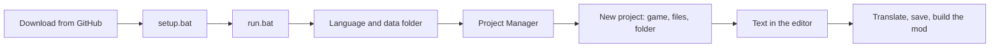

# Getting Started

**Language:** English · [Українська](uk/0_Getting_Started.md)

This page takes you from GitHub to your first translated line: download the program, start it, add a game, open its
text and save your translation. Every step was run on a clean copy of the program, and the screenshots come from the
real window. They show the Ukrainian interface; pick English in the first dialog to see the English labels used below.

## 1. Download and install

You need Windows and Python 3.10 or newer (3.14 is the tested one). Windows also needs the Microsoft C++ Build Tools
once, because one package is built on your computer (see the [README](../../README.md)).

1. Download the program: `git clone https://github.com/rashevskyv/Picoripi.git`, or press **Code → Download ZIP** on
   GitHub and unpack the archive.
2. Open the program folder and double-click **`setup.bat`**. It makes a `.venv` folder and installs the packages. This
   takes one to three minutes and ends with "Setup completed successfully".
3. Double-click **`run.bat`**. The first window can take about 15 seconds to appear, so do not start it twice.

## 2. Language and data folder

The first window asks where Picoripi keeps your data: settings, project list, glossaries. It also asks for the
interface language. The language starts as the language of Windows when Picoripi has it, otherwise English. Change it
in the list at the top and the window changes at once.

- **Next to the program, in the data folder** is the default. The data sits beside the program: move the program
  folder and the data moves with it.
- **Choose a folder** keeps the data wherever you like.
- **My user profile** uses an older `~/.picoripi` folder. **Copy existing data** is off by default; tick it only to
  bring an older profile along.

Press **Use this folder**. Nothing is deleted. You can change the folder later in **Settings → Global → Data folder**.

## 3. The Project Manager

The Project Manager opens next. All your games live here. It is empty for now.

Press **+ Add project → New project...**. Later, **File → New Project** (Ctrl+N) does the same.

## 4. New project

### Step 1: the game

Type a part of the game's name in **Game** and pick it from the list. **Project name** fills in by itself; you can
change it.

### Step 2: the files

Press **Add files...** and choose the game files: the game itself, its update and its DLC, in any order. You can also
press **Add folder...** and point to a game that is already unpacked. The file dialog starts in your home folder, so it
is easiest to paste the full path into the **File name** box.

Picoripi reads each file and sets its **Role** (**Base game**, **Update** or **DLC**) and **Platform** itself. For
Switch and 3DS, the game ID inside the file tells base game, update and DLC apart. If the guess is wrong, change it in
the lists. To give many files one role, select their rows, pick the role beside **Apply** and press it. Only DLC can
repeat.

The **Status** column and the red text under the list tell you at once what stops the project:

| Message | What to do |
|---|---|
| Needs the key file | The file is encrypted. Press **Add the key file for ...** and choose your console's key file (Switch `prod.keys`, 3DS `aes_keys.txt`, Wii `keys.bin`). Picoripi only remembers where the file is. |
| Cannot read: add its folder | This game cannot unpack that kind of file by itself. Remove it and add the unpacked game with **Add folder...**. |
| Two files have the role ... | Give each file its own role. Only DLC can repeat. |

**Next** stays off until the list is fine.

### Step 3: the project folder

The project folder holds the project file, the unpacked files and the translation. Picoripi suggests
`Documents\Picoripi\<project name>`; change it if you like. The window shows exactly where each file goes. The
originals are not copied.

Press **Create project**. A progress window shows the unpacking, and you can cancel it. A big game takes a few minutes
to unpack and load. When it is done, the Project Manager closes and the project opens in the editor.

## 5. Your first translation

This is the main window with a project open.

1. In the **Blocks** tree on the left, pick a block with text, for example `zel_00.bmg`.
2. At the top, in **Strings in block**, click a line.
3. Below it, **Original** (read only) is on the left and **Editable** on the right. Type your translation there.

Leave tags such as `{boxatleast:30}` where they are: the game reads them. The numbers beside the lines are the width of
the text in game pixels; Picoripi warns you when a line is too wide.

Press **Ctrl+S** to save. Picoripi writes the translation into the project and, for games with archives, packs the
archive again.

## 6. What next

The buttons above the **Editable** pane are the ones you will want first.

- **AI Translate** translates the current line, **AI Variation** offers another wording, and **Auto-fix**
  (`Ctrl+Shift+A`) repairs width, spacing and tag problems. To use AI, set up a provider first in **Settings → AI
  Translation** (`Ctrl+P`); see [AI Translation](11_AI_Translation.md) and [Gemini Web2API](5_Gemini_Web2API.md).
- The **Glossary** button at the bottom left opens the list of terms that you and the AI use the same way. How to build
  it from the game's text is in the [Localization Pipeline](8_Localization_Pipeline.md).
- **Build mod** and **Export mod** are in the Project Manager: open it with **File → Project Manager**
  (`Ctrl+Shift+M`), expand the project's row and press the button. To start the game at once, set **Emulator...** and
  choose **Run in emulator**.
- You can translate together: [Working Together](13_Working_Together.md).
- Every menu item and button of the main window is described in [the interface guide](1_User_Guide_and_Workflow_Pipeline.md).

## What each game needs

| Game | Files to add | Key file |
|---|---|---|
| Yo-kai Watch, Switch | the game `.nsz` or `.nsp` and its update | Switch `prod.keys` |
| Yo-kai Watch, 3DS | the `.3ds` | 3DS keys, only when the file is encrypted |
| Twilight Princess, GameCube | the `.iso` | none |
| Twilight Princess, Wii | the Wii `.iso` | Wii `keys.bin` |
| Twilight Princess HD, Wii U | the unpacked game folder (Picoripi cannot read `.wux` yet) | none |

Every other game is in the **Game** list of step 1.
