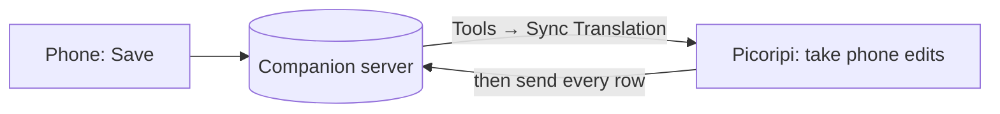

# Picoripi Companion (Mobile PWA & Sync)

**Language:** English · [Українська](uk/12_Picoripi_Companion.md)

Picoripi Companion lets translators review, edit, and approve glossary entries on a mobile phone (iOS Safari or Android Chrome) or tablet. It consists of a mobile Progressive Web App (PWA), a lightweight FastAPI backend server, and an automatic background synchronization client embedded in Picoripi desktop.

Desktop implementation: `core/companion_sync.py`, `ui/settings/companion_mixin.py`. Server & web app: `companion/server/`, `companion/web/`. Deployment guide: `companion/README.md`.

---

## 1. Desktop Configuration

Configure the companion server endpoint in **Settings → Companion** (`Ctrl+P`):

| Setting | Notes |
|---------|-------|
| Companion Server URL | Endpoint of your Companion instance, e.g. `http://127.0.0.1:8000` or `http://<server-ip>:8000`. Persisted in `settings.json` (`companion_server_url`). |
| API Token / PIN | Bearer security token (default: `picoripi`). Persisted in `settings.json` (`companion_api_token`). |
| Automatically sync on project open and close | Checkbox (`companion_auto_sync`, default on). Automatically keeps local and server glossaries in sync. |
| Test Connection | Tests connectivity and credentials against the server. |

### Background Auto-Sync Workflow

When **Automatically sync on project open and close** is enabled:
- **Startup Auto-Pull**: 600 ms after UI initialization or whenever a project is opened, Picoripi launches a non-blocking `CompanionPullWorker` thread. If remote terms were confirmed or edited on mobile, local `glossary.json` is safely updated (after creating a durable `glossary.json.bak` backup), in-memory data structures are hot-reloaded (`glossary_mgr.refresh_from_disk()`), editor syntax highlighting is refreshed, and open review dialogs reload automatically.
- **Diff Check**: If local and remote glossaries are already identical, `changed_count = 0` and disk writes are completely skipped, reporting a calm status: `Companion: glossary is in sync with server.`.
- **Auto-Push Fallback**: If the server has no terms for the current project while the local project has terms, Picoripi automatically pushes the initial glossary so terms become immediately available on mobile.
- **Save & Exit Auto-Push**: Saving changes (`Ctrl+S`), closing a project, closing the glossary dialog, or exiting the application automatically launches a background `CompanionPushWorker` to send updated terms, context occurrences, and reference translations to the server.
- **Debouncing & Safety**: All network sync requests use a 3-second debounce window and detect active workers (`existing_worker.isRunning()`) to prevent race conditions or duplicate requests. Network timeouts or offline servers never freeze the UI or show blocking modal errors.
- **Manual actions run in the background too**: *Push*, *Pull* and *Test Server Connection* (glossary window and Settings) show a small progress window with **Cancel**; cancelling returns at once and a cancelled pull does not touch the local glossary. After you resolve conflicts, the merge is committed by the same background worker.
- **Exit never waits for a silent server**: the sync window shown on exit gives up after 6 seconds without an answer and closes; **Skip** closes it immediately.

---

## 2. Desktop Manual Synchronization

Translators can also manually trigger synchronization at any time:
1. Open the Glossary dialog (**Glossary…** / `Ctrl+G`).
2. Click the **`[☁ Companion Sync...]`** button in the bottom toolbar.
3. Choose the action:
   - **⬆ Push Glossary & Context to Mobile Companion**: Uploads current terms, AI proposed variants, in-game quotes, and reference translations to the server.
   - **⬇ Pull Reviewed Glossary from Mobile Companion**: Downloads terms reviewed on mobile, creates a local `.bak` backup, updates `glossary.json`, and reloads active views.

---

## 3. Mobile PWA Interface & Workflow

Open `http://<your-server-ip>:8000` on your smartphone browser.

### Installing as a Standalone App (PWA)
- **iOS (Safari)**: Tap **Share ➔ Add to Home Screen**.
- **Android (Chrome)**: Tap **Menu (⋮) ➔ Install app** or **Add to Home Screen**.

The companion opens in full-screen standalone mode without browser URL bars or navigation clutter.

### Key Mobile Features
- **Header**: Compact glowing green status dot (`.status-dot`), streamlined project selector dropdown, and manual sync action.
- **Category Tabs**: Horizontally scrolling category pills (`All`, `Characters`, `Locations`, `Items`, etc.) with real-time term counts.
- **Search & Filters**: Debounced live text search and a **Needs review** filter toggle that isolates unconfirmed terms (confirmed terms are strictly excluded even if they retain historical AI variants).
- **Term Review Screen**:
  - Touch navigation: Previous/Next buttons (`[◀]` and `[▶]`) with 44×38px touch targets, tap animations, and term counter (`X / Y`).
  - Source Card (`О:`): Displays original term with 1-tap clipboard copy.
  - Translation Editor (`П:`): Large touch-friendly input field.
  - **"✓ Confirm & Next"** primary button: Confirms the translation, saves the record, and automatically advances to the next unreviewed entry.
  - **Proposed AI Variants**: Interactive cards displaying candidate translations and rationales; tapping any variant immediately fills the translation field.
  - **Lore & Context Accordions**: Collapsible cards for dynamic lore descriptions (with real-time `{{TERM}}` substitution), user notes, and dialogue occurrences with English script quotes and reference translations.
  - **Layout Ergonomics**: Protected by `flex-shrink: 0` so bottom accordions never get squashed, native momentum scrolling (`-webkit-overflow-scrolling: touch`), and safe-area inset padding.

---

## 3a. Translation rows on the phone

The Companion also edits the translation itself, not only the glossary.

1. In Picoripi, open the project and choose **Tools → Sync Translation with Companion**. Picoripi sends every row
   of the project (original and current text) to the server. It uses the server and token from **Settings → Companion**.
2. On the phone, tap **Strings** in the header. Pick a block, or search the original and translation of every block.
   The filters are **All**, **Untranslated** (the text is still the original) and **Changed on phone**.
3. Tap a row, change the translation, then tap **Save** or **✓ Save & Next**.
4. Back on the PC, run **Tools → Sync Translation with Companion** again. Picoripi takes the phone edits into the
   project as normal edits (unsaved, undoable with `Ctrl+Z`, shared with a **Work Together** room), then sends every
   row again. Save the project as usual.



**Conflicts.** Nothing is overwritten silently, and neither text is lost:

- The same row changed on the PC and on the phone, to different texts: Picoripi shows the original, the PC text
  and the phone text. Choose one per row. **Cancel** takes nothing and sends nothing; the phone edits stay on the server.
- The PC sent a new text after the phone page loaded the row: **Save** on the phone shows the PC text under your
  text. Tap **Save mine** or **Take PC text**.
- A phone edit made after Picoripi looked at the server stays open for the next sync.
- A phone edit for a row this project does not have (other files opened) is skipped and stays on the server.

The server keeps the rows in `strings.json` next to `glossary.json`. Nothing new is written into the project or
session files.

---

## 4. Server Deployment

The companion backend runs on Python 3.10+ (FastAPI + Uvicorn) and stores project glossaries in a `projects/` folder it creates next to the server code (`companion/server/`), with automatic `.bak` backups before every modification.

### Option A: Docker Compose (Recommended)

1. On your Linux server:
   ```bash
   git clone https://github.com/rashevskyv/Picoripi.git
   cd Picoripi/companion/server
   docker compose up -d --build
   ```
2. The web service starts on port `8000`.

### Option B: Native Ubuntu systemd Service

1. Run the included installer script:
   ```bash
   cd Picoripi
   sudo ./companion/server/install_ubuntu.sh <SECRET_TOKEN> 8000
   ```
2. Manage service:
   ```bash
   sudo systemctl status picoripi-companion
   sudo systemctl restart picoripi-companion
   ```

---

## 5. What not to do

- Do not expose the Companion server to the public internet with the default token `picoripi`. Set a custom `PICORIPI_COMPANION_TOKEN`.
- Do not edit the same term simultaneously on desktop and mobile without syncing first.
- Do not disable `companion_auto_sync` if you frequently review terms on your phone while keeping Picoripi open on desktop.

---

## 6. MCP server for agents

`python -m mcp_server` starts a local MCP server on stdin/stdout. An AI agent (Claude Code, for example) uses it to read your projects. Only `write_translations` and `import_font` change a project.

Add it to the agent's MCP configuration with the command `python -m mcp_server` and the Picoripi folder as the working directory.

| Tool | What it returns |
|---|---|
| `list_projects` | The projects of the Project Manager: path, id, platform |
| `get_issue_rules(plugin)` | The warning rules of a game plugin |
| `list_issues(project)` | The warnings from the last scan, counted by rule and block (read from `issues_cache.json`) |
| `scan_string(plugin, text, source_text)` | The warnings of one string: tags and the plugin rules |
| `check_fit(project, items)` | For each `{block, string, text}`: the width of every line in the translation font, the window limits of that message, lines per page, the plugin warnings and the tag check |
| `ask_ai(prompt, system)` | The reply of the AI provider Picoripi translates with (Settings → AI Translation, for example the Gemini proxy). The agent uses it for bulk text work instead of its own model |
| `translate_strings(project, block, strings)` | The AI translation of strings of one block, made the way Picoripi's block translation makes it: the same prompt, glossary, context, speakers, plugin rules, tag check and window fit. It writes nothing |
| `write_translations(project, items)` | Writes each `{block, string, text}` into the translation files and the session, like a save in Picoripi. Close the project in Picoripi first: an open window does not see the change and overwrites it with its next save |
| `list_fonts(project)` | The game's bitmap fonts in the project: label, format, file |
| `export_font(project, label, out_dir)` | Writes the font's sheets as PNG: `sheet_<n>.png` (the translation now) and `original_<n>.png` (the game's own). Returns the cell size and the cell of each character |
| `import_font(project, label, in_dir)` | Writes the edited `sheet_<n>.png` (same size) into the font's translation file. The game's own file stays as it is. Close that font in the font editor first |

- The server reads files on disk. Edits that Picoripi has not saved are not visible.
- `list_issues` shows the last scan, with its time. It does not scan again. Open the project in Picoripi to refresh it.
- `scan_string` does not measure line width, because the font map is not loaded. `check_fit` measures it: it reads the project's translation font and the original message.
- The same check runs without MCP: `python -m mcp_server.check_fit <project.uiproj> <items.json> [--failed]`.

<!-- wiki-nav -->
---

**Previous:** [Working Together and Progress](13_Working_Together.md) · [Back to the wiki index](README.md) · **Next:** [Recipes: I want to ...](Recipes.md)
