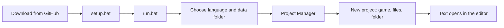

# Getting Started

**Language:** English · [Українська](uk/14_Getting_Started.md)

This page takes you from the GitHub page to a game open in the editor, with the screens you will see. It was
written from tests by people who had never used Picoripi. Every step was run on a clean copy of the program.

## 1. Download and install

You need Windows and Python 3.10 or newer (3.14 is the tested one). Windows also needs the Microsoft C++ build
tools once, because one package is built on your computer (see the [README](../../README.md)).

1. Download the program: `git clone https://github.com/rashevskyv/Picoripi.git`, or press **Code → Download ZIP** on
   the GitHub page and unpack it.
2. Open the program folder and double-click **`setup.bat`**. It makes a `.venv` folder and installs the packages.
   It takes one to three minutes and ends with "Setup completed successfully".
3. Double-click **`run.bat`** to start the program. The first window can take about 15 seconds to appear.

## 2. First start: language and data folder

The first window asks where Picoripi keeps your data (settings, project list, glossaries). It also asks for the
interface language. The language starts as the language of Windows when Picoripi has it, else English. Change it in
the list at the top: the window changes at once.

- **Next to the program, in the data folder** is the default. It is portable: move the program folder and the data
  moves with it.
- **Choose a folder** keeps the data wherever you like.
- **My user profile** uses an older `~/.picoripi` folder. **Copy existing data** is off by default; tick it only to
  import an older profile.

Press **Use this folder**. Nothing is deleted. You can change the folder later in **Settings → Global → Data folder**.

## 3. The Project Manager

After the data folder, the Project Manager opens. It lists your games. It is empty now.

Press **+ Add project → New project...**. **File → New Project** (Ctrl+N) does the same later.

## 4. New project: three steps

### Step 1: the game

Type a part of the game's name in **Game** and pick it from the list. The **Project name** fills in by itself; you
can add to it.

### Step 2: the files

Press **Add files...** and choose the game files: the game, its update and its DLC, in any order. Or press **Add
folder...** and choose an unpacked game. The file dialog starts in your user folder; type or paste the full path in
the **File name** box.

Picoripi reads each file and sets its **Role** (**Base game**, **Update**, **DLC**) and **Platform**. A Switch or
3DS title ID tells base game, update and DLC apart. Change them with the lists if the guess is wrong. To give many
files one role, select their rows, pick the role beside **Apply**, and press it. Only DLC can repeat.

The **Status** column and the red text under the list tell you at once what blocks the project:

| Message | What to do |
|---|---|
| Needs the key file | The file is encrypted. Press **Add the key file for ...** and choose your console's key file (Switch `prod.keys`, 3DS `aes_keys.txt`, Wii `keys.bin`). Picoripi stores only where the file is. |
| Cannot read: add its folder | This game cannot unpack that kind of file itself. Remove it and add the unpacked game with **Add folder...**. |
| Two files have the role ... | Give each file its own role. Only DLC can repeat. |

**Next** stays off until the list is fine.

### Step 3: the folder

The project folder holds the project file, the unpacked files and the translation. Picoripi suggests
`Documents\Picoripi\<project name>`; change it if you like. The window lists exactly where each file goes. The
originals are not copied.

Press **Create project**. A progress window shows the unpacking, and you can cancel it. Unpacking and loading can
take a few minutes for a big game. When it ends, the Project Manager closes and the project opens in the editor.

## 5. See the text

Pick a block in the tree on the left. The original text shows on the left, your translation on the right. The
project icon comes from the game when Picoripi can read it (3DS and GameCube); **Change icon...** on the project's
row in the Project Manager replaces it.

## What each game needs

| Game | Files to add | Key file |
|---|---|---|
| Yo-kai Watch, Switch | the game `.nsz` or `.nsp` and its update | Switch `prod.keys` |
| Yo-kai Watch, 3DS | the `.3ds` | 3DS keys only when the file is encrypted |
| Twilight Princess, GameCube | the `.iso` | none |
| Twilight Princess, Wii | the Wii `.iso` | Wii `keys.bin` |
| Twilight Princess HD, Wii U | the unpacked game folder (Picoripi cannot read `.wux` yet) | none |

Every other game is listed in the **Game** box of step 1. Related pages: [interface](1_User_Guide_and_Workflow_Pipeline.md),
[AI translation](11_AI_Translation.md), [configuration](4_Configuration_Guide.md).
