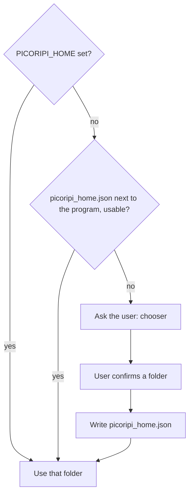

# Configuration

**Language:** English · [Українська](uk/4_Configuration_Guide.md)

User-facing settings live in **Settings…** (`Ctrl+P`), `ui/settings_dialog.py`. On-disk: `settings.json` in the data folder (see [Where Picoripi keeps your data](#where-picoripi-keeps-your-data); do not commit it). Optional `.env` is loaded at startup (`core/settings_manager.py` + `python-dotenv`) for API key env vars.

This page lists **controls as the UI shows them**, then the files they persist to.

---

## Settings tabs

### Global

| Control | Notes |
|---------|--------|
| Theme (requires restart) | Auto, Light, Dark. Changing it shows “A restart is required to apply the new theme.” |
| Active Game Plugin | Discovered from `plugins/*/config.json`. Changing it requires restart |
| Application Font Size | 6–24, default 10 |
| Tooltip Font Size | 6–32, default 11 |
| External Tool/Script Path | `.bat` / `.cmd` / `.exe` — the toolbar `>_` button |
| Wiimms ISO Tool (wit.exe) Path | Optional path to `wit.exe` for automatic GameCube/Wii ISO message extraction |
| Show special spaces as dots | |
| Space Dot Color | |
| Restore unsaved session on startup | If unchecked, unsaved changes are discarded on close |
| Show prompt editor before AI requests | |
| Enable Live Preview (turn off to reduce lag) | Also **View → Preview** |
| Enable Real-Time Warning Scan (turn off to reduce lag) | |
| Enable Glossary System (turn off to reduce lag) | |
| Show archive size warnings | Packed archive larger than original |
| Auto-Sleep Idle Delay (minutes) | 1–60, default 5. Idle after a finished task before sleep |

### Project (only with a project open)

Subtabs:

| Subtab | Role |
|--------|------|
| File Paths | **Directory Mode (Load from folder)**, **Auto-generate translation path**, Original / Changes paths, Original Fonts Directory Path, Fonts Directory Path, **Reference Translation / ROM Path** (reference patch folder, unpacked ROM, or `.iso` disc image) |
| Display | Default Font for Project, wrap preview, wrap editors, Newline Symbol + style, Tag Style |
| Rules | Game Dialog Max Width (px), Editor Line Width Warning (px), Show guideline, Lines Per Page. For `zelda_bmg`: **Window limit mode** — Shared for all windows vs Separate by window type (`window_layouts.json`) |
| Context Tags | Custom insert/wrap tags for the editor menu |
| Tag Aliases | alias ↔ original tag; **File → Reload Tag Mappings from Settings** |
| Font Map | Glyph widths |
| Detection | Per-problem-id checkboxes from `get_problem_definitions()` |
| Auto-fix | Which of those ids Auto-fix may apply |

Changing Rules marks a rescan.

### Spelling

Enable spell checking · Dictionary Language · **Manage Dictionaries…** (download/remove Hunspell dicts; words added via Spellcheck → Add to Dictionary).

### AI Translation / AI Glossary

See [11. AI Translation](11_AI_Translation.md). Keys belong in Settings or `.env`, never in git.

Default translation config (`build_default_translation_config`): provider `disabled`, workers `6`, OpenAI env `OPENAI_API_KEY`, Gemini env `GEMINI_API_KEY`, OpenAI timeout 60 s, Gemini timeout 120 s.

### Companion

Connection to the mobile review backend. See [12. Picoripi Companion](12_Picoripi_Companion.md).

| Control | Notes |
|---------|-------|
| Companion Server URL | URL of Companion service (e.g. `http://127.0.0.1:8000` or remote server IP) |
| API Token / PIN | Authentication token (`companion_api_token`) |
| Test Connection | Tests whether the server is reachable and accepting tokens |
| Automatically sync on project open and close | Background auto-pull on project open; auto-push on save/exit |

### Logging

| Control | |
|---------|--|
| Enable Console Logging | |
| Enable File Logging | |
| Log AI Traffic to File (`ai_traffic.log`) | Written to the data folder (`ai_traffic.log`) as JSON Lines: one record per request, response or error with a shared `request_id`, chunk number, attempt, sizes and duration, plus a summary per run. Rolled over to `ai_traffic.log.1` at 8 MB instead of being cleared |
| Log File Path | empty → `app_debug.txt` |

Categories: general, lifecycle, file_ops, settings, ui_action, ai, scanner, plugins.

---

## Where Picoripi keeps your data

The first time Picoripi starts, it asks where to keep its data. The data folder holds your settings, the Project Manager list, series glossaries, plugin data and caches. Picoripi never picks a folder for you: you confirm it.

- The suggested folder is `data`, next to the program. It is portable: move the program folder and the data moves with it.
- You can choose another folder. You can also keep using your old profile folder `~/.picoripi`. Copying the old data is optional. The old folder is never changed or deleted.
- Change the folder later in **Settings → Global → Data folder → Data location…**. Picoripi copies the data to the new folder. Restart Picoripi to use it.
- Two explicit overrides exist: the environment variable `PICORIPI_HOME`, and `picoripi_home.json` next to the program (the chooser writes it).
- Git: every data folder gets a `.gitignore` with a `*` line. Git then skips the folder, even inside a repository. If the chosen folder is in a Git repository that does not ignore it, the chooser asks first. **Write .gitignore** is the default. Files outside the data folder do not change.

The log file `app_debug.txt` stays next to the program unless **Log File Path** names another file. Short-lived temporary files use the system temp folder.

---

## Files next to the app

| File | Role |
|------|------|
| `settings.json` | Global + last plugin + AI presets + `ui_language` + `companion_server_url`/`token`/`auto_sync`. Local; untracked |
| `locales/en.json` | English UI catalog (keys = English source strings) |
| `locales/uk.json` | Ukrainian UI catalog. Add a key here whenever you add `tr("...")` in code |
| `.env` | Optional `OPENAI_API_KEY`, `GEMINI_API_KEY`, … |
| `session` / `.picoripi_session.json` | UI filters, navigation, unsaved edits, undo. **Show Unsaved Only** is forced off on restore |
| `session_state.json` in the data folder | Tree expansion, selection and cursor per project (read once from the old `session_state.json` in the program folder) |
| `project_manager.json` in the data folder | Project Manager list: added projects, their folders, the group and sort choices. Written atomically. A file it cannot read is kept as `.unreadable` |
| `project_index.json` in the data folder | Project Manager cache: the last card and string counts of each project. Safe to delete; rebuilt on the next visit |
| `project.uiproj` | Project record: name, plugin folder, source/translation paths, bookmarks, `reference_patch_path` |
| plugin `config.json` | Defaults for that game |
| plugin `aliases.json` | Extra tag aliases |
| `translation_prompts/` | Prompt JSON used by Edit Prompts JSON / glossary pipeline |

---

## What not to do

- Do not commit `settings.json`, `.env`, session files, or API keys.
- Do not switch **Active Game Plugin** and expect BMG load without restart.
- Do not point External Tool at a build that reads unsaved buffers — Save first.
- Do not put machine-absolute paths in wiki or README examples.

To fill extra interface languages (or to complete Ukrainian): start Gemini Web2API, then run `tools/i18n-translate/run.bat`. The window selects target languages; **Ukrainian is on by default**. After a catalog has translations, it appears in **Language**; the name comes from `@language_name` in that JSON. Missing strings stay English.
