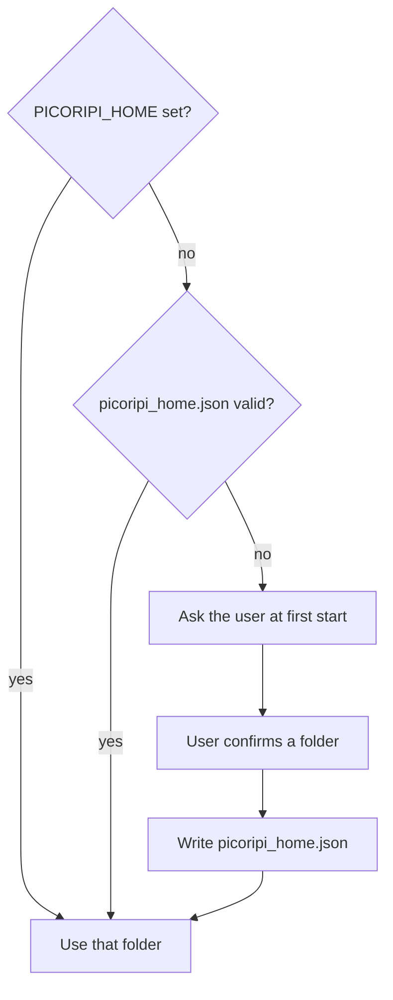

# Configuration

**Language:** English · [Українська](uk/4_Configuration_Guide.md)

This page is the map of **Settings** (`Ctrl+P`). It lists every tab, each control, its default, and whether a restart is needed. It also shows which file keeps each value, and how the data folder works.

## How the dialog works

- **OK** applies the changes and saves them. **Cancel** discards them.
- The **Project** tab appears only while a project is open.
- Most controls apply at once after **OK**. Exceptions: the **Console keys** tab applies each change at once, without **OK**.
- A restart is needed for **Theme**, **Active Game Plugin** and **Default Font for Project**. Picoripi restarts itself after **OK** when you change one of them.
- The **Data folder** and the interface **Language** need a restart that you start yourself. The table column "Restart" shows **Yes** for these.
- Settings do not reset on their own. See [Reset to defaults](#reset-to-defaults).

## Global

| Control | What it does | Default | Restart |
|---|---|---|---|
| Theme (requires restart) | Auto, Light or Dark colours. | Auto | Yes, auto |
| Active Game Plugin | The game plugin Picoripi loads. Lists the plugins it finds. | `zelda_mc` | Yes, auto |
| Application Font Size | Font size of the program. Range 6 to 24. | System font size | No |
| Tooltip Font Size | Font size of tooltips. Range 6 to 32. | 11 | No |
| External Tool/Script Path | The file the `>_` toolbar button runs (`.bat`, `.cmd`, `.exe`, `.py`, `.sh`). | Empty | No |
| Wiimms ISO Tool (wit.exe) Path | Optional `wit.exe`, used to read GameCube and Wii ISO messages. Empty means PATH or automatic search. | Empty | No |
| Show special spaces as dots | Draws repeated or special spaces as dots in the editor. | On | No |
| Space Dot Color | Colour of those dots. | `#BBBBBB` | No |
| Restore unsaved session on startup | Keeps a copy of unsaved text in `settings.json` and loads it at start. Off means that copy is not written. | Off | No |
| Show prompt editor before AI requests | Opens the prompt editor before each AI request. | On | No |
| Enable Live Preview | Shows the game-style preview under the editor. Same as **View → Preview**. | On | No |
| Enable Real-Time Warning Scan | Checks lines for problems while you type. Off reduces lag. | On | No |
| Enable Glossary System | Turns the glossary features on. Off reduces lag. | On | No |
| Show archive size warnings | Warns when a packed archive is larger than the original. | On | No |
| Auto-Sleep Idle Delay (minutes) | Idle time, 1 to 60 minutes, before the computer sleeps after a finished task. | 5 | No |
| Data folder: **Data location…** | Shows the data folder. Moves the data to another folder (copies it). See [Data folder](#the-data-folder). | Next to the program (`data`) | Yes, you restart |

## Project

Open a project first. The tab has eight sub-tabs.

### File Paths

| Control | What it does | Default | Restart |
|---|---|---|---|
| Directory Mode (Load from folder) | Loads all files of a folder instead of one file. | Off | No |
| Auto-generate translation path | Builds the translation path from the original path. The translation field is then read-only. | Off | No |
| Original File Path / Directory Path | The source files. The label changes with Directory Mode. | The project's source path | No |
| Changes File Path / Directory Path | The translation files. | The project's translation path | No |
| Original Fonts Directory Path | Folder with the original game fonts. | Empty | No |
| Fonts Directory Path | Folder with your translated fonts. Added to the font list. | Empty | No |
| Reference Translation / ROM Path | A reference translation folder, an unpacked ROM folder, or a disc image (`.iso`, `.rvz`). Shown next to your translation. | Empty | No |

### Display

| Control | What it does | Default | Restart |
|---|---|---|---|
| Default Font for Project | Font used for the whole project. | None | Yes, auto |
| Wrap lines in preview panel | Wraps long lines in the preview. | On | No |
| Wrap lines in editor panels | Wraps long lines in the editor. | Off | No |
| Newline Symbol | Character that shows a line break. | `↵` | No |
| Newline Symbol Style | Colour, bold, italic and underline of the newline symbol. | `#A020F0`, bold | No |
| Tag Style | Colour, bold, italic and underline of tags. | `#FF8C00`, bold | No |

### Rules

| Control | What it does | Default | Restart |
|---|---|---|---|
| Game Dialog Max Width (px) | The hard limit. A wider line is an error. | 300 | No |
| Editor Line Width Warning (px) | The point where the editor marks a line as too wide. | 280 | No |
| Show guideline | Draws the width limit in the editor. | On | No |
| Lines Per Page | Lines that one game window holds. Auto-fix uses it. | 4 | No |
| Window limit mode | Only for plugins with several window types. **Shared for all windows** uses one set of limits. **Separate by window type** uses a table with **Warning**, **Maximum** and **Lines** for each type. | Separate by window type | No |

Changing a rule starts a rescan of all lines. Warning cannot be larger than Maximum in the window table.

### Context Tags

Two tables: **Single Tags (RMB without selection)** and **Wrap Tags (RMB with selection)**. Each row has a display text and the tag. A wrap row has an opening and a closing tag. Use **Add Row**, **Remove Row** and **Filter Tags**. The rows feed the right-click menu in the editor.

- Default: empty.
- Changes take effect after **OK**.

### Tag Aliases

A table with **Alias** and **Original Tag**. An alias gives a raw game tag a readable name. Use **Add Alias**, **Remove Alias** and **Filter Aliases**.

- Default: the aliases of the plugin (its `config.json`).
- Saved in the plugin's user folder as `aliases.json`.
- After you edit the plugin file by hand, use **File → Reload Tag Mappings from Settings**.

### Font Map

A table with **Character / Sequence** and **Width (pixels)**. The widths feed the line-width warnings. Use **Add Character**, **Remove Character** and **Filter Characters**.

- Default: the plugin's font map. A character that is not in the table counts as 8 pixels.
- Saved in the plugin's user folder as `font_map.json`. Picoripi never changes the plugin's own file.

### Detection

One checkbox for each problem type the plugin checks. Each box shows the problem colour and a tooltip.

- Default: all on.
- Turn a check off to stop it from marking lines.

### Auto-fix

| Control | What it does | Default | Restart |
|---|---|---|---|
| Align sentences to original page layout | Matches sentence breaks to the original pages. | Off | No |
| Prevent adding empty padding lines during pagination | No empty lines at the end of a page to fill space. | Off | No |
| One box per problem type | Lets Auto-fix change that problem type. | All off | No |

## Spelling

| Control | What it does | Default | Restart |
|---|---|---|---|
| Enable spell checking | Turns spell check on in the editor. | Off | No |
| Dictionary Language | Language of the dictionary. Lists the dictionaries you have. | `uk` | No |
| Manage Dictionaries... | Downloads or removes dictionaries. Shows the words you added with **Add to Dictionary**. | Not applicable | No |

## AI Translation

| Control | What it does | Default | Restart |
|---|---|---|---|
| Target Language | Language the AI writes. Free text. | Ukrainian | No |
| Active Provider | **Disabled**, **OpenAI Compatible**, **Ollama Chat**, **Gemini** or **Perplexity**. | Disabled | No |
| Test Provider | Sends one small request. Shows the result. | Not applicable | No |
| Preset and **Save Preset** / **Delete Preset** | Stores the provider and its settings under a name. **Default** cannot be overwritten or deleted. | Default | No |
| Parallel Requests | Requests sent at once during batch translation. Range 1 to 16. | 6 | No |
| Offer sentences translated in other games of the series | Offers matching sentences from other games of the series. | Off | No |
| Safe matches start ticked | Ticks the safe matches in that offer list. | On | No |
| **Edit Prompts JSON** | Opens the prompt templates in your editor. | Not applicable | No |

Each provider has its own fields:

| Provider | Fields and defaults |
|---|---|
| OpenAI Compatible | API Key, API Key Env Var (`OPENAI_API_KEY`), Endpoint, Model (`gpt-4o-mini`), Temperature 0.0, Max Output Tokens 0 (provider default), Request Timeout 60 s |
| Ollama Chat | Base URL (`http://localhost:11434`), Model (`llama3`), Temperature 0.0, Request Timeout 120 s, Keep Alive (empty) |
| Gemini | Base URL (empty = Google API), API Key (optional for a local proxy), Model (`gemini-3.7-flash`), Temperature 0.0, Request Timeout 120 s |
| Perplexity | API Key, Base URL, Model, Temperature, Max Output Tokens, Request Timeout. The fields show their hints; no default value is set in the code |

Keys stay in these fields or in `.env`. Do not put keys in a project you share. See [AI Translation](11_AI_Translation.md).

## AI Glossary

| Control | What it does | Default |
|---|---|---|
| Provider | Provider for glossary building. Same list as AI Translation. | OpenAI Compatible |
| API Key | Key for this provider. | Empty |
| Use API key from AI Translation | Reuses the key of the AI Translation provider. | Off |
| Model | Model name. | `gpt-4o` |
| Text Chunk Size | Characters of game text per request. | 8000 |
| Parallel Requests | Glossary requests at once. Match this to the number of accounts a proxy rotates. | 6 |
| Retry Delay | Seconds before a failed entry is retried. A `Retry-After` from the server wins. | 60 s |

Restart: no.

## Companion

| Control | What it does | Default |
|---|---|---|
| Server URL | Address of the Companion server, for example `http://192.168.1.100:8000`. | Empty |
| API Token / PIN | Token or PIN set on the server. Shown as dots. | `picoripi` |
| Test Connection | Checks that the server answers and accepts the token. | Not applicable |
| Automatically sync on project open and close | Pulls reviewed terms on open and pushes changes on save or close. | On |

Restart: no. See [Picoripi Companion](12_Picoripi_Companion.md).

## Console keys

One row for each console. Each row shows the stored path, its state, **Browse...** and **Clear**.

| Row | The file | Default |
|---|---|---|
| 3DS | The 3DS key file (for example `aes_keys.txt`) | Not set |
| Switch | The Switch key file (`prod.keys`) | Not set |
| Wii | The Wii key file (`keys.bin`) | Not set |
| Oodle | The Oodle library (a DLL). Not a key file. | Not set |
| PlayStation BIOS | The BIOS file. Its font table gives the menu lines of one game. No BIOS data is shipped. | Not set |

- Picoripi stores only the path. It never shows, logs or copies the contents.
- The state shows **File found** or **File not found**.
- The Oodle path is read in this order: this row, then the environment variable `PICORIPI_OODLE_DLL`, then a search of known folders.
- Changes apply at once. Restart: no.

### Default source for key files

Picoripi can download the 3DS, Switch and Wii key files for you. The default source is the `bios/Nintendo` folder of the [Abdess/retrobios](https://github.com/Abdess/retrobios) repository, at one fixed commit. Picoripi ships no keys. A download runs only after you confirm it.

- **Consent.** Each download opens a dialog. The dialog names the address and the folder. You are responsible for the legal status of these keys in your country.
- **Where the files go.** `key_source/<console>/` in the data folder. The 3DS folder also holds `boot9.bin` and `seeddb.bin`. The 3DS reader reads them beside the key file.
- **Your own file wins.** A key file you chose with **Browse...** stays in use. The source does not replace it. Click **Clear** to use the source for that console.
- **Checks.** Each file of the default source must match the size and SHA-256 that the repository publishes for it. A file that does not match is not kept. A source you set yourself has no record. Picoripi then checks only that the key file has the right format.
- **Use another source.** Type its address in **Source folder:**. It must start with `https://` or `http://`, and it must use the same folder layout. **Use the default source** restores the default.
- **Turn it off.** Clear **Allow downloads from a source**. The wizard then shows no download button.
- **Download again.** After a download the button reads **Download again**. It replaces the downloaded files. Picoripi never keeps a partial file.
- **Errors.** Picoripi says if the connection fails, the source refuses the request, the source has moved, or a file does not match.

## Logging

| Control | What it does | Default |
|---|---|---|
| Enable Console Logging | Writes log lines to the console window. | On |
| Enable File Logging | Writes log lines to the log file. | On |
| Log AI Traffic to File (`ai_traffic.log`) | Writes each AI request and response as one JSON line. Rolls over to `ai_traffic.log.1` at 8 MB. | Off |
| Log File Path | The log file. Empty means `app_debug.txt` next to the program. The environment variable `PICORIPI_LOG_FILE` changes the default. | Empty |
| Log Event Categories | Eight boxes: general, lifecycle, file_ops, settings, ui_action, ai, scanner, plugins. Unchecked categories are not logged. | All on |

Restart: no.

---

## Where values are stored

| Values | File | Folder |
|---|---|---|
| Global, Spelling, AI defaults and presets, AI Glossary, Logging, Companion, last plugin, interface language | `settings.json` | Data folder |
| Project tab values, project AI settings | `project_settings.json` | Project folder |
| Project name, plugin, source and translation paths, bookmarks | `project.uiproj` | Project folder |
| Tag aliases, font map, window limits | `aliases.json`, `font_map.json`, `window_layouts.json` | Data folder, `plugins/<plugin>/` |
| Console key paths | `console_keys.json` | Data folder |
| Default key source settings and downloaded key files | `key_source.json`, `key_source/` | Data folder |
| Project list, groups, emulator commands | `project_manager.json` | Data folder |
| Unsaved edits of a project | `.picoripi_session` | Project folder |
| Event log | `app_debug.txt` (or your log path); `ai_traffic.log` | Program folder; data folder |

Do not commit `settings.json`, `project_settings.json`, `.env`, `console_keys.json` or any API key. The data folder has a `.gitignore` that hides it from Git.

## The data folder

The data folder holds your settings, the project list, glossaries, plugin data and caches. Picoripi never chooses it for you. You confirm it at the first start.

- The suggested folder is `data`, next to the program. Move the program folder and the data moves with it.
- You can choose any other folder. You can also keep using the old profile folder `~/.picoripi`. Copying old data is optional. The old folder is never changed or deleted.
- To move the data: **Settings → Global → Data location…**. Picoripi copies the data to the new folder. Restart Picoripi to use it.

Two overrides exist. They win over the choice you made in the dialog.

| Name | Type | Effect |
|---|---|---|
| `PICORIPI_HOME` | Environment variable | Names the data folder. |
| `picoripi_home.json` | File next to the program | Stores the chosen data folder. The first-start dialog writes it. A relative path is kept when the folder is inside the program folder. |

## Environment variables and .env

Picoripi reads a file named `.env` in the program folder at start. It uses the `python-dotenv` package. Values that are already set in the system environment are kept.

| Name | Used for |
|---|---|
| `OPENAI_API_KEY` | Default key of OpenAI Compatible (its **API Key Env Var** field). |
| `GEMINI_API_KEY` | Default key of Gemini. |
| `PICORIPI_HOME` | Data folder (see above). |
| `PICORIPI_LOG_FILE` | Default log file path. |
| `PICORIPI_OODLE_DLL` | Oodle library path, used when the Oodle row is empty. |

The provider fields hold the name of the variable, not the key. Keep the keys in `.env` or in the fields, never in a shared file.

## Reset to defaults

Settings has no reset button. Two ways exist:

1. Set each value back by hand in the tabs above and press **OK**.
2. Close Picoripi. Open `settings.json` in the data folder and delete one key. Picoripi uses the default for a missing key at the next start.

Make a copy of `settings.json` first. Deleting a key like `translation_ai` or `glossary_ai` also removes the API keys stored there.

<!-- wiki-nav -->
---

**Previous:** [Keyboard shortcuts](Hotkeys.md) · [Back to the wiki index](README.md) · **Next:** [Supported games](Supported_Games.md)
