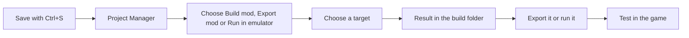

# Building a mod and testing it in the game

**Language:** English · [Українська](uk/Build_and_Test.md)

This page shows how to turn your saved translation into a mod. It also shows how to test the mod. Read it when your translation is saved and you want to see it in the game.

Picoripi does not install emulators. It has no emulator list. You install your emulator and give Picoripi its command.

## Terms

| Term | Meaning |
|---|---|
| Build | Make the mod from the saved files. The result goes to `build\<target>` |
| Target | One kind of result the game can make. Each game lists its own targets |
| Export | Copy a build to a folder that you choose |
| Run in emulator | Build, then start the emulator with the result |
| Emulator command | The line that starts your emulator, for example `"C:\Emu\emu.exe" {path}` |

## Before you build

A build reads the files on disk. It does not read the editor. Press `Ctrl+S` first. A line that is not saved is not in the mod.

## Steps: build a mod

1. Open the Project Manager: **File → Project Manager...** (`Ctrl+Shift+M`).
2. Click the arrow at the left of your project's row. The row opens.
3. Press **Build mod**. A menu lists the targets of the game.
4. Click a target. The status line shows **Working...**, then the percent.
5. Read the result. **Built: <path>** means success. **Failed: <reason>** means an error.

If the game has no target, **Build mod** is off. Hover over the button to read the reason.

## Targets

The game plugin decides the list of targets. A target has one of three kinds:

| Kind | What you get | Typical use |
|---|---|---|
| **files** | A folder of separate game files | A port, or a game that loads loose files |
| **patch** | A changed copy of a game file, such as a disc image or a ROM | Dolphin, a DS emulator, a disc |
| **layeredfs** | A mod folder for a loader | Atmosphere, Luma, Cemu, SDCafiine |

The result goes to `build\<target>` inside the project folder. Each target has its own folder. A new build of the same target replaces the old result. To keep an old result, export it first.

Examples. The label is the text you see in the menu.

| Plugin | Target label | Platform | Kind |
|---|---|---|---|
| `zelda_tww` | Disc image (ISO) | `gc` | patch |
| `zelda_tww` | BlueWake disc (original main.dol) | `bluewake` | patch |
| `super_mario_sunshine` | GameCube disc image (ISO) | `gc` | patch |
| `super_mario_sunshine` | PC and Switch port pack (mods/uk) | all | layeredfs |
| `zelda_bmg` | Dusklight mod (.dusk, needs the original disc) | `gc` | patch |
| `zelda_bmg` | Wii U graphic pack and SDCafiine folder (HD) | `wiiu` | layeredfs |
| `zelda_ww` | **Cemu graphic pack** | `wiiu` | layeredfs |
| `pokemon_nx` | Switch: Atmosphere LayeredFS mod | `switch` | layeredfs |
| `pokemon_gen5` | Translated DS ROM | `nds` | patch |
| `zelda_las` | **LAS Recomp (romfs.bin)** | `switch` | files |
| `okami_wii` | Wii: changed message entries (files) | `wii` | files |

Some labels have no Ukrainian text yet. They appear in English in the Ukrainian interface.

## Export

1. Press **Export mod**. Choose a target.
2. Choose a folder. Use an empty folder or a new one.
3. Wait for **Exported to <path>**.

If the folder already holds files, the export stops with "The folder is not empty". Choose another folder.

## Emulator command

Set the command once for each platform.

1. In the Project Manager, press **Emulator...**. The window is **Emulator commands**.
2. Type a command in the line of each platform you use. Write `{path}` where the result goes.
3. Press **OK**. An empty line means no command for that platform.

Example: `"C:\Emu\emu.exe" {path}`. Put quotes around a path that has spaces.

- Picoripi replaces `{path}` with the result path. If you write no `{path}`, Picoripi adds the path at the end.
- Picoripi starts the emulator and does not wait for it to close.
- The emulator starts in its own folder.
- If the line is empty, **Run in emulator** is off for that platform.

## Progress, errors and warnings

- The status line on the project row shows the work. It shows **Working...**, then the step and the percent.
- **Failed: <reason>** names the problem. Fix what the reason names. Then build again.
- A build can finish with warnings. The status line shows **Built: <path> (N warnings: ...)** and the first warning.
- All warnings are in the file `BUILD_WARNINGS.txt`, in the result folder.
- The full trace is in the log. The log file path is in **Settings → Logging**.
- The Project Manager has no cancel button for a build. Closing the Manager stops the build.

## The Built and Verified in game boxes

Each project row has two boxes: **Built** and **Verified in game**. Only you set them. Picoripi never changes them. Use them as your own notes. **Built** means you built the mod. **Verified in game** means you checked it in the game.

## Run External Script

The **>_** button at the right end of the toolbar starts your own tool or script. Set its path in **Settings → Global → External Tool/Script Path**. This button does not build the mod.

## How to test per platform

Test in an emulator first. Test on hardware only after the emulator test works.

- **GameCube and Wii (Dolphin).** Build a disc image target (patch). Set the Dolphin command for `gc` or `wii`. Press **Run in emulator**. Hardware: not verified in this page.
- **3DS (Azahar or Citra).** Build a 3DS target (layeredfs). Set the command of Azahar or Citra for `3ds`. On hardware, use a Luma LayeredFS folder on the SD card. Check the folder path in your Luma guide. Not verified in this page.
- **Switch (emulator or hardware).** Set your Switch emulator command for `switch`. On hardware, copy a layeredfs mod to the SD card for Atmosphere. Check the folder layout in the result folder. Not verified in this page.
- **Wii U (Cemu and SDCafiine).** Build a **Cemu graphic pack** target. Copy the result to Cemu's graphic packs folder. For SDCafiine, copy the HD folder to the SD card, as its guide says.
- **PC ports and recompilations.** Build the port target, for example **PC and Switch port pack (mods/uk)** or **LAS Recomp (romfs.bin)**. Copy the result to the folder that the port reads. Read the port's own guide.
- **Other platforms.** Choose the target that names your platform. Set its emulator command. Not verified for every platform.

## Common situations

- **Build mod is off.** The game has no target yet. Hover over the button to read the reason.
- **Run in emulator is off.** Set the emulator command for that platform with **Emulator...**.
- **The build failed.** Read **Failed: <reason>**. Fix what it names. Build again.
- **My last change is not in the mod.** Save with `Ctrl+S`. Build again. Only saved files go into a build.
- **I want two versions.** Export the first build to its own empty folder. Then build the second one.
- **The emulator did not start.** The status line shows "The emulator did not start". Check the program path in the command.
- **The build has warnings.** Open `BUILD_WARNINGS.txt` in the result folder. Fix the lines it names. Build again.
- **The build is slow.** A big game takes minutes. The percent shows progress. Do not close the Manager.
- **The mod works in the emulator but not on hardware.** Compare the folder layout with your loader's guide. Picoripi writes the mod files. The loader is your own setup.

## Related pages

- [Getting Started](0_Getting_Started.md), section 17
- [Project Manager](Project_Manager.md)
- [Fonts and textures](Fonts_and_Textures.md)
- [Troubleshooting](Troubleshooting.md)
- [Configuration](4_Configuration_Guide.md)

<!-- wiki-nav -->
---

**Previous:** [Fonts and textures](Fonts_and_Textures.md) · [Back to the wiki index](README.md) · **Next:** [Working Together and Progress](13_Working_Together.md)
