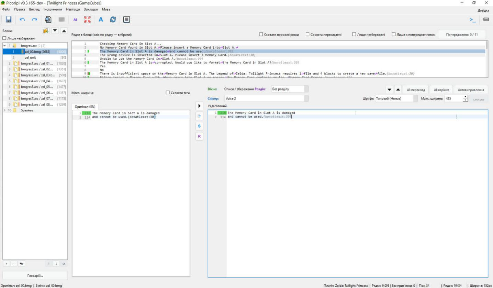

# Translating in the editor

**Language:** English · [Українська](uk/Editor_Basics.md)

This page explains the main window of a project. Use it to find each panel, translate a line and move through the game text. Read [Getting Started](0_Getting_Started.md) first if you have not opened a project yet.

The screenshots show the Ukrainian interface. The labels in this page are English.

## 1. Main window map

| Area | What it is |
|---|---|
| Menu bar | **File**, **Edit**, **View**, **Tools**, **Navigation**, **Bookmarks**, **Language**, **Help** |
| Toolbar | Save, undo, redo, find, preview, AI Batch Translation, Open AI Chat, Font Editor, Rescan All, Settings, Run External Script, Shortcuts Help |
| Blocks (left) | The tree of blocks and virtual folders. Block buttons and **Glossary…** are under it |
| Strings in block (top right) | The lines of the selected block. Filters are above the list |
| Original (bottom left) | The source text. Read only |
| Narrow column | Four icon buttons between Original and Editable |
| Editable (bottom right) | Your translation. The only text panel you can write in |
| Header above Editable | Window, Chapter, Speaker, AI and Auto-fix buttons, Font, Max-width, Apply |
| Preview (under Editable) | The line as the game shows it. Turn it on with **View → Preview** |
| Status bar | File paths, plugin, string counts, and the cursor position, Line and Width |

## 2. The Blocks tree

A block is one part of the game text, usually one game file. Folders group blocks. Virtual folders group lines from the story data. They are not files on disk.

| Virtual folder | Lines it groups |
|---|---|
| Speakers | Lines by the character who speaks them |
| Story | Lines by story chapter and act |
| Items | Lines about items |
| Windows | Lines by message window type |
| None | Lines with no binding |

| Button | What it does |
|---|---|
| **+** | Adds a block |
| **−** | Removes a block from the project. The files on disk stay |
| **✎** | Renames the selected block |
| **↑**, **↓** | Moves the selected block up or down |
| **⟳** | Rebuilds the virtual folders from the story data. It does not change translations |

**Show Unsaved Only** above the tree shows only blocks and folders with unsaved changes. It is off after a restart.

**Right-click a block** for **Rename Block**, **Remove Block**, **Reveal in Explorer**, **Rescan Issues**, **Calculate Line Widths**, **Spellcheck**, **Set Default Font**, **Revert to Original**, **Restore Translations** and **Properties...**. A virtual block, a folder and empty space have their own short menus. Empty space has **Create Folder** and **AI Batch Translation...**.

**Markers:**

- A green wash behind a name shows how much of the block is translated.
- Coloured marks at the right show the warning types in the block. Each warning type has its own colour.
- A purple mark shows a line or block with its own font or width.

## 3. Strings in block (top right)

Click a line. Original and Editable show that line. The list itself is read only.

| Filter | What it keeps |
|---|---|
| **Hide empty strings** | Folds empty lines in a row into one placeholder |
| **Hide translated** | Only lines that are not translated |
| **Show Overrides Only** | Lines with their own font or width |
| **Show Unsaved Only** | Lines with changes that are not saved |
| **Show Warnings Only** | Lines with the warning types you choose. **Warnings: X / Y** opens the choice |
| **Highlight moved**, **Hide moved** | Lines already moved to a virtual folder. They appear only when virtual folders apply |

Filters work together. If the list looks empty, turn off every filter first.

## 4. Original, reference tabs and Editable

- **Original (EN)** is the first tab. It is read only. You can select and copy text from it.
- A reference tab appears for each other language that has text for the selected line.
- **Editable** is where you type. **Enter** starts a new line. In some games, **Shift+Enter** or **Ctrl+Enter** inserts a special character that the game rules define.
- The number above **Original** is the width of the original. Click it to copy it into **Max-width**, then press **Apply**.

## 5. The narrow button column

| Button | What it does |
|---|---|
| Arrow | **Revert string.** Replaces the translation with the original text. Your translation goes to the backup first |
| Restore | **Restore translation.** Brings back the last saved backup of this line (`Ctrl+Shift+T`) |
| S | **Inspect story context.** Shows timeline, speaker and visual context (`Ctrl+I`) |
| R | **Open in Script Markup Studio.** Jumps to the marked place of this line |

## 6. The header above Editable

| Row | Field or button | What it does |
|---|---|---|
| 1 | **Window:** | Shows the message window type. Double-click the label to open the physical block |
| 1 | **Chapter:** | Assigns the line to a story chapter. Double-click the label to open that chapter |
| 1 | Arrows | Go to the previous or next line with a problem (`Ctrl+Up`, `Ctrl+Down`) |
| 1 | **AI Translate**, **AI Variation**, **Auto-fix** | AI and automatic fixes for this line |
| 2 | **Speaker:** | Type a name and press **Enter**. Picking an item from the list alone does not save |
| 2 | **Font:**, **Max-width:**, **Apply** | Font and width for this line only. **Apply** is on only while a change is not applied |

**Max-width** 0 means "use the plugin default". Right-click the field for **Reset to Plugin Default** or **Set Width from Original**.

## 7. Translate one line

1. In the **Blocks** tree, click a block with text.
2. In **Strings in block**, click a line. **Original** and **Editable** show the line.
3. Read **Original**. Do not type there.
4. Click in **Editable**. Type your translation.
5. Look at the number beside the line. It is the line width in game pixels.
6. If the line has a coloured mark, read the warning. Fix the line or press **Auto-fix**.
7. If needed, set **Speaker** and **Chapter**. Press **Enter** after the speaker name.
8. Press `Ctrl+S` to save the changes.

## 8. Status bar

| Field | Meaning |
|---|---|
| **Original:**, **Changes:** | Paths of the original file and of the file where changes are written |
| **Plugin:** | The active game plugin |
| **Strings:** N **\| Unbound:** N | All game strings, and strings with no Story, Speaker, Item or Window binding |
| **Pos:** | The cursor position in the line |
| **Line:** a/b | Visible characters without tags, and all characters with tags |
| **Width:** | Pixel width of the text from the start of the line to the cursor |

The number beside a line in **Editable** is the width of the whole line. **Width** counts only up to the cursor.

## 9. Edit menu items that change text

| Item | Key | What it does |
|---|---|---|
| **Undo Typing** | `Ctrl+Z` | Undoes the last edit. Works in the Speaker field too |
| **Redo Typing** | `Ctrl+Y` or `Ctrl+Shift+Z` | Redoes the edit you undid |
| **Save Translated** | `Ctrl+T` | Writes this line's translation to the backup file |
| **Restore Translated** | `Ctrl+Shift+T` | Puts the backup of this line back into Editable |
| **Paste Block Text** | `Ctrl+Shift+V` | Pastes several lines from the clipboard. `{END}` separates the lines |
| **Undo Paste Block** | | Undoes the last **Paste Block Text** |
| **Auto-fix Current String** | `Ctrl+Shift+A` | Fixes the problems of this line |

## 10. Move between lines, blocks and folders

Use `Ctrl+Up` and `Ctrl+Down` for lines with a problem. Use `Alt+Up` and `Alt+Down` for any line. Use `Alt+Shift` with the arrows for blocks and folders. The full list is on [Keyboard shortcuts](Hotkeys.md).

## 11. Hide tags

Tags such as `{boxatleast:30}` drive the game. Press `Ctrl+Q`, or tick **Hide tags** above **Original**. The tags are hidden in every panel. The stored text does not change.

## 12. Project mode and single-file mode

- **Project mode:** you open a project (`project.uiproj`) from the [Project Manager](Project_Manager.md). **Import Block…** and **Import Directory…** work only in this mode.
- **Single-file mode:** no project is open, and project items are off. A menu route to it is not verified.

## Common situations

- **I cannot type in the text.** Type only in **Editable**. **Original** is read only.
- **The Strings list is empty.** Turn off every filter above the list. Then check the block in the tree.
- **I typed a wrong line.** Press `Ctrl+Z`. To get the last saved backup back, press `Ctrl+Shift+T`.
- **I want the original text back.** Click the arrow in the narrow column. Your translation is saved to the backup first.
- **The speaker name did not save.** Click in **Speaker**, type the name and press **Enter**.
- **A line has a warning.** Read it. Press `Ctrl+Down` for the next problem line. Use **Auto-fix** or edit the line.
- **A line has no speaker or chapter.** It is unbound. The **Unbound** count in the status bar counts these lines. The **None** folder lists them.

Related pages: [Width, fonts and tags](Width_Fonts_Tags.md), [Warnings and auto-fix](Warnings_and_Autofix.md), [Search and bookmarks](Search_Bookmarks.md), [Saving and recovery](Saving_and_Recovery.md).

<!-- wiki-nav -->
---

**Previous:** [Creating a project: every kind of game](New_Project_Scenarios.md) · [Back to the wiki index](README.md) · **Next:** [Line width, fonts and tags](Width_Fonts_Tags.md)
