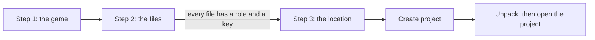

# Creating a project: every kind of game

**Language:** English · [Українська](uk/New_Project_Scenarios.md)

This page explains the new-project wizard. Use it when you add a game for the first time. It shows what each
kind of game file needs, and what to do when the wizard stops.

*The screenshots show the Ukrainian interface.*

## The wizard in three steps

## Start the wizard

1. Press **+ Add project → New project...** in the [Project Manager](Project_Manager.md).
2. Or press **File → New Project** (`Ctrl+N`) in the main window.

The wizard has the buttons **Back**, **Next** and **Cancel**.

## Step 1: the game

1. Type part of the game name in **Game**.
2. Pick the game from the list.
3. Check **Project name**. It fills in by itself. Change it if you like.
4. Press **Next**.

## Step 2: the files

1. Press **Add files...** for game files. Add the base game, its update and its DLC, in any order.
2. Or press **Add folder...** for a game that is already unpacked. Choose the folder.
3. Check the **Platform** and **Role** of each file. Picoripi sets them itself. Change them in the lists if they are wrong.
4. Press **Next** when the list has no problem.

The roles are **Base game**, **Update** and **DLC**. Only DLC can repeat. For Switch and 3DS, the title ID in
the file sets the role.

To change many files at once:

1. Select the rows (`Shift` or `Ctrl`).
2. Pick a role in **Role for the selected files:**.
3. Press **Apply**.

**Remove selected** takes a file off the list. The file itself is not deleted.

## Step 3: the location

1. Check **Project folder**. Picoripi suggests `Documents\Picoripi\<project name>`.
2. Press **Browse...** to choose another folder.
3. Read the summary. It shows where the project file, the unpacked files and the translation go.
4. Press **Create project**.

The project folder holds `project.uiproj`, the `unpacked` folder, the `translation` folder and the `build` folder.
The original game files are not copied. The project keeps their paths.

## Game sources

| Source | What to add | What the wizard asks |
|---|---|---|
| GameCube or Wii disc image (ISO, WIA, RVZ) | The image file | A Wii file with encrypted content needs `keys.bin` |
| Switch game (NSP, NSZ, XCI) | Base game, Update and DLC files | Encrypted files need `prod.keys` |
| 3DS game (CIA, 3DS) | The files | Encrypted files need `aes_keys.txt` |
| Unpacked game | **Add folder...** | Nothing, when the folder is readable |
| PC game | The game folder, with **Add folder...** | Depends on the game plugin |

**Switch with update and DLC:** add the three kinds of file. Check each role. Give the base game and the update one file each. Add as many DLC files as you need.

**Switch XCI:** not verified for every case. If the wizard refuses an encrypted XCI, use the unpacked folder or an NSP or NSZ file instead.

**3DS, encrypted:** the roles come from the title ID. The file needs `aes_keys.txt`. Decrypted files need no key.

**An unpacked folder:** add the folder alone. A folder cannot be mixed with other sources. Remove the other files
first.

## Key files

Some game files are encrypted. Picoripi needs the key file of the console to read them.

| Console | Key file |
|---|---|
| Nintendo 3DS | `aes_keys.txt` |
| Nintendo Switch | `prod.keys` |
| Wii | `keys.bin` |
| Oodle library | The Oodle DLL (`oo2core` or `oo2ext`) |
| PlayStation BIOS | The BIOS file |

1. The wizard shows **Needs the key file** in the **Status** column.
2. Press **Add the key file for ...** and choose the file.
3. Picoripi remembers only the path. It never shows, copies or logs the key contents.

To set a key file before you start, open **File → Settings (Ctrl+P) → Console keys**. The path is kept for every
console. Any game can reuse it.

If you move or delete the key file, the wizard asks for it again.

## Existing translation folder

Use this option when a translation folder already exists, for example from another copy of the project.

1. Tick **Use an existing translation folder**.
2. Press **Browse...** and choose the **Existing translation folder**.
3. Create the project. The folder is used as it is. Picoripi does not change its files.

A single-file game cannot use this option. Uncheck the option and create the project again.

## Common situations

**Next is grey.**
- The file list has a problem. Read the red text under the list. Fix each line.

**A file shows Cannot read: add its folder.**
- The game plugin cannot unpack this kind of file. Remove the file. Unpack the game yourself, then press **Add folder...**.

**A file shows Not recognised by this game.**
- The plugin does not know this file. Check that you chose the right game in step 1.

**Two files have the role Base game.**
- Each file needs its own role. Only DLC can repeat. Change one of the roles.

**The platform says Not detected.**
- Choose the platform in the list of the file row. Picoripi could not read it from the file.

**Create project says This folder already holds a project.**
- The project folder already has `project.uiproj`. Choose another folder. To use the old project, use **Add existing project...** in the Project Manager.

**The wizard says Not enough free space.**
- The drive needs room for the unpacked files. The message shows the space needed and the space free. Free space on that drive, or choose another project folder.

**I pressed Cancel unpacking.**
- The wizard removes what it made. The message says **Unpacking was cancelled. Nothing was created.** Start again when you are ready.

**Unpacking failed.**
- The message shows the reason. The wizard removes what it made. Check the message, fix the cause, and create the project again.

**The unpacking is slow.**
- A big game takes minutes. Wait for the progress bar to finish. Do not close Picoripi.

**I made a mistake in step 2.**
- Press **Back**. Change the list. Press **Next** again.

**I chose the wrong game.**
- Press **Back** to step 1 and pick the right game. Then check the files again.

**The project has no game icon.**
- Picoripi reads the icon of 3DS and GameCube games only. For other games, press **Change icon...** in the Project Manager.

**Cancel the whole wizard.**
- Press **Cancel**. A running unpack stops first.
## Related pages

- [Project Manager](Project_Manager.md)
- [Getting Started](0_Getting_Started.md)
- [Supported Games](Supported_Games.md)
- [Configuration Guide](4_Configuration_Guide.md)
- [Troubleshooting](Troubleshooting.md)

<!-- wiki-nav -->
---

**Previous:** [Project Manager](Project_Manager.md) · [Back to the wiki index](README.md) · **Next:** [Translating in the editor](Editor_Basics.md)
