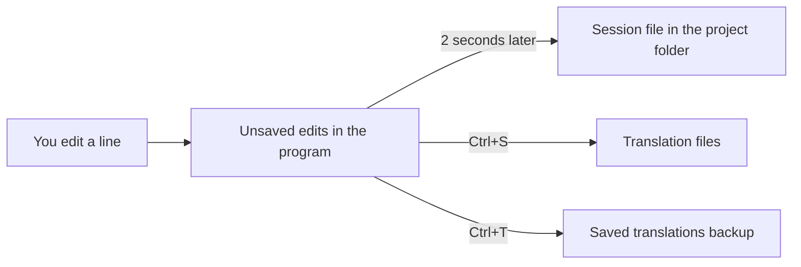

# Saving, undo, backups and recovery

**Language:** English · [Українська](uk/Saving_and_Recovery.md)

This page explains where your edits go, how to save them, and how to get them back. Read it before you revert text, close a project, or move a project to another computer.

## What Ctrl+S writes

1. Press `Ctrl+S`, or choose **File → Save Changes**.
2. Picoripi writes every block that has changes. It does not ask first.
3. Nothing happens when there are no changes.

| Mode | Where Ctrl+S writes |
|---|---|
| Project | The translation file of each block. The files stay in the translation folder of the project. |
| Single file | The `_edited` file next to the original file. Its name is `<name>_edited.<extension>`. |

Picoripi never changes the original files. In project mode it writes only to the translation folder. In single-file mode it writes only to the `_edited` file.

Archives: a block inside an archive is unpacked into temporary space, edited, and packed again in the translation folder. If the new archive is larger than the original, Picoripi shows a size warning. The archive is still saved. A large project shows progress for each file while it saves.

## Session autosave

- Two seconds after an edit, Picoripi writes `.picoripi_session` into the project folder. In single-file mode it writes next to the `_edited` file.
- The file holds your unsaved text and your undo steps.
- Every five minutes, Picoripi also writes a JSON copy, `.picoripi_session.json`.
- When you open the project again, Picoripi reads the newer copy. Your unsaved text returns.
- The session file is not a save. Only `Ctrl+S` changes the translation files.
- Do not edit or move these files by hand.

**Restore unsaved session on startup** (**Settings → Global**) controls a separate copy. That copy sits in the program settings. Picoripi reads it when the program starts. The code default is off. Turning this setting off does not stop the project session file from restoring your text when you open the project.

## Undo and redo

- `Ctrl+Z` undoes. `Ctrl+Y` or `Ctrl+Shift+Z` redoes. The Edit menu shows **Undo Typing** and **Redo Typing**.
- There is one undo history for the whole project. It keeps 500 steps. The oldest steps are dropped first.
- Typing in one line counts as one step. A new step starts when you type a different kind of character, for example a space after a letter.
- Moving to another line is also a step. The first `Ctrl+Z` can only take you back to the previous line.
- A bulk action is one step. Examples: revert, restore, paste a block, import translations, AI translation.
- Undo does not cover replacements made in [Advanced Search](Search_Bookmarks.md). See that page.
- The session file keeps the undo history, so it survives a crash.

## Saved translations backup

**Save Translated** (`Ctrl+T`, **Edit → Save Translated**) copies the translation of the current line to a backup file.

- Project mode: `saved_translations.json` in the project folder.
- Single-file mode: `<name>_saved_translations.json` next to the file.

**Restore Translated** (`Ctrl+Shift+T`, **Edit → Restore Translated**) puts the backup text back into the current line.

In the Blocks tree, right-click a block to see **Restore Translated for '<block name>'**. Right-click empty space in the tree to see **Restore All Translations**. Restore All overwrites the current edits. Picoripi asks first.

## Revert

Picoripi makes a backup before any revert. The backup holds only the translations that differ from the original text.

| Action | Where | Result |
|---|---|---|
| **Revert String to Original** | Right-click one line | Reverts that line. |
| **Revert to Original** | Right-click selected lines | Reverts the selected lines. |
| **Revert ... to original** | Right-click blocks in the tree | Reverts all lines in those blocks. |
| **Revert Chapter ... to original** | Right-click a chapter | Reverts all lines in the chapter. |
| **Revert All Blocks to Original** | Right-click empty space in the tree | Reverts every block. |

Each revert asks you to confirm. Read the question. For one line, the default answer is **No**.

**Revert Changes File to Original...** (**File** menu) overwrites the translation files with the original text:

- Single-file mode: it overwrites the `_edited` file.
- Project mode: it overwrites the translation file of every block.
- It removes all unsaved edits and it does not make a backup in `saved_translations.json`. Copy the translation folder first if you need the old text.

**Reload Original** (**File** menu) reloads the original files. It asks first when you have unsaved edits. Those edits are lost. The files on disk do not change.

## Close, exit and open

- **Close Project** (**File** menu) writes the session file first. It does not ask to save. Your unsaved text stays in the session file. Open the project again to continue.
- **Exit** does not ask to save either. The session file keeps the unsaved text.
- Opening another file asks **Save before opening new file?** Choose **Save**, **Discard** or **Cancel**.

## Export and import

- **Export Translations to JSON...** (**File** menu) writes the current translations to a JSON file. Use it as a copy.
- **Import Translations from JSON...** loads the translations from a JSON file into the editor. Picoripi matches each line by file, block and line position. Imported text is unsaved until you press `Ctrl+S`. One `Ctrl+Z` undoes the whole import. The import replaces the current text of the matching lines.

## Translation memory

- **Update Translation Memory with Context** (**File** menu) adds context to each row of the translation memory. Picoripi keeps a copy of the old file beside the new one.
- **Restore Translation Memory Before the Context Update** puts back that copy.
- The memory file is `translation_memory.json`. It sits next to the saved translations backup.

## Common situations

- **Ctrl+S does nothing.** You have no unsaved changes. Picoripi writes nothing.
- **I lost my translation.** Check these places in order:
  1. Press `Ctrl+Z` on the line. Undo may still hold the text.
  2. Press `Ctrl+Shift+T` on the line. This restores the saved backup.
  3. Open the project again. The session file may hold unsaved text.
  4. Open the JSON copy from **Export Translations to JSON...**, if you made one.
- **The program crashed.** Open the project again. Check the text. Press `Ctrl+S` when the text is correct.
- **The session file cannot be read.** Picoripi opens the project from its files. Unsaved text in the session file is lost. Keep copies of the project folder.
- **I reverted by mistake.** Use **Restore Translated** on the line. For many lines, use **Restore All Translations**.
- **I want to translate again from the start.** Copy the translation folder first. Then use **Revert Changes File to Original...**.
- **I want to close a project and copy its folder.** Close the project first. This writes the session file and the latest state. Then copy the folder.
- **I moved the project to another computer.** Copy these items:
  - the project file (`.uiproj`) and the project folder;
  - the translation folder;
  - the source folder with the original files.
  Install the same game plugin on the other computer. The paths stored in the project must exist there. Update the paths if the folders are in other places.
- **I keep the project in Git.** Commit these items:
  - the translation files;
  - the project file;
  - `saved_translations.json` and `translation_memory.json`.
  Do not commit `.picoripi_session`, `.picoripi_session.json`, `.picoripi_session.clean` or temporary `.tmp` files. Commit before a large replacement. Git then gives you a point to return to.
- **Opening another file asks about my changes.** Press **Save** to keep them, or **Discard** to drop them.

## Related pages

- [Find, replace and bookmarks](Search_Bookmarks.md) for search and replace.
- [Editor Basics](Editor_Basics.md) for the editor and the strings list.
- [Troubleshooting](Troubleshooting.md) for other problems.

<!-- wiki-nav -->
---

**Previous:** [Find, replace and bookmarks](Search_Bookmarks.md) · [Back to the wiki index](README.md) · **Next:** [Localization Pipeline](8_Localization_Pipeline.md)
