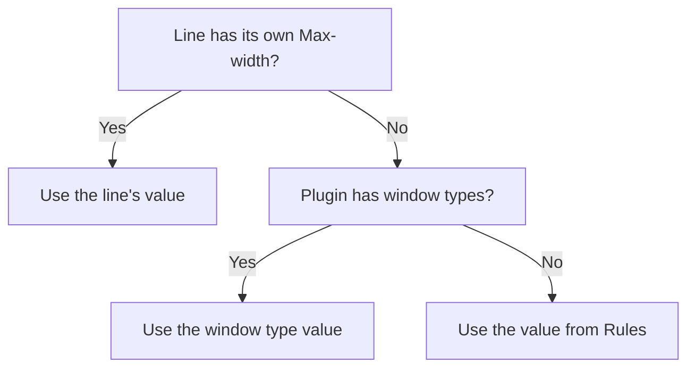

# Line width, fonts and tags

**Language:** English · [Українська](uk/Width_Fonts_Tags.md)

This page explains how Picoripi measures a line. It shows how to set the width and the font for one line or many. It also explains tags. Read it when a line is too wide or a tag looks wrong.

*The screenshot shows the Ukrainian interface. The labels on this page are English.*

## What width means

Width is the number of game pixels a line uses. Picoripi measures each letter with its own width. So width is not the number of letters.

A line wider than the game window runs out of the box in the game. The program warns you before that happens. Each visible subline is measured on its own.

## Where you see the width

| Where | What it shows |
|---|---|
| The number right of a line number in **Editable** | The width of that line |
| **Width** in the status bar | The width of the text up to the cursor, or of the selection |
| **Max-width** above **Original** | The width of the widest line in the original |

## Set the width of one string

1. Select a line in **Strings in block**.
2. In **Max-width**, type a number of pixels. Zero uses the plugin default.
3. Press **Apply**. The button is on only when a change is not applied yet.

A width set for one string sets both the warning limit and the hard limit to that value.

Right-click the **Max-width** field:

| Item | Result |
|---|---|
| **Reset to Plugin Default** | Removes the width of this line |
| **Set Width from Original** | Types the width of the widest original line. Then press **Apply** |

Click the **Max-width** number above **Original** to copy it into the field.

To set a font for one line, pick it in **Font** above **Editable** and press **Apply**. The font applies to this line only.

## Set width or font for many strings

1. Select several lines in **Strings in block**.
2. Right-click and choose **Set Width for Multiple Lines** or **Set Font for Multiple Lines**.
3. Enter the value. Tick **Auto-width from original** to take each width from its original line.
4. Press **Default** to reset the value.

## Project limits

Go to **File → Settings (`Ctrl+P`) → Project → Rules**. The **Project** tab appears only when a project is open.

| Field | Meaning | Default |
|---|---|---|
| **Game Dialog Max Width (px)** | The hard limit. A subline wider than this is a problem | 300 |
| **Editor Line Width Warning (px)** | The editor marks a width as too wide from this value | 280 |
| **Lines Per Page** | How many lines one game window holds | 4 |
| **Show guideline** | Draws a vertical line at the width limit in the editor | On |

Press **OK**. The program rescans all lines. It shows "Rules have been updated. Rescanning all issues...".

## Window types

Some plugins have several kinds of message window. Zelda: Twilight Princess is one. Their **Rules** tab shows **Window limit mode**:

- **Shared for all windows** uses one set of values. The group is named **Shared defaults**.
- **Separate by window type** uses the table **Defaults by window type**. Its columns are **Window type**, **Warning**, **Maximum** and **Lines**.

The window type comes from the message data. **Warning** cannot be larger than **Maximum**. If it is, the program shows an error and does not save the table.

## Which value the program uses

The order is:

1. The line's own width, from the **Max-width** field.
2. The value for the window type, if the plugin has window types.
3. The value from **Rules**.

## The Font Map

Letter widths are in **Settings → Project → Font Map**.

- The table has two columns: **Character / Sequence** and **Width (pixels)**.
- **Add Character** adds an empty row. **Remove Character** deletes the selected row.
- The **Filter Characters:** field searches the table. Change a width and press **OK**. The program counts all warnings again.

The program saves the map in your data folder. It never changes the plugin file in `plugins/`.

A letter that is not in the table counts as 8 pixels in the editor. Add the letter with its real width.

## Default font

Go to **Settings → Project → Display**. Use **Default Font for Project:** to choose the font file for the project. The list shows the font files from the plugin's fonts folder and from your custom fonts folder. The first choice is **None**.

The same tab has more settings:

| Setting | Meaning |
|---|---|
| **Wrap lines in preview panel** | Wraps long lines in the preview |
| **Wrap lines in editor panels** | Wraps long lines in the editors |
| **Newline Symbol:** | The character shown for a line break |
| **Newline Symbol Style:** | Colour, **Bold**, **Italic**, **Underline** for the newline symbol |
| **Tag Style:** | Colour, **Bold**, **Italic**, **Underline** for tags |

## Letters the font lacks

A new letter can be missing from the game font. Do this in order:

1. Add the letter to the **Font Map** with its width. Otherwise the program uses 8 pixels.
2. Open the font editor from the toolbar. Draw or edit the letter's glyph.
3. Rescan all with `Ctrl+Shift+R`.

For the font files and the textures, see [Fonts and textures](Fonts_and_Textures.md).

## Tags

Tags such as `{boxatleast:30}` control the game. They set colour, pause and the hero name. Leave them in place. The editor shows them in grey or orange.

- **Hide tags** (`Ctrl+Q`, or **View → Hide Tags**) hides tags in all panels. The stored text does not change.
- To insert a tag, right-click in **Editable**. With no selection, the menu inserts one tag. With a selection, the tag wraps the selected text.
- The tags in that menu come from **Settings → Project → Context Tags**:
  - **Single Tags (RMB without selection)** has the columns **Display (Emoji/Hex)** and **Tag**.
  - **Wrap Tags (RMB with selection)** has the columns **Display (Emoji/Hex)**, **Opening Tag** and **Closing Tag**.
  - Use **Add Row** and **Remove Row**. Changes apply after **OK**.
- **Tag Aliases** give a tag a readable name. For example, `{F:Link}` stands for `{escape:0:0000}`. The columns are **Alias (e.g. {F:Link})** and **Original Tag (e.g. {escape:0:0000})**. The width of a line still counts the original tag.

## Common situations

**A line is too wide but looks short.**
- Some letters are wider than you expect.
- Check the Font Map for the letters in the line.
- Add any missing letter with its real width.

**A warning stays after I change the width or the Font Map.**
- Press **Rescan All** (`Ctrl+Shift+R`).
- Use it after font, tag or width changes.

**I typed a width but nothing changed.**
- Press **Apply**. The button is on only with an unapplied change.
- Zero means the plugin default.

**The window type table does not save.**
- A **Warning** value is larger than its **Maximum**.
- Make **Warning** equal to or smaller than **Maximum**, then press **OK**.

**The font list shows only None.**
- The plugin fonts folder has no `.json` or `.bfn` files.
- Archives with `.arc`, `.rarc` or `.u8` extensions are also read.

## Related pages

[Getting Started](0_Getting_Started.md) · [Editor basics](Editor_Basics.md) · [Warnings and auto-fix](Warnings_and_Autofix.md) · [Fonts and textures](Fonts_and_Textures.md) · [Configuration guide](4_Configuration_Guide.md)

<!-- wiki-nav -->
---

**Previous:** [Translating in the editor](Editor_Basics.md) · [Back to the wiki index](README.md) · **Next:** [Warnings and auto-fix](Warnings_and_Autofix.md)
