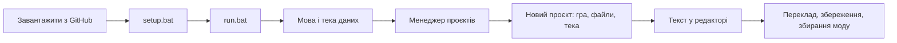
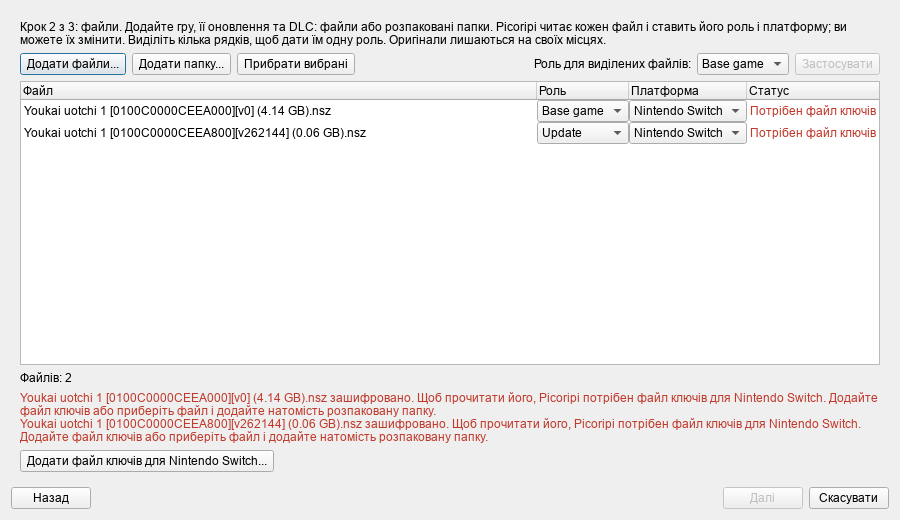

# З чого почати

**Мова:** [English](../0_Getting_Started.md) · Українська

Ця сторінка проводить вас від GitHub до першого рядка перекладу: завантажити програму, запустити, додати гру,
відкрити текст і зберегти переклад. Кожен крок перевірено на чистій копії програми, а знімки екрана зроблено у
справжньому вікні.

## 1. Завантажте й встановіть

Потрібні Windows і Python 3.10 або новіший (перевірено на 3.14). Крім того, один раз знадобляться Microsoft C++ Build
Tools: один із пакетів збирається на вашому комп'ютері (докладніше в [README](../../../README.md)).

1. Завантажте програму: `git clone https://github.com/rashevskyv/Picoripi.git`. Або натисніть на GitHub **Code →
   Download ZIP** і розпакуйте архів.
2. Відкрийте теку програми й двічі клацніть **`setup.bat`**. Він створить теку `.venv` і встановить потрібні пакети.
   Це займе від однієї до трьох хвилин, наприкінці з'явиться «Setup completed successfully».
3. Двічі клацніть **`run.bat`**. Перше вікно може з'явитися лише за 15 секунд, тож не поспішайте клацати вдруге.

## 2. Мова і тека даних

Перше вікно запитує, де Picoripi зберігатиме ваші дані: налаштування, список проєктів, глосарії. Тут також
вибирається мова інтерфейсу. За замовчуванням стоїть мова Windows, якщо Picoripi її підтримує, а інакше англійська.
Якщо змінити мову у списку вгорі, вікно перекладеться одразу.

- **Поруч із програмою, у теці data** — типовий вибір. Дані лежать поруч із програмою: перенесете теку програми, і
  дані підуть разом із нею.
- **Обрати папку** — зберігати дані там, де зручно вам.
- **Мій профіль користувача** — взяти стару теку `~/.picoripi`. Позначку **Скопіювати наявні дані** типово вимкнено;
  вмикайте її, лише якщо хочете перенести старий профіль.

Натисніть **Використати цю папку**. Нічого не видаляється. Теку можна змінити пізніше: **Settings → Global → Data
folder**.

## 3. Менеджер проєктів

Далі відкриється Менеджер проєктів, у якому живуть усі ваші ігри. Поки що він порожній.

Натисніть **+ Додати проєкт → Новий проєкт...**. Згодом те саме зробить **Файл → Новий проєкт** (Ctrl+N).

## 4. Новий проєкт

### Крок 1. Гра

У полі **Гра** введіть частину назви й виберіть гру зі списку. **Назва проєкту** підставиться сама, її можна змінити.

### Крок 2. Файли

Натисніть **Додати файли...** і виберіть файли гри: саму гру, оновлення та DLC, у будь-якому порядку. Можна також
натиснути **Додати папку...** і вказати вже розпаковану гру. Вікно вибору файлу відкривається у вашій домашній теці,
тож повний шлях зручніше вставити в поле **Ім'я файлу**.

Picoripi читає кожен файл і сам визначає його **Роль** (**Base game**, **Update** чи **DLC**) та **Платформу**. Для
Switch і 3DS базу, оновлення й DLC розрізняє ідентифікатор гри у файлі. Якщо програма помилилась, виправте значення у
списках. Щоб дати одну роль багатьом файлам, виділіть їхні рядки, виберіть роль поряд із кнопкою **Застосувати** й
натисніть її. Повторюватися може лише DLC.

Стовпець **Статус** і червоний текст під списком одразу показують, що заважає створити проєкт:

| Повідомлення | Що робити |
|---|---|
| Потрібен файл ключів | Файл зашифровано. Натисніть **Додати файл ключів для ...** і вкажіть файл ключів вашої консолі (Switch `prod.keys`, 3DS `aes_keys.txt`, Wii `keys.bin`). Picoripi запам'ятовує лише розташування файлу. |
| Не читається: додайте папку | Ця гра не вміє сама розпаковувати такий файл. Приберіть його й додайте розпаковану гру кнопкою **Додати папку...**. |
| Два файли мають роль ... | Дайте кожному файлу власну роль. Повторюватися може лише DLC. |

Доки список не в порядку, кнопка **Далі** неактивна.

### Крок 3. Тека проєкту

У теці проєкту лежать файл проєкту, розпаковані файли та переклад. Picoripi пропонує
`Документи\Picoripi\<назва проєкту>`; за потреби змініть. Вікно показує, куди саме потрапить кожен файл. Оригінали
не копіюються.

Натисніть **Створити проєкт**. Вікно прогресу покаже розпакування, його можна скасувати. Велика гра розпаковується й
завантажується кілька хвилин. Коли все буде готово, Менеджер проєктів закриється, а проєкт відкриється в редакторі.

## 5. Перший переклад

Ось головне вікно з відкритим проєктом.

1. Ліворуч у дереві **Блоки** виберіть блок із текстом, наприклад `zel_00.bmg`.
2. Угорі, у списку **Рядки в блоці**, клацніть потрібний рядок.
3. Під ним ліворуч показано **Оригінал** (лише для читання), праворуч — поле **Редагований**. Введіть у ньому переклад.

Теги на кшталт `{boxatleast:30}` залишайте на місці: вони керують грою. Числа поруч із рядками — це ширина
тексту в пікселях гри; якщо рядок занадто широкий, програма попередить про це.

Натисніть **Ctrl+S**, щоб зберегти зміни. Picoripi збереже переклад у проєкті, а для ігор з
архівами ще й перепакує архів.

## 6. Що далі

Над полем **Редагований** є кнопки, які знадобляться одразу.

- **AI-переклад** перекладає поточний рядок за допомогою штучного інтелекту, **AI-варіант** пропонує інше формулювання,
  а **Автовиправлення** (`Ctrl+Shift+A`) усуває проблеми з шириною, пробілами й тегами. Щоб AI працював, спершу
  налаштуйте постачальника: **Settings → AI Translation** (`Ctrl+P`). Як це зробити, описано на сторінках
  [AI-переклад](11_AI_Translation.md) і [Gemini Web2API](5_Gemini_Web2API.md).
- Кнопка **Глосарій** внизу ліворуч відкриває словник термінів, які ШІ й ви використовуєте однаково. Як збудувати його
  з тексту гри, читайте в розділі [Конвеєр локалізації](8_Localization_Pipeline.md).
- **Зібрати мод** і **Експортувати мод** лежать у Менеджері проєктів: відкрийте його через **Файл → Менеджер
  проєктів** (`Ctrl+Shift+M`), розгорніть рядок проєкту й натисніть кнопку. Щоб відразу запустити гру, налаштуйте
  **Емулятор...** й виберіть **Запустити в емуляторі**.
- Над перекладом можна працювати разом: [Спільна робота](13_Working_Together.md).
- Усі пункти меню й кнопки головного вікна описано на сторінці [Інтерфейс](1_User_Guide_and_Workflow_Pipeline.md).

## Що потрібно для кожної гри

| Гра | Які файли додати | Файл ключів |
|---|---|---|
| Yo-kai Watch, Switch | гра `.nsz` або `.nsp` та її оновлення | Switch `prod.keys` |
| Yo-kai Watch, 3DS | `.3ds` | ключі 3DS, лише якщо файл зашифровано |
| Twilight Princess, GameCube | `.iso` | не потрібен |
| Twilight Princess, Wii | `.iso` для Wii | Wii `keys.bin` |
| Twilight Princess HD, Wii U | розпакована тека гри (файл `.wux` Picoripi ще не читає) | не потрібен |

Усі інші ігри є у списку **Гра** на кроці 1.
