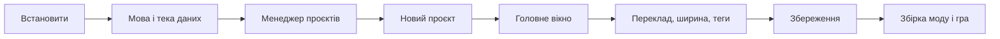

# З чого почати

**Мова:** [English](../0_Getting_Started.md) · Українська

Ця сторінка вчить працювати з Picoripi від першого запуску до готового моду. Вона йде в тому порядку, в якому ви
натискаєте кнопки. Кожен крок описує, що ви бачите, що натиснути і що станеться далі. Назви кнопок взято з
українського інтерфейсу. Знімки екрана зроблено у справжніх вікнах.

**Зміст.** 1 Встановлення · 2 Мова і тека даних · 3 Менеджер проєктів · 4 Новий проєкт · 5 Головне вікно ·
6 Перший переклад · 7 Ширина рядка · 8 Теги · 9 Попередження й автовиправлення · 10 Пошук і заміна ·
11 Збереження, скасування, відкат · 12 Закладки і навігація · 13 Попередній перегляд · 14 AI-переклад ·
15 Глосарій · 16 Де що налаштовується · 17 Збірка, експорт, запуск у грі · 18 Поширення проєкту ·
19 Якщо щось пішло не так · 20 Що потрібно для кожної гри.

---

## 1. Встановлення

Потрібні Windows і Python 3.10 або новіший (перевірено на 3.14). Один раз знадобляться Microsoft C++ Build Tools:
один із пакетів збирається на вашому комп'ютері (докладніше в [README](../../../README.md)).

1. Завантажте програму: `git clone https://github.com/rashevskyv/Picoripi.git`. Або натисніть на GitHub **Code →
   Download ZIP** і розпакуйте архів.
2. Відкрийте теку програми й двічі клацніть **`setup.bat`**. Він створить теку `.venv` і встановить пакети. Це
   займе від однієї до трьох хвилин. Наприкінці з'явиться «Setup completed successfully».
3. Двічі клацніть **`run.bat`**. Перше вікно може з'явитися лише за 15 секунд. Не запускайте програму вдруге.

Щоб оновити програму, виконайте `git pull` у теці програми й знову запустіть `setup.bat`.

## 2. Мова і тека даних

Перше вікно питає, де Picoripi зберігатиме ваші дані: налаштування, список проєктів, глосарії. У ньому також
вибирається мова інтерфейсу. Спершу стоїть мова Windows, якщо Picoripi її має. Інакше стоїть англійська. Змініть
мову у списку вгорі, і вікно перекладеться одразу.

- **Поруч із програмою, у теці data** — типовий вибір. Дані лежать поруч із програмою. Перенесете теку програми, і
  дані підуть разом із нею.
- **Обрати папку** — зберігати дані там, де зручно вам.
- **Мій профіль користувача** — взяти стару теку `~/.picoripi`. Позначка **Скопіювати наявні дані** типово
  вимкнена. Увімкніть її, лише якщо хочете перенести старий профіль.

Натисніть **Використати цю папку**. Нічого не видаляється.

Пізніше теку даних можна змінити: **Файл → Налаштування (Ctrl+P) → Загальні → Розташування даних…**. Після
зміни перезапустіть програму. Мову інтерфейсу можна змінити в меню **Мова** головного вікна. Після вибору
програма пропонує перезапуск: мова не змінюється на ходу.

## 3. Менеджер проєктів

Після першого запуску відкривається Менеджер проєктів. Тут живуть усі ваші ігри. Спершу він порожній.

Пізніше його можна відкрити з головного вікна: **Файл → Менеджер проєктів...** (`Ctrl+Shift+M`). Якщо при
закритті Менеджера жодного проєкту не відкрито, програма закривається. Якщо проєкт відкрито, ви повертаєтеся в нього.

### Кнопки зверху

| Кнопка | Що робить |
|---|---|
| **+ Додати проєкт** | Відкриває меню з чотирма пунктами (нижче) |
| **Нова папка...** | Створює папку в Менеджері, щоб групувати проєкти. На диску нічого не з'являється |
| **Груповий глосарій...** | Створює, змінює або від'єднує глосарій, спільний для всіх проєктів папки |
| **Емулятор...** | Задає команду запуску емулятора для кожної платформи (розділ 17) |
| **Пошук проєктів** | Фільтр за назвою, серією, платформою, плагіном, папкою й шляхом. `Ctrl+F` ставить курсор сюди, `Esc` очищає поле |
| **Список / Плитка** | Перемикає вигляд. У плитці проєкт показано великою піктограмою |
| **Групування** | За папкою, за платформою, за готовністю, за обсягом тексту або без групування |
| **Сортування**, **За спаданням** | Порядок проєктів у групі: за назвою, рядками, платформою, готовністю чи датою зміни |

Пункти меню **+ Додати проєкт**:

1. **Новий проєкт...** — майстер нового проєкту (розділ 4). Після створення проєкт відкривається, а Менеджер закривається.
2. **Додати наявний проєкт...** — виберіть файл `project.uiproj`, який уже є на диску.
3. **Імпорт проєктів з папки...** — виберіть теку, і програма знайде в ній усі проєкти. Позначте потрібні й натисніть **Імпорт**.
4. **Імпортувати спільний проєкт...** — відкрити проєкт, який вам надіслали (розділ 18).

### Список проєктів

Колонки: **Назва проєкту**, **Платформа**, **Серія**, **Плагін**, **Прогрес** (перекладено з потрібного й
відсоток), **Відкрито останнім**, **Статус**. Останній відкритий проєкт завжди стоїть першим, над групами. Двічі
клацніть рядок, щоб відкрити проєкт. Клацніть стрілку ліворуч від рядка, щоб розгорнути докладні відомості.

У розгорнутому рядку є:

- шлях до проєкту, платформа, плагін, файли гри з ролями, серійний глосарій;
- кількість рядків, відсоток перекладу, кількість блоків, дати;
- таблиця ресурсів (текст, шрифти, текстури, інше);
- рядок **Потребує уваги** з переліком проблем, якщо вони є;
- позначки **Зібрано** і **Перевірено в грі**. Їх ставите тільки ви, програма їх не змінює;
- кнопки **Відкрити**, **Показати в папці**, **Прибрати з менеджера**, **Змінити значок...**, **Поділитися
  проєктом...**, **Зібрати мод**, **Експортувати мод**, **Запустити в емуляторі**.

Значок проєкту програма бере з самої гри, якщо вміє. Власний значок задає кнопка **Змінити значок...** або пункт
контекстного меню. Програма записує його як `icon.png` у теку проєкту.

Права кнопка миші на проєкті відкриває меню: **Відкрити**, **Показати в папці**, **Поділитися проєктом...**,
**Перейменувати...**, **Перемістити до папки...**, **Змінити значок...**, **Прибрати значок**, **Прибрати з
менеджера**. Пункт **Перейменувати** змінює лише назву в списку.

**Прибрати з менеджера** лише викреслює проєкт зі списку. Файли проєкту, переклад і розпаковані файли лишаються
на диску. Видалити проєкт з диска у програмі не можна. Видаліть теку проєкту у Провіднику.

## 4. Новий проєкт

Натисніть **+ Додати проєкт → Новий проєкт...**. Те саме робить **Файл → Новий проєкт** (`Ctrl+N`). Майстер має
три кроки і кнопки **Назад**, **Далі**, **Скасувати**.

### Крок 1. Гра

У полі **Гра** введіть частину назви й виберіть гру зі списку. **Назва проєкту** підставиться сама. Її можна
змінити.

### Крок 2. Файли

Натисніть **Додати файли...** і виберіть файли гри: саму гру, оновлення та DLC, у будь-якому порядку. Якщо гра вже
розпакована, натисніть **Додати папку...** і виберіть теку. Кнопка **Прибрати вибрані** прибирає файл зі списку.
Вікно вибору файлу відкривається у вашій домашній теці. Повний шлях зручніше вставити в поле **Ім'я файлу**.

Picoripi читає кожен файл і сам визначає його **Роль** і **Платформу**. Ролі: **Base game** (сама гра), **Update**
(оновлення), **DLC** (додатковий вміст). Для Switch і 3DS ролі розрізняє ідентифікатор гри у файлі. Якщо програма
помилилась, виправте значення у списках у рядку файлу.

Щоб дати одну роль багатьом файлам, виділіть їхні рядки (`Shift` або `Ctrl`), виберіть роль у списку **Роль для
вибраних файлів** і натисніть **Застосувати**. Повторюватися може лише DLC. Base game і Update — по одному.

Стовпець **Статус** і червоний текст під списком одразу показують, що заважає створити проєкт:

| Повідомлення | Що робити |
|---|---|
| Потрібен файл ключів | Файл зашифровано. Натисніть **Додати файл ключів для ...** і вкажіть файл ключів вашої консолі (Switch `prod.keys`, 3DS `aes_keys.txt`, Wii `keys.bin`). Picoripi запам'ятовує лише розташування файлу. Вміст ключів програма не показує й не копіює |
| Не читається: додайте папку | Ця гра не вміє сама розпаковувати такий файл. Приберіть його й додайте розпаковану гру кнопкою **Додати папку...** |
| Два файли мають роль ... | Дайте кожному файлу власну роль. Повторюватися може лише DLC |

Доки список не в порядку, кнопка **Далі** неактивна.

### Крок 3. Тека проєкту

У теці проєкту лежать файл проєкту `project.uiproj`, розпаковані файли в `unpacked`, переклад у `translation` і
результати збірки в `build`. Picoripi пропонує `Документи\Picoripi\<назва проєкту>`. За потреби змініть теку
кнопкою **Огляд...**. Вікно показує, куди потрапить кожен файл. Оригінали не копіюються: проєкт лише пам'ятає
шлях до них.

Натисніть **Створити проєкт**. Вікно прогресу покаже розпакування. Кнопка скасування зупиняє його й прибирає все,
що майстер встиг створити. Перед розпаковуванням програма перевіряє вільне місце на диску. Велика гра
розпаковується й завантажується кілька хвилин. Потім Менеджер закривається, а проєкт відкривається в редакторі.

## 5. Головне вікно

Ось головне вікно з відкритим проєктом.

| Де | Що це |
|---|---|
| Рядок меню | **Файл**, **Правка**, **Вигляд**, **Інструменти**, **Навігація**, **Закладки**, **Мова**. Праворуч кнопка **Довідка** (`F1`) |
| Панель кнопок | Зберегти, скасувати, повторити, знайти, перегляд, AI-пакетний переклад, чат з AI, редактор шрифтів, пересканувати все, налаштування. Праворуч `>_` запускає ваш зовнішній скрипт |
| Ліворуч, **Блоки** | Дерево файлів і віртуальних тек гри. Внизу кнопки роботи з блоками й кнопка **Глосарій…** |
| Вгорі праворуч, **Рядки в блоці** | Список рядків вибраного блоку, лише для читання. Над ним фільтри |
| Внизу ліворуч, **Оригінал** | Початковий текст, лише для читання. Це єдине місце, де не можна друкувати |
| Внизу праворуч, **Редагований** | Тут ви друкуєте переклад |
| Вузька колонка між ними | Кнопки: копіювати оригінал у переклад, відновити переклад, контекст сюжету (`S`), студія розмітки (`R`) |
| Над **Редагований** | **Вікно**, **Розділ**, **Спікер**, кнопки **AI-переклад**, **AI-варіант**, **Автовиправлення**, а також **Шрифт**, **Макс. ширина**, **Застосувати** |
| Під **Редагований** | Попередній перегляд, як рядок виглядатиме в грі (розділ 13) |
| Рядок стану внизу | Шляхи, плагін, кількість рядків, позиція курсора й ширина |

### Дерево блоків

- Клацніть блок, щоб відкрити його рядки. Двічі клацніть, щоб перейменувати.
- Кнопки внизу дерева: **+** додає блок, **−** прибирає блок із проєкту (файли на диску лишаються), **✎**
  перейменовує, **↑** і **↓** переставляють, **⟳** перебудовує віртуальні теки зі сюжетних даних. Переклад вона не
  чіпає. `Ctrl` і колесо миші над деревом змінюють розмір шрифту.
- Прапорець **Лише незбережені** лишає блоки, у яких є незбережені зміни. Після перезапуску його вимкнено.
- Права кнопка на блоці відкриває меню: перейменувати, прибрати, відкрити в Провіднику (оригінал або переклад),
  пересканувати блок, порахувати ширини, зберегти зміни цього блоку, повернути блок до оригіналу, відновити
  переклад, AI-переклад блоку. Права кнопка на порожньому місці створює теку.
- Ліворуч від назви стоїть смужка. Зелений відтінок показує, яка частина блоку вже перекладена. Кольорові
  смужки праворуч показують типи попереджень у блоці. Зірочка перед номером означає незбережені зміни.

### Список рядків

Клацніть рядок, і він з'явиться в **Оригінал** та **Редагований**. Зеленкувата підсвітка номера означає, що рядок
перекладено. Зірочка перед номером означає, що зміни не збережено. Кольорові смужки праворуч від номера
показують попередження. Фільтри над списком:

| Фільтр | Що робить |
|---|---|
| **Сховати порожні рядки** | Згортає порожні рядки поспіль в один |
| **Сховати перекладені** | Лишає тільки неперекладене |
| **Лише перевизначення** | Лишає рядки з власним шрифтом або власною шириною |
| **Лише незбережені** | Лишає рядки зі змінами, яких ще не збережено |
| **Лише з попередженнями** | Лишає рядки з вибраними типами попереджень |
| **Попередження: X / Y** | Відкриває вибір типів попереджень для попереднього фільтра |

Фільтри можна вмикати разом. Якщо список порожній, перевірте, чи не лишився ввімкнений якийсь фільтр.

## 6. Перший переклад

1. Ліворуч у дереві **Блоки** виберіть блок із текстом, наприклад `zel_00.bmg`.
2. Угорі, у списку **Рядки в блоці**, клацніть потрібний рядок.
3. Під списком ліворуч з'явиться **Оригінал** (лише для читання). Праворуч з'явиться поле **Редагований**.
   Клацніть у ньому й надрукуйте переклад.
4. Подивіться на числа ліворуч від кожного рядка в **Редагований**. Це ширина рядка в пікселях гри (розділ 7).
5. Натисніть `Ctrl+S`, щоб зберегти.

Щоб почати з оригіналу, натисніть стрілку `→` у вузькій колонці. Вона копіює оригінал у поле **Редагований**.

Далі переходьте між рядками так:

| Дія | Клавіші |
|---|---|
| Наступний або попередній рядок з проблемою | `Ctrl+↓`, `Ctrl+↑` або стрілки над **Редагований** |
| Наступний або попередній рядок | `Alt+↓`, `Alt+↑` |
| Наступний або попередній блок | `Alt+Shift+↓`, `Alt+Shift+↑` |
| Наступна або попередня тека | `Alt+Shift+→`, `Alt+Shift+←` |

Поле **Спікер** задає, хто каже цей рядок. Надрукуйте ім'я й натисніть `Enter`: вибір зі списку без `Enter` не
зберігається. Поле **Розділ** прив'язує рядок до розділу сюжету. Поле **Вікно** показує тип вікна повідомлення.

## 7. Ширина рядка

Ширина — це кількість пікселів, які рядок займає у вікні гри. Picoripi рахує її за шрифтом гри: кожна літера має
свою ширину в пікселях. Тому ширина не дорівнює кількості літер. Якщо рядок ширший за вікно, у грі він вилізе за
межі. Програма попереджає про це заздалегідь.

**Де видно ширину.** Число праворуч від номера рядка в полі **Редагований** показує ширину цього рядка. У рядку
стану внизу є поле **Ширина**: воно показує ширину тексту до курсора (або вибраного фрагмента). Над полем
**Оригінал** є число **Макс. ширина**: ширина найширшого рядка оригіналу.

### Ширина для одного рядка

Це поля над **Редагований**: **Шрифт**, **Макс. ширина**, **Застосувати**.

1. Виберіть рядок.
2. У полі **Макс. ширина** введіть число пікселів. Нуль означає «типове значення плагіна».
3. Натисніть **Застосувати**. Кнопка активна лише тоді, коли є незастосована зміна.

Права кнопка на полі **Макс. ширина** дає два пункти:

- **Скинути до типового значення плагіна** — прибирає власну ширину рядка;
- **Встановити ширину як у оригіналі** — вимірює найширший рядок оригіналу й вписує число. Потім натисніть
  **Застосувати**.

Клацніть число **Макс. ширина** над **Оригінал**, щоб скопіювати його в поле ширини. Так само діє поле **Шрифт**: вибраний
шрифт стосується лише цього рядка.

Щоб змінити ширину або шрифт для багатьох рядків, виділіть їх у списку **Рядки в блоці**, натисніть праву кнопку
й виберіть **Встановити ширину для кількох рядків** або **Встановити шрифт для кількох рядків**. Прапорець **Автоширина від
оригіналу** бере ширину з оригіналу кожного рядка. Кнопка **За замовчуванням** скидає значення.

Фільтр **Лише перевизначення** покаже всі рядки з власними значеннями. Фіолетова позначка біля номера теж їх
показує.

### Ширина для всього проєкту

**Файл → Налаштування (`Ctrl+P`) → Проєкт → Правила.** Вкладка **Проєкт** є лише тоді, коли відкрито проєкт.

| Поле | Що означає | Типове значення |
|---|---|---|
| **Найбільша ширина вікна гри (пікс.)** | Жорстка межа. Рядок ширший за неї вважається помилкою | 300 |
| **Попередження про ширину рядка (пікс.)** | Поріг, з якого редактор позначає рядок як надто широкий | 280 |
| **Рядків на сторінку** | Скільки рядків вміщує одне вікно гри. Використовує автовиправлення | 4 |
| **Показати направляючу** | Малює у редакторі вертикальну лінію на межі ширини | увімкнено |

Деякі плагіни, наприклад Zelda: Twilight Princess, мають вікна кількох видів. Для них угорі є вибір **Режим ліміту
вікон**:

- **Спільне для всіх вікон** — одні значення на всю гру;
- **Розділяти за типом вікна** — таблиця **Типові значення за типом вікна** з колонками **Тип вікна**,
  **Попередження**, **Найбільша**, **Рядки**. Тип вікна береться з даних повідомлення. «Попередження» не може бути
  більшим за «Найбільша».

Натисніть **OK**. Програма сама пересканує всі рядки: з'явиться повідомлення «Правила оновлено. Повторне сканування
всіх проблем...».

**Яке значення бере програма.** У такому порядку:

1. власна ширина рядка (поле **Макс. ширина**);
2. значення за типом вікна, якщо плагін має кілька типів;
3. значення з **Правила**.

### Ширина кожної літери

Ширини літер лежать у **Налаштування → Проєкт → Карта шрифту**. Таблиця має колонки **Символ або послідовність** і
**Ширина (пікселі)**. Кнопки **Додати персонажа** й **Видалити персонажа** змінюють рядки, поле **Фільтр
персонажів** шукає в таблиці. Літеру, якої немає в таблиці, програма вважає завширшки 8 пікселів. Змініть ширину,
і після **OK** усі попередження перерахуються. Програма записує карту у вашу теку даних. Файл плагіна в `plugins/`
вона не змінює.

Шрифт для всього проєкту вибирають у **Налаштування → Проєкт → Відображення → Типовий шрифт для проєкту**. Після
зміни програма перезапускається. Інші поля цієї вкладки: **Переносити рядки у панелі перегляду**, **Переносити
рядки в панелях редактора**, **Символ нового рядка** та **Стиль символу нового рядка** і **Стиль тегів**: колір,
жирний, курсив, підкреслений.

Розмір шрифту самої програми задає **Налаштування → Загальні → Розмір шрифту програми**.

## 8. Теги

Теги на кшталт `{boxatleast:30}` керують грою: колір, пауза, ім'я героя. Лишайте їх на місці. Редактор показує їх
сірим або оранжевим кольором.

- **Сховати теги** (`Ctrl+Q`, прапорець над **Оригінал** або **Вигляд → Сховати теги**) ховає теги в усіх панелях.
  Збережений текст не змінюється.
- Щоб вставити тег, клацніть правою кнопкою в **Редагований**. Без виділення вставляється один тег. З виділенням
  тег огортає виділений текст.
- Список тегів у цьому меню — **Налаштування → Проєкт → Теги контексту**. Таблиця **Окремі теги** має колонки
  **Вигляд (емодзі або код)** і **Тег**. Таблиця **Обернути тегами** має **Початковий тег** і **Кінцевий тег**.
  Кнопки **Додати рядок** й **Видалити рядок**.
- **Налаштування → Проєкт → Псевдоніми тегів** дають тегові зрозумілу назву. Наприклад, `{F:Link}` замість
  `{escape:0:0000}`. Колонки **Псевдонім** і **Справжній тег**. Ширина рядка теж рахується за справжнім тегом.
- Кольори й накреслення тегів змінюються в **Проєкт → Відображення → Стиль тегів**.

## 9. Попередження й автовиправлення

Програма сама перевіряє кожен рядок: чи не надто він широкий, чи правильні розриви, пробіли й теги. Набір
перевірок залежить від плагіна гри. Рядок із проблемою позначений кольоровою смужкою біля номера.

- **Щоб перейти до проблем:** стрілки над **Редагований** або `Ctrl+↓`/`Ctrl+↑`. Для списку лише проблем
  увімкніть **Лише з попередженнями** і виберіть типи через **Попередження: X / Y**.
- **Які перевірки діють:** **Налаштування → Проєкт → Виявлення**. Кожна проблема має прапорець і колір. Усі
  ввімкнені типово.
- **Автовиправлення:** кнопка **Автовиправлення** над **Редагований** (`Ctrl+Shift+A`) виправляє поточний рядок.
  Клік із `Ctrl` дає вибрати правила. Клік із `Shift` виправляє в межах однієї сторінки.
- **Що виправляти:** **Налаштування → Проєкт → Автовиправлення**. Прапорці для кожної проблеми вимкнені типово.
  Окремі прапорці **Вирівняти речення за оригінальною розміткою сторінки** і **Запобігати додаванню порожніх рядків
  відступу під час розбиття на сторінки**.
- **Виправити все одразу:** **Інструменти → Виправити всі стрічки...**.
- **Пересканувати все:** `Ctrl+Shift+R`. Кнопка на панелі робить те саме. Вона перераховує ширини й пошук проблем
  по всьому проєкту.

## 10. Пошук і заміна

**Швидкий пошук** (`Ctrl+F`). Над редактором з'являється рядок пошуку. Кнопки **Назад** і **Далі** (`F3`,
`Shift+F3`) ходять по збігах. Пошук іде по всьому проєкту і не зациклюється: на кінці він пише «Не знайдено».
Прапорці:

- **Aa** — враховувати регістр;
- **Неточний** — шукати схожі слова й різні закінчення;
- **Оригінал** — шукати в оригіналі, а не в перекладі;
- **Без тегів** — ігнорувати теги, переноси й зайві пробіли (увімкнено типово).

**Розширений пошук** (`Ctrl+H` або кнопка **Продовжити**). Поля **Знайти** та **Замінити на**. Ліворуч список
збігів. Клацніть збіг, і редактор перейде до нього. Кнопки: **Знайти**, **Замінити** (лише поточний збіг),
**Замінити все**, **Пропустити**. Прапорець **Враховувати регістр при заміні** зберігає великі літери: `Слово`
стане `Заміна`, а `СЛОВО` стане `ЗАМІНА`.

Заміни потрапляють у проєкт, коли ви закриваєте вікно, і стають незбереженими змінами. Щоб записати їх на диск,
натисніть `Ctrl+S`.

## 11. Збереження, скасування, відкат

**Збереження.** `Ctrl+S` (**Файл → Зберегти зміни**) записує файли перекладу всіх блоків, де є зміни. Якщо змін
немає, нічого не записується. Оригінальні файли Picoripi ніколи не змінює. Для архівів програма перепаковує
архів у копії перекладу й попереджає, якщо він став більшим за оригінал. У заголовку вікна стоїть зірочка,
поки є незбережені зміни.

**Автозбереження сеансу.** Кожні дві секунди після зміни програма записує службовий файл `.picoripi_session` у
теку проєкту. У ньому є й незбережений текст. Після аварії або закриття програма відновить його при відкритті
проєкту. Це не заміна `Ctrl+S`: файли перекладу змінює лише збереження. Якщо вимкнути **Налаштування →
Загальні → Відновлювати незбережений сеанс під час запуску**, незбережений текст губиться при закритті.

**Скасувати й повторити.** `Ctrl+Z` і `Ctrl+Y` (або `Ctrl+Shift+Z`). Стос один на весь проєкт і вміщує 500
кроків. Послідовний набір в одному рядку об'єднується в один крок. Перехід до іншого рядка теж рахується кроком,
тому перше `Ctrl+Z` може повернути вас до попереднього рядка.

**Резервна копія перекладу.** `Ctrl+T` (**Правка → Зберегти переклад**) записує переклад поточного рядка в
резервний файл `saved_translations.json`. Програма сама робить копію перед будь-яким поверненням до оригіналу
та після AI-перекладу. `Ctrl+Shift+T` (**Відновити переклад**) повертає збережений текст у редактор.

**Повернути рядок до оригіналу.** Стрілка `→` у вузькій колонці або пункт у правій кнопці. Програма питає
підтвердження для кількох рядків. Перед поверненням вона зберігає ваш переклад у резервну копію, тому його можна
відновити.

**Повернути файл змін до оригіналу...** у меню **Файл** стирає переклад на диску. Користуйтеся цим пунктом лише
тоді, коли хочете почати переклад заново.

Закриття проєкту чи програми не питає «зберегти?». Незбережений текст лишається у службовому файлі сеансу.

## 12. Закладки і навігація

- **Закладки → Додати закладку...** (`Ctrl+B`) запам'ятовує поточний рядок. Назву можна змінити. Клацніть
  закладку в меню, щоб повернутися. **Видалити закладку** і **Очистити всі закладки** питають підтвердження.
  Закладка прив'язана до номера блоку й рядка. Якщо ви переставили блоки, вона може вказувати не туди.
- **Навігація** містить чотири пункти переходу між блоками й теками (розділ 6).
- **Правка → Вставити текст блоку** (`Ctrl+Shift+V`) вставляє з буфера кілька рядків. Рядки розділяє `{END}`.
  **Скасувати вставлення блоку** повертає, як було.

## 13. Попередній перегляд

**Вигляд → Прев'ю** (`Ctrl+Shift+P`) показує під полем **Редагований**, як рядок виглядатиме у вікні гри:
шрифт, розмір вікна, переноси. Для частини ігор перегляд точний, для частини орієнтовний. Якщо
програма гальмує, вимкніть **Налаштування → Загальні → Увімкнути інтерактивний перегляд**. Те саме можна зробити
для **сканування попереджень у реальному часі** і **системи глосарія**.

Деякі плагіни мають окремі вікна на **Інструменти**: **Редактор шрифтів...** (він же кнопка **A** на панелі),
**Текстури...**, **Студія розмітки скриптів...**. Їх описано на сторінках [Інтерфейс](1_User_Guide_and_Workflow_Pipeline.md)
і [Script Markup](9_Script_Markup.md).

## 14. AI-переклад

AI перекладає за вас, а ви правите. Спершу налаштуйте постачальника.

1. **Налаштування (`Ctrl+P`) → AI-переклад.**
2. У **Цільова мова** лишіть Ukrainian або впишіть іншу.
3. У **Активний провайдер** виберіть, що використовувати: **Сумісний з OpenAI**, **Чат Ollama**, **Gemini** або
   **Perplexity**. Типово стоїть **Вимкнено**.
4. Заповніть поля, які з'явилися: ключ API, адресу, модель. Для локального Gemini Web2API ключ не потрібен.
   Дивіться [Gemini Web2API](5_Gemini_Web2API.md).
5. Натисніть **Перевірити провайдера**. Програма надішле один маленький запит і покаже результат.
6. Натисніть **OK**.

Після цього над **Редагований** працюють кнопки:

| Кнопка | Що робить |
|---|---|
| **AI-переклад** | Перекладає поточний рядок. `Ctrl`+клік відкриває редактор промпту |
| **AI-варіант** | Пропонує інше формулювання вашого перекладу. Виділіть фрагмент, щоб переписати лише його |
| **Автовиправлення** | Усуває проблеми з шириною, пробілами й тегами (розділ 9) |

Щоб перекласти багато рядків, виділіть їх у списку, натисніть праву кнопку й виберіть **AI Translate**. Щоб
перекласти блок, клацніть блок правою кнопкою й виберіть «AI: Translate Block». Для всієї гри є **Інструменти →
Пакетний переклад за допомогою ШІ**. Він має три режими: спершу сюжет, решта блоків, усе разом. Це довгі
операції зі зверненням до платного сервісу, тому спершу спробуйте на одному блоці.

Чат: **Відкрити чат штучного інтелекту** (`Ctrl+Shift+C`). Докладніше: [AI-переклад](11_AI_Translation.md).

## 15. Глосарій

Глосарій — це словник термінів гри (імена, предмети, місця) з вашими перекладами. AI і ви використовуєте його
однаково, тому «Link» скрізь залишається «Лінком».

1. Натисніть **Глосарій…** під деревом блоків (`Ctrl+G`).
2. Ліворуч список термінів із пошуком і вкладками за категоріями. Прапорець **Потребує перевірки** лишає
   непідтверджені терміни.
3. Виберіть термін. Праворуч впишіть переклад у поле й натисніть **Підтвердити переклад**, щоб перейти до
   наступного. **Зберегти** (`Ctrl+S` у цьому вікні) записує зміни.
4. Кнопка **Обговорити з ШІ…** відкриває чат із повним контекстом терміна.

Збудувати глосарій з тексту гри автоматично: **Інструменти → Підготувати глосарій...**. Докладніше: [Конвеєр
локалізації](8_Localization_Pipeline.md).

## 16. Де що налаштовується

**Файл → Налаштування** (`Ctrl+P`). Кнопки лише **OK** і **Скасувати**. Зміни діють після **OK**. Перезапуск
потрібен, лише коли змінюються тема, активний ігровий плагін або типовий шрифт проєкту.

| Що треба | Де | Перезапуск |
|---|---|---|
| Тема, мова інтерфейсу | **Загальні → Тема**, меню **Мова** | так |
| Тека даних | **Загальні → Розташування даних…** | так |
| Розмір шрифту програми й підказок | **Загальні** | ні |
| Шлях до зовнішнього скрипту (кнопка `>_`) | **Загальні → Шлях до зовнішньої програми/скрипту** | ні |
| Шлях до `wit.exe` для ISO | **Загальні** | ні |
| Показ пробілів крапками | **Загальні** | ні |
| Вимкнути перегляд, пошук проблем, глосарій для швидкості | **Загальні** | ні |
| Шляхи до оригіналу, перекладу, шрифтів, еталону | **Проєкт → Шляхи до файлів** | ні |
| Ширина вікна, попередження, рядків на сторінку | **Проєкт → Правила** | ні |
| Типовий шрифт, переноси, кольори | **Проєкт → Відображення** | шрифт: так |
| Теги для вставки | **Проєкт → Теги контексту** | ні |
| Псевдоніми тегів | **Проєкт → Псевдоніми тегів** | ні |
| Ширини літер | **Проєкт → Карта шрифту** | ні |
| Які проблеми шукати | **Проєкт → Виявлення** | ні |
| Які проблеми виправляти автоматично | **Проєкт → Автовиправлення** | ні |
| Перевірка орфографії | **Правопис** (мова словника, **Керування словниками...**) | ні |
| AI-постачальник, ключ, модель | **AI-переклад** | ні |
| Постачальник для глосарію | **AI-глосарій** | ні |
| Сервер для телефона | **Кампаньйон** | ні |
| Журнал подій | **Журнал** | ні |
| Файли ключів консолей | **Ключі консолей** | ні |

Вкладка **Проєкт** з'являється лише тоді, коли відкрито проєкт. Глобальні налаштування лежать у `settings.json` у теці
даних. Налаштування проєкту лежать у файлі проєкту. Докладніше: [Конфігурація](4_Configuration_Guide.md).

## 17. Збірка, експорт, запуск у грі

Збирати моди можна, коли переклад збережено. Збірка читає файли перекладу з диска, а не з редактора. Тому
спершу натисніть `Ctrl+S`.

1. Відкрийте Менеджер проєктів: **Файл → Менеджер проєктів...** (`Ctrl+Shift+M`).
2. Розгорніть рядок проєкту.
3. Натисніть **Зібрати мод** і виберіть ціль. Цілі залежать від гри: диск ISO, мод LayeredFS, пакет для порту, тека
   для емулятора. Якщо гра ще не має цілей, кнопка неактивна.
4. Стежте за рядком стану: «Працюю...», потім відсотки. Результат: «Зібрано: <шлях>». Зібране лежить у
   `build\<ціль>` у теці проєкту.
5. У разі помилки рядок покаже «Помилка: <причина>». Прочитайте причину, виправте назване й повторіть. Повний
   слід лежить у журналі.

Скасувати збірку в Менеджері не можна. Закриття Менеджера перериває збірку.

**Експортувати мод.** Виберіть ціль, потім порожню теку. Програма збере мод і скопіює його туди. Створіть нову
порожню теку: непорожню програма не візьме.

**Запустити в емуляторі.** Спершу задайте команду.

1. У Менеджері натисніть **Емулятор...**.
2. Для потрібної платформи впишіть команду, а на місці файлу чи теки моду напишіть `{path}`. Приклад:
   `"C:\Emu\emu.exe" {path}`. Порожній рядок означає «команди немає».
3. Натисніть **OK**.
4. У розгорнутому рядку проєкту натисніть **Запустити в емуляторі** і виберіть ціль. Програма збере мод і запустить
   емулятор.

Програма не має списку емуляторів: ви вказуєте будь-яку команду. Позначка **Зібрано** і **Перевірено в грі** — ваші
власні нотатки для списку проєктів.

## 18. Поширення проєкту

- **Поділитися проєктом...** пакує проєкт, переклад і глосарії в один `.zip`. Оригінали гри в архів не потрапляють.
  Незбережений текст теж. Спершу натисніть `Ctrl+S`.
- **Імпортувати спільний проєкт...** (в меню **+ Додати проєкт**). Виберіть `.zip`, потім порожню теку, потім ваші
  власні файли гри.
- Для роботи в реальному часі є **Інструменти → Спільна робота...**: один учасник створює кімнату, інші
  приєднуються. Дивіться [Спільна робота](13_Working_Together.md). **Інструменти → Прогрес...** відкриває сторінку прогресу.
- Для перегляду з телефона є [Picoripi Companion](12_Picoripi_Companion.md).

## 19. Якщо щось пішло не так

| Що бачите | Що робити |
|---|---|
| Список рядків порожній | Вимкніть усі фільтри над списком, особливо **Лише незбережені** і **Сховати порожні рядки** |
| Кнопка **Зібрати мод** неактивна | Гра ще не має цілей збірки. Дивіться підказку на кнопці |
| Кнопка **Запустити в емуляторі** неактивна | Задайте команду кнопкою **Емулятор...** |
| Перший запуск довго не показує вікно | Це нормально, до 15 секунд. Не запускайте вдруге |
| «Потрібен файл ключів» у майстрі | Вкажіть файл ключів консолі кнопкою в рядку помилки. Або додайте розпаковану папку |
| Усі рядки з попередженням про ширину | Перевірте **Проєкт → Правила** і **Карту шрифту** |
| Програма гальмує | Вимкніть у **Загальні** перегляд у реальному часі й пошук проблем у реальному часі |
| Не знаєте, що сталося | Подивіться журнал: **Налаштування → Журнал**. Шлях до файлу вказано там |

## 20. Що потрібно для кожної гри

| Гра | Які файли додати | Файл ключів |
|---|---|---|
| Yo-kai Watch, Switch | гра `.nsz` або `.nsp` та її оновлення | Switch `prod.keys` |
| Yo-kai Watch, 3DS | `.3ds` | ключі 3DS, лише якщо файл зашифровано |
| Twilight Princess, GameCube | `.iso` | не потрібен |
| Twilight Princess, Wii | `.iso` для Wii | Wii `keys.bin` |
| Twilight Princess HD, Wii U | розпакована тека гри (файл `.wux` Picoripi ще не читає) | не потрібен |

Усі інші ігри є у списку **Гра** на кроці 1 майстра.

<!-- wiki-nav -->
---

[До змісту вікі](README.md) · **Далі:** [Посібник: інтерфейс](1_User_Guide_and_Workflow_Pipeline.md)
