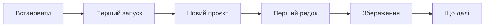
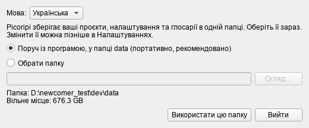
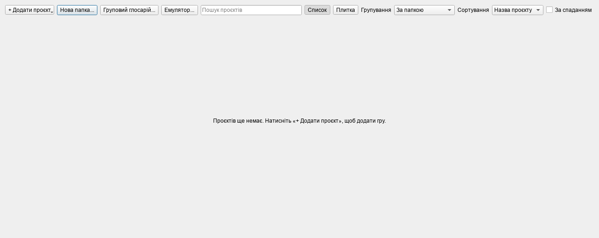
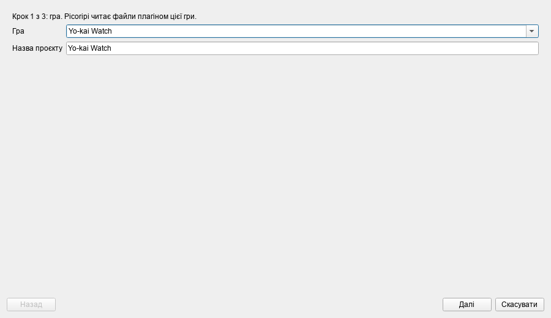
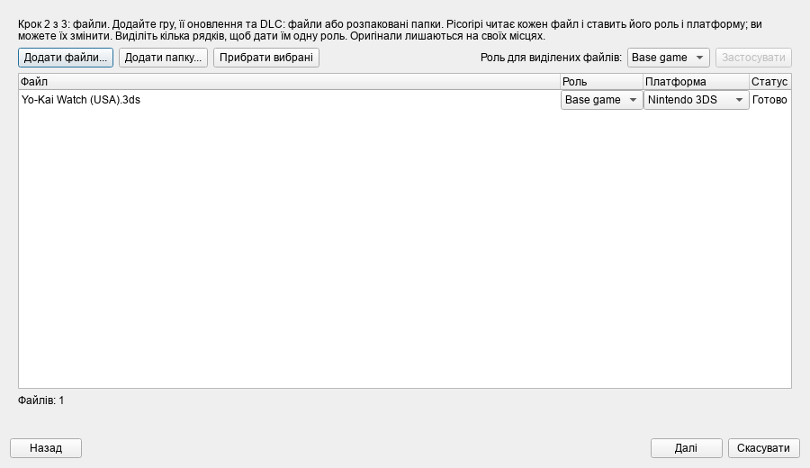
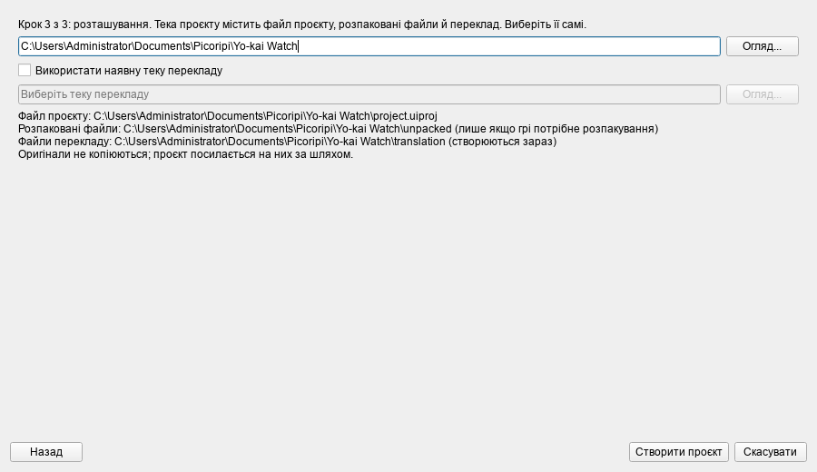

# З чого почати

**Мова:** [English](../0_Getting_Started.md) · Українська

Ця сторінка веде від GitHub до першого збереженого рядка перекладу. Це п'ять кроків. Кожну тему докладно описує окрема
сторінка, і посилання на неї стоїть у кінці. Знімки екрана зроблено у справжніх вікнах.

## 1. Встановіть

Потрібні Windows і Python 3.10 або новіший (перевірено на 3.14). Один раз знадобляться Microsoft C++ Build Tools:
один із пакетів збирається на вашому комп'ютері (докладніше в [README](../../../README.md)).

1. Завантажте програму: `git clone https://github.com/rashevskyv/Picoripi.git`. Або натисніть на GitHub **Code →
   Download ZIP** і розпакуйте архів.
2. Відкрийте теку програми й двічі клацніть **`setup.bat`**. Він створить теку `.venv` і встановить пакети. Це
   займе від однієї до трьох хвилин. Наприкінці з'явиться «Setup completed successfully».
3. Двічі клацніть **`run.bat`**. Перше вікно може з'явитися лише за 15 секунд. Не запускайте програму вдруге.

Щоб оновити програму, виконайте `git pull` і знову запустіть `setup.bat`.

## 2. Перший запуск

Перше вікно питає, де Picoripi зберігатиме ваші дані, і дає вибрати мову інтерфейсу. Спершу стоїть мова Windows,
якщо Picoripi її має. Змініть мову у списку вгорі, і вікно перекладеться одразу.

Типовий вибір — **Поруч із програмою, у теці data**. Натисніть **Використати цю папку**. Нічого не видаляється.
Про інші варіанти й про зміну теки пізніше читайте в розділі [Налаштування](4_Configuration_Guide.md).

Далі відкриється Менеджер проєктів. Спершу він порожній.

## 3. Створіть проєкт

Натисніть **+ Додати проєкт → Новий проєкт...**. Майстер має три кроки.

1. **Гра.** Введіть частину назви й виберіть гру зі списку. **Назва проєкту** підставиться сама.

   

2. **Файли.** Натисніть **Додати файли...** й виберіть файли гри: саму гру, оновлення та DLC. Якщо гра вже
   розпакована, натисніть **Додати папку...**. Програма сама визначить роль і платформу кожного файлу. Зашифрований
   файл потребує файл ключів. Тоді натисніть **Отримати ключі з типового джерела** або **Додати файл ключів для ...**.
   Див. [Ключі консолей](4_Configuration_Guide.md#ключі-консолей).

   

3. **Тека проєкту.** Прийміть запропоновану теку `Документи\Picoripi\<назва проєкту>` або виберіть іншу. Натисніть
   **Створити проєкт**.

   

Велика гра розпаковується кілька хвилин. Потім Менеджер закривається, а проєкт відкривається в редакторі.

Усі випадки (Switch з оновленням і DLC, 3DS, Wii, розпакована папка, ключі) описано на сторінці [Створення проєкту:
усі види ігор](New_Project_Scenarios.md). Менеджер проєктів описано на сторінці [Менеджер проєктів](Project_Manager.md).

## 4. Перекладіть перший рядок

1. Ліворуч у дереві **Блоки** виберіть блок із текстом, наприклад `zel_00.bmg`.
2. Угорі, у списку **Рядки в блоці**, клацніть потрібний рядок.
3. Під списком ліворуч з'явиться **Оригінал** (лише для читання). Праворуч з'явиться поле **Редагований**.
   Клацніть у ньому й надрукуйте переклад.
4. Число ліворуч від рядка в **Редагований** — ширина рядка в пікселях гри. Якщо рядок надто широкий, програма
   попередить.

Теги на кшталт `{boxatleast:30}` лишайте на місці: вони керують грою.

## 5. Збережіть

Натисніть `Ctrl+S`. Програма запише переклад у теку `translation` вашого проєкту. Оригінальні файли вона ніколи не
змінює. Про резервні копії й відновлення читайте на сторінці [Збереження і відновлення](Saving_and_Recovery.md).

## 6. Що далі

| Я хочу... | Сторінка |
|---|---|
| Зрозуміти вікно редактора й клавіші | [Переклад у редакторі](Editor_Basics.md), [Гарячі клавіші](Hotkeys.md) |
| Налаштувати ширину рядка, шрифти й теги | [Ширина, шрифти й теги](Width_Fonts_Tags.md) |
| Виправити помилки в перекладі | [Попередження й автовиправлення](Warnings_and_Autofix.md) |
| Знайти й замінити слово у всій грі | [Пошук, заміна й закладки](Search_Bookmarks.md) |
| Перекласти за допомогою AI | [AI-переклад](11_AI_Translation.md), [Глосарій і конвеєр](8_Localization_Pipeline.md) |
| Зібрати мод і перевірити в грі | [Збірка й перевірка в грі](Build_and_Test.md) |
| Працювати разом з іншими | [Спільна робота](13_Working_Together.md) |
| Швидку відповідь «як зробити...» | [Рецепти](Recipes.md) |
| Знайти причину помилки | [Розв'язання проблем](Troubleshooting.md) |
| Побачити, які ігри підтримуються | [Підтримувані ігри](Supported_Games.md) |

## Що потрібно для кількох відомих ігор

| Гра | Які файли додати | Файл ключів |
|---|---|---|
| Yo-kai Watch, Switch | гра `.nsz` або `.nsp` та її оновлення | Switch `prod.keys`, якщо зашифровано |
| Yo-kai Watch, 3DS | `.3ds` | 3DS `aes_keys.txt`, лише якщо зашифровано |
| Twilight Princess, GameCube | `.iso` | не потрібен |
| Twilight Princess, Wii | `.iso` для Wii | Wii `keys.bin`, якщо зашифровано |
| Twilight Princess HD, Wii U | розпакована тека гри (файл `.wux` Picoripi ще не читає) | не потрібен |

<!-- wiki-nav -->
---

[До змісту вікі](README.md) · **Далі:** [Менеджер проєктів](Project_Manager.md)
