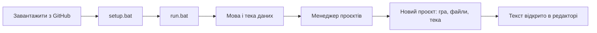

# Перший запуск

**Мова:** [English](../14_Getting_Started.md) · Українська

Ця сторінка веде від сторінки на GitHub до гри, відкритої в редакторі, з екранами, які ви побачите. Її написано за
тестами людей, які ніколи не користувалися Picoripi. Кожен крок виконано на чистій копії програми.

## 1. Завантаження і встановлення

Потрібні Windows і Python 3.10 або новіший (перевірено на 3.14). Також один раз потрібні Microsoft C++ build tools,
бо один пакет збирається на вашому комп'ютері (див. [README](../../../README.md)).

1. Завантажте програму: `git clone https://github.com/rashevskyv/Picoripi.git`, або натисніть **Code → Download ZIP**
   на сторінці GitHub і розпакуйте архів.
2. Відкрийте теку програми й двічі клацніть **`setup.bat`**. Він створить теку `.venv` і встановить пакети. Це триває
   від однієї до трьох хвилин і закінчується написом «Setup completed successfully».
3. Двічі клацніть **`run.bat`**, щоб запустити програму. Перше вікно може з'явитися приблизно за 15 секунд.

## 2. Перший запуск: мова і тека даних

Перше вікно питає, де Picoripi зберігає ваші дані (налаштування, список проєктів, глосарії). Воно також питає мову
інтерфейсу. Спершу це мова Windows, якщо Picoripi її має, інакше англійська. Змініть її у списку вгорі: вікно
перемкнеться одразу.

- **Поруч із програмою, у теці data** — типовий варіант. Він портативний: перенесете теку програми — дані підуть
  разом із нею.
- **Обрати теку** зберігає дані там, де ви хочете.
- **Мій профіль користувача** бере старішу теку `~/.picoripi`. **Скопіювати наявні дані** типово вимкнено; увімкніть
  лише щоб імпортувати старий профіль.

Натисніть **Використати цю папку**. Нічого не видаляється. Теку можна змінити пізніше в **Settings → Global → Data
folder**.

## 3. Менеджер проєктів

Після теки даних відкривається Менеджер проєктів. Він показує ваші ігри. Зараз він порожній.

Натисніть **+ Додати проєкт → Новий проєкт...**. Пізніше те саме робить **Файл → Новий проєкт** (Ctrl+N).

## 4. Новий проєкт: три кроки

### Крок 1: гра

Введіть частину назви гри в полі **Гра** і виберіть її зі списку. **Назва проєкту** заповниться сама; її можна
доповнити.

### Крок 2: файли

Натисніть **Додати файли...** і виберіть файли гри: гру, її оновлення та DLC, у будь-якому порядку. Або натисніть
**Додати папку...** і виберіть розпаковану гру. Вікно вибору файлу починається у вашій теці користувача; введіть або
вставте повний шлях у поле **Ім'я файлу**.

Picoripi читає кожен файл і ставить його **Роль** (**Base game**, **Update**, **DLC**) і **Платформу**. ID тайтлу
Switch або 3DS відрізняє базу, оновлення й DLC. Якщо припущення хибне, змініть його у списках. Щоб дати багатьом
файлам одну роль, виділіть їхні рядки, оберіть роль біля **Застосувати** і натисніть її. Повторюватися може лише DLC.

Стовпець **Статус** і червоний текст під списком одразу кажуть, що заважає проєкту:

| Повідомлення | Що робити |
|---|---|
| Потрібен файл ключів | Файл зашифровано. Натисніть **Додати файл ключів для ...** і виберіть файл ключів вашої консолі (Switch `prod.keys`, 3DS `aes_keys.txt`, Wii `keys.bin`). Picoripi запам'ятовує лише місце файлу. |
| Не читається: додайте папку | Ця гра не вміє сама розпакувати такий файл. Приберіть його і додайте розпаковану гру через **Додати папку...**. |
| Два файли мають роль ... | Дайте кожному файлу власну роль. Повторюватися може лише DLC. |

**Далі** вимкнена, доки список не гаразд.

### Крок 3: тека

Тека проєкту містить файл проєкту, розпаковані файли та переклад. Picoripi пропонує
`Документи\Picoripi\<назва проєкту>`; змініть, якщо хочете. Вікно показує, куди саме піде кожен файл. Оригінали не
копіюються.

Натисніть **Створити проєкт**. Вікно прогресу показує розпакування, його можна скасувати. Розпакування і
завантаження великої гри можуть тривати кілька хвилин. Коли все закінчиться, Менеджер проєктів закриється, а проєкт
відкриється в редакторі.

## 5. Побачити текст

Виберіть блок у дереві ліворуч. Оригінал показано ліворуч, ваш переклад праворуч. Значок проєкту береться з гри,
коли Picoripi його читає (3DS і GameCube); **Змінити значок...** у рядку проєкту в Менеджері проєктів замінює його.

## Що потрібно для кожної гри

| Гра | Які файли додати | Файл ключів |
|---|---|---|
| Yo-kai Watch, Switch | гра `.nsz` або `.nsp` та її оновлення | Switch `prod.keys` |
| Yo-kai Watch, 3DS | `.3ds` | ключі 3DS лише для зашифрованого файлу |
| Twilight Princess, GameCube | `.iso` | немає |
| Twilight Princess, Wii | `.iso` для Wii | Wii `keys.bin` |
| Twilight Princess HD, Wii U | розпакована тека гри (Picoripi ще не читає `.wux`) | немає |

Решта ігор є у списку **Гра** на кроці 1. Пов'язані сторінки: [інтерфейс](1_User_Guide_and_Workflow_Pipeline.md),
[AI-переклад](11_AI_Translation.md), [налаштування](4_Configuration_Guide.md).
