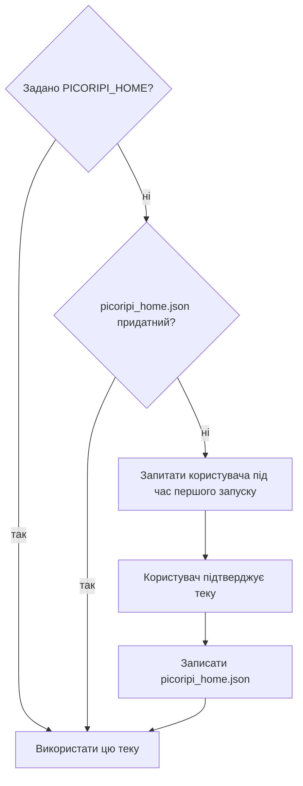

# Налаштування

**Мова:** [English](../4_Configuration_Guide.md) · Українська

Ця сторінка — карта **Налаштувань** (`Ctrl+P`). Тут описано кожну вкладку, кожен елемент, типове значення та потребу в перезапуску. Також сказано, який файл зберігає кожне значення, і як працює тека даних.

## Як працює вікно

- **OK** застосовує зміни і зберігає їх. **Cancel** скасовує зміни.
- Вкладка **Проєкт** з'являється, лише коли відкрито проєкт.
- Більшість елементів діє одразу після **OK**. Виняток: вкладка **Ключі консолей** застосовує кожну зміну одразу, без **OK**.
- Перезапуск потрібен для **Теми**, **Активного ігрового плагіна** та **Типового шрифту для проєкту**. Після **OK** Picoripi перезапускається сам, якщо змінили один із них.
- Для **Папки даних** і **мови інтерфейсу** потрібен перезапуск, який ви робите самі. У колонці «Перезапуск» стоїть **Так, вручну**.
- Налаштування саме не скидаються. Див. [Скидання до типових значень](#скидання-до-типових-значень).

## Загальні

| Елемент | Що робить | Типове значення | Перезапуск |
|---|---|---|---|
| Тема (потрібен перезапуск) | Колір: Auto, Light або Dark. | Auto | Так, автоматично |
| Активний ігровий плагін | Плагін гри, який завантажує Picoripi. Список плагінів, які знайдено. | `zelda_mc` | Так, автоматично |
| Розмір шрифту програми | Розмір шрифту програми. Діапазон від 6 до 24. | Системний розмір | Ні |
| Розмір шрифту підказок | Розмір шрифту підказок. Діапазон від 6 до 32. | 11 | Ні |
| Шлях до зовнішньої програми/скрипту | Файл, який запускає кнопка `>_` на панелі. Підходять `.bat`, `.cmd`, `.exe`, `.py`, `.sh`. | Порожньо | Ні |
| Шлях до Wiimms ISO Tool (wit.exe) | Необов'язковий `wit.exe` для читання повідомлень з образів GameCube і Wii. Порожньо: PATH або автопошук. | Порожньо | Ні |
| Показувати спеціальні пробіли крапками | Малює пробіли-повтори та спеціальні пробіли крапками в редакторі. | Увімкнено | Ні |
| Колір пробільної крапки | Колір цих крапок. | `#BBBBBB` | Ні |
| Відновлювати незбережений сеанс під час запуску | Зберігає копію незбереженого тексту в `settings.json` і завантажує її на старті. Вимкнено: копія не пишеться. | Вимкнено | Ні |
| Показувати редактор промптів перед запитами до ШІ | Відкриває редактор промптів перед кожним запитом до ШІ. | Увімкнено | Ні |
| Увімкнути інтерактивний перегляд | Показує перегляд у стилі гри під редактором. Те саме, що **Вигляд → Прев’ю**. | Увімкнено | Ні |
| Увімкнути сканування попереджень у реальному часі | Перевіряє рядки під час введення. Вимкнення зменшує затримки. | Увімкнено | Ні |
| Увімкнути систему глосарія | Вмикає функції глосарія. Вимкнення зменшує затримки. | Увімкнено | Ні |
| Показувати попередження про розмір архіву | Попереджає, коли запакований архів більший за оригінал. | Увімкнено | Ні |
| Простій перед сном комп'ютера (хвилин) | Час бездіяльності від 1 до 60 хвилин, після якого комп'ютер засинає після завершеного завдання. | 5 | Ні |
| Папка даних: **Розташування даних…** | Показує папку даних. Переносить дані в іншу папку (копіює). Див. [Папка даних](#тека-даних). | Поруч із програмою (`data`) | Так, вручну |

## Проєкт

Спершу відкрийте проєкт. Вкладка має вісім підвкладок.

### Шляхи до файлів

| Елемент | Що робить | Типове значення | Перезапуск |
|---|---|---|---|
| Режим каталогів (завантаження з папки) | Завантажує всі файли папки, а не один файл. | Вимкнено | Ні |
| Автоматично згенерувати шлях до перекладу | Будує шлях перекладу з оригінального шляху. Поле перекладу тоді лише для читання. | Вимкнено | Ні |
| Шлях до оригінального файлу / каталогу | Вихідні файли. Напис змінюється в режимі каталогів. | Шлях джерела проєкту | Ні |
| Шлях до файлу змін / каталогу змін | Файли перекладу. | Шлях перекладу проєкту | Ні |
| Шлях до каталогу оригінальних шрифтів | Папка з оригінальними шрифтами гри. | Порожньо | Ні |
| Шлях до каталогу шрифтів | Папка з вашими перекладеними шрифтами. Додається до списку шрифтів. | Порожньо | Ні |
| Шлях до референсного перекладу / ROM | Папка референсного перекладу, розпакований ROM або образ диска (`.iso`, `.rvz`). Показується поруч із вашим перекладом. | Порожньо | Ні |

### Відображення

| Елемент | Що робить | Типове значення | Перезапуск |
|---|---|---|---|
| Типовий шрифт для проєкту | Шрифт для всього проєкту. | Немає | Так, автоматично |
| Переносити рядки у панелі перегляду | Переносить довгі рядки в перегляді. | Увімкнено | Ні |
| Переносити рядки в панелях редактора | Переносить довгі рядки в редакторі. | Вимкнено | Ні |
| Символ нового рядка | Символ, який показує розрив рядка. | `↵` | Ні |
| Стиль символу нового рядка | Колір, жирний, курсив і підкреслення символу. | `#A020F0`, жирний | Ні |
| Стиль тегів | Колір, жирний, курсив і підкреслення тегів. | `#FF8C00`, жирний | Ні |

### Правила

| Елемент | Що робить | Типове значення | Перезапуск |
|---|---|---|---|
| Найбільша ширина вікна гри (пікс.) | Жорсткий ліміт. Ширший рядок — помилка. | 300 | Ні |
| Попередження про ширину рядка (пікс.) | Місце, з якого редактор позначає рядок як занадто широкий. | 280 | Ні |
| Показати направляючу | Малює межу ширини в редакторі. | Увімкнено | Ні |
| Рядків на сторінку | Скільки рядків вміщує одне вікно гри. Автовиправлення цим користується. | 4 | Ні |
| Режим ліміту вікон | Лише для плагінів з кількома типами вікон. **Спільне для всіх вікон** — один набір лімітів. **Розділяти за типом вікна** — таблиця з колонками **Попередження**, **Найбільша** і **Рядки** для кожного типу. | Розділяти за типом вікна | Ні |

Зміна правила запускає повторне сканування всіх рядків. У таблиці вікон **Попередження** не може бути більше за **Найбільшу**.

### Теги контексту

Дві таблиці: **Окремі теги (ПКМ без виділення)** і **Обернути тегами (ПКМ при виділенні)**. Кожен рядок має текст відображення і тег. Рядок обгортки має початковий і кінцевий тег. Кнопки: **Додати рядок**, **Видалити рядок** і **Фільтр тегів:**. Рядки потрапляють у меню правого кліку в редакторі.

- Типово: порожньо.
- Зміни діють після **OK**.

### Псевдоніми тегів

Таблиця з колонками **Псевдонім** і **Справжній тег**. Псевдонім дає сирому тегу гри зрозумілу назву. Кнопки: **Додати псевдонім**, **Видалити псевдонім** і **Фільтр псевдонімів:**.

- Типово: псевдоніми плагіна (його `config.json`).
- Зберігається в користувацькій теці плагіна як `aliases.json`.
- Після ручної зміни файлу плагіна скористайтеся **Файл → Reload Tag Mappings from Settings**.

### Карта шрифту

Таблиця з колонками **Символ або послідовність** і **Ширина (пікселі)**. Ширини йдуть у попередження про ширину рядка. Кнопки: **Додати персонажа**, **Видалити персонажа** і **Фільтр персонажів:**.

- Типово: карта шрифту плагіна. Символ, якого немає в таблиці, рахується як 8 пікселів.
- Зберігається в користувацькій теці плагіна як `font_map.json`. Picoripi ніколи не змінює файл самого плагіна.

### Виявлення

Один прапорець для кожного типу проблем, які перевіряє плагін. Кожен рядок показує колір проблеми і підказку.

- Типово: усі увімкнено.
- Вимкніть перевірку, щоб вона не позначала рядки.

### Автовиправлення

| Елемент | Що робить | Типове значення | Перезапуск |
|---|---|---|---|
| Вирівняти речення за оригінальною розміткою сторінки | Узгоджує розриви речень з оригінальними сторінками. | Вимкнено | Ні |
| Запобігати додаванню порожніх рядків відступу під час розбиття на сторінки | Немає порожніх рядків у кінці сторінки, щоб заповнити місце. | Вимкнено | Ні |
| Один прапорець для кожного типу проблем | Дозволяє автовиправленню змінювати цей тип проблем. | Усі вимкнено | Ні |

## Правопис

| Елемент | Що робить | Типове значення | Перезапуск |
|---|---|---|---|
| Увімкнути перевірку орфографії | Вмикає перевірку правопису в редакторі. | Вимкнено | Ні |
| Мова словника | Мова словника. Показує словники, які є у вас. | `uk` | Ні |
| Керування словниками... | Завантажує або видаляє словники. Показує слова, які ви додали через **Додати до словника**. | Не застосовується | Ні |

## AI-переклад

| Елемент | Що робить | Типове значення | Перезапуск |
|---|---|---|---|
| Цільова мова | Мова, якою пише ШІ. Вільний текст. | Ukrainian | Ні |
| Активний провайдер | **Вимкнено**, **Сумісний з OpenAI**, **Чат Ollama**, **Gemini** або **Perplexity**. | Вимкнено | Ні |
| Перевірити провайдера | Надсилає один малий запит і показує результат. | Не застосовується | Ні |
| Пресет, **Зберегти пресет** / **Видалити пресет** | Зберігає провайдера та його налаштування під назвою. **Default** не можна перезаписати чи видалити. | Default | Ні |
| Паралельні запити | Скільки запитів іде одночасно під час пакетного перекладу. Діапазон від 1 до 16. | 6 | Ні |
| Пропонувати речення, перекладені в інших іграх серії | Пропонує схожі речення з інших ігор серії. | Вимкнено | Ні |
| Безпечні збіги починаються з позначкою | Ставить позначку на безпечних збігах у списку. | Увімкнено | Ні |
| **Редагувати JSON з підказками** | Відкриває шаблони промптів у вашому редакторі. | Не застосовується | Ні |

Кожен провайдер має власні поля:

| Провайдер | Поля і типові значення |
|---|---|
| Сумісний з OpenAI | API-ключ, Змінна середовища ключа API (`OPENAI_API_KEY`), Ендпоінт, Модель (`gpt-4o-mini`), Температура 0.0, Макс. кількість вихідних токенів 0 (типово для провайдера), Тайм-аут запиту 60 с |
| Чат Ollama | Базова URL-адреса (`http://localhost:11434`), Модель (`llama3`), Температура 0.0, Тайм-аут запиту 120 с, Підтримувати з'єднання (порожньо) |
| Gemini | Базова URL-адреса (порожньо = API Google), API-ключ (необов'язковий для локального проксі), Модель (`gemini-3.7-flash`), Температура 0.0, Тайм-аут запиту 120 с |
| Perplexity | API-ключ, Базова URL-адреса, Модель, Температура, Макс. кількість вихідних токенів, Тайм-аут запиту. Поля показують підказки; у коді типове значення не задано |

Ключі зберігаються в цих полях або в `.env`. Не кладіть ключі в проєкт, яким ділитеся. Див. [AI-переклад](11_AI_Translation.md).

## AI-глосарій

| Елемент | Що робить | Типове значення |
|---|---|---|
| Провайдер | Провайдер для побудови глосарія. Той самий список, що в AI-перекладі. | Сумісний з OpenAI |
| API-ключ | Ключ цього провайдера. | Порожньо |
| Використовувати API-ключ із AI Translation | Бере ключ провайдера перекладу. | Вимкнено |
| Модель | Назва моделі. | `gpt-4o` |
| Розмір фрагмента тексту | Символів тексту гри в одному запиті. | 8000 |
| Паралельні запити | Запитів глосарія одночасно. Підберіть число під кількість акаунтів, між якими проксі чергує запити. | 6 |
| Затримка повторної спроби | Секунди до повтору невдалих записів. Значення `Retry-After` від сервера важливіше. | 60 с |

Перезапуск: ні.

## Кампаньйон

| Елемент | Що робить | Типове значення |
|---|---|---|
| URL сервера | Адреса сервера Companion, наприклад `http://192.168.1.100:8000`. | Порожньо |
| API Токен / PIN | Токен або PIN, задані на сервері. Показується крапками. | `picoripi` |
| Перевірити з'єднання | Перевіряє, що сервер відповідає і приймає токен. | Не застосовується |
| Автоматично синхронізувати при відкритті та закритті проєкту | Отримує перевірені терміни при відкритті і надсилає зміни при збереженні або закритті. | Увімкнено |

Перезапуск: ні. Див. [Picoripi Companion](12_Picoripi_Companion.md).

## Ключі консолей

Один рядок для кожної консолі. Рядок показує збережений шлях, стан, кнопки **Огляд...** і **Очистити**.

| Рядок | Файл | Типове значення |
|---|---|---|
| 3DS | Файл ключів 3DS (наприклад `aes_keys.txt`) | Не задано |
| Switch | Файл ключів Switch (`prod.keys`) | Не задано |
| Wii | Файл ключів Wii (`keys.bin`) | Не задано |
| **Oodle** | Бібліотека Oodle (DLL). Це не файл ключів. | Не задано |
| BIOS PlayStation | Файл BIOS. Його таблиця шрифту дає рядки меню однієї гри. Дані BIOS не постачаються. | Не задано |

- Picoripi зберігає лише шлях. Вона ніколи не показує, не записує в журнал і не копіює вміст.
- Стан показує **Файл знайдено** або **Файл не знайдено**.
- Шлях до Oodle шукається в такому порядку: цей рядок, потім змінна середовища `PICORIPI_OODLE_DLL`, потім пошук у відомих папках.
- Зміни діють одразу. Перезапуск: ні.

### Типове джерело файлів ключів

Picoripi може завантажити для вас файли ключів 3DS, Switch і Wii. Типове джерело — папка `bios/Nintendo` репозиторію [Abdess/retrobios](https://github.com/Abdess/retrobios) на одному фіксованому коміті. Picoripi не містить ключів. Завантаження починається лише після вашого підтвердження.

- **Згода.** Кожне завантаження відкриває діалог. Діалог називає адресу і теку. Ви відповідаєте за правовий статус цих ключів у вашій країні.
- **Куди зберігаються файли.** `key_source/<консоль>/` у теці даних. Тека 3DS містить також `boot9.bin` і `seeddb.bin`. Читач 3DS шукає їх поруч із файлом ключів.
- **Ваш файл має пріоритет.** Файл ключів, який ви вибрали кнопкою **Огляд...**, залишається в користуванні. Джерело його не замінює. Натисніть **Очистити**, щоб для цієї консолі використовувати джерело.
- **Перевірки.** Кожен файл типового джерела має збігатися з розміром і SHA-256, які репозиторій публікує для нього. Файл, що не збігається, не зберігається. Для джерела, яке ви вказали самі, запису немає: Picoripi перевіряє лише, що файл ключів має правильний формат.
- **Інше джерело.** Введіть його адресу в поле **Папка джерела:**. Адреса має починатися з `https://` або `http://` і мати ту саму структуру тек. Кнопка **Використати типове джерело** повертає типове.
- **Вимкнення.** Зніміть прапорець **Дозволити завантаження з джерела**. Майстер тоді не показує кнопку завантаження.
- **Завантажити знову.** Після завантаження кнопка має напис **Завантажити знову**. Вона замінює завантажені файли. Частково завантажених файлів Picoripi не зберігає.
- **Помилки.** Picoripi повідомляє, якщо немає з’єднання, джерело відхиляє запит, джерело переїхало або файл не збігається.

## Журнал

| Елемент | Що робить | Типове значення |
|---|---|---|
| Увімкнути ведення журналу в консолі | Пише рядки журналу у вікно консолі. | Увімкнено |
| Увімкнути ведення логу у файл | Пише рядки журналу у файл. | Увімкнено |
| Записувати трафік ШІ до файлу (`ai_traffic.log`) | Пише кожен запит і відповідь ШІ як один рядок JSON. При 8 МБ переноситься в `ai_traffic.log.1`. | Вимкнено |
| Шлях до файлу журналу | Файл журналу. Порожньо: `app_debug.txt` поруч із програмою. Змінна середовища `PICORIPI_LOG_FILE` змінює типове значення. | Порожньо |
| Категорії подій журналу | Вісім прапорців: general, lifecycle, file_ops, settings, ui_action, ai, scanner, plugins. Вимкнені категорії не записуються. | Усі увімкнено |

Перезапуск: ні.

---

## Де зберігаються значення

| Значення | Файл | Тека |
|---|---|---|
| Загальні, правопис, типові значення ШІ та пресети, AI-глосарій, журнал, кампаньйон, останній плагін, мова інтерфейсу | `settings.json` | Тека даних |
| Значення вкладки «Проєкт», налаштування ШІ проєкту | `project_settings.json` | Тека проєкту |
| Назва проєкту, плагін, шляхи джерела та перекладу, закладки | `project.uiproj` | Тека проєкту |
| Псевдоніми тегів, карта шрифту, ліміти вікон | `aliases.json`, `font_map.json`, `window_layouts.json` | Тека даних, `plugins/<плагін>/` |
| Шляхи до ключів консолей | `console_keys.json` | Тека даних |
| Типове джерело ключів і завантажені файли | `key_source.json`, `key_source/` | Тека даних |
| Список проєктів, групи, команди емулятора | `project_manager.json` | Тека даних |
| Незбережені правки проєкту | `.picoripi_session` | Тека проєкту |
| Журнал подій | `app_debug.txt` (або ваш шлях); `ai_traffic.log` | Тека програми; тека даних |

Не комітьте `settings.json`, `project_settings.json`, `.env`, `console_keys.json` і жодні ключі API. Тека даних має `.gitignore`, тому Git її пропускає.

## Тека даних

Тека даних містить ваші налаштування, список проєктів, глосарії, дані плагінів і кеші. Picoripi ніколи не обирає її сам. Теку підтверджуєте ви під час першого запуску.

- Запропонована тека — `data` поруч із програмою. Якщо перенести теку програми, дані переїдуть разом із нею.
- Можна обрати будь-яку іншу теку. Можна також далі користуватися старим профілем `~/.picoripi`. Копіювання старих даних необов'язкове. Стара тека ніколи не змінюється і не видаляється.
- Щоб перенести дані: **Налаштування → Загальні → Розташування даних…**. Picoripi копіює дані в нову теку. Щоб її використати, перезапустіть Picoripi.

Є два перевизначення. Вони важливіші за вибір, який ви зробили у вікні.

| Назва | Тип | Дія |
|---|---|---|
| `PICORIPI_HOME` | Змінна середовища | Вказує теку даних. |
| `picoripi_home.json` | Файл поруч із програмою | Зберігає обрану теку даних. Його записує вікно першого запуску. Відносний шлях зберігається, якщо тека всередині теки програми. |

## Змінні середовища і .env

Під час запуску Picoripi читає файл `.env` у теці програми. Він використовує пакет `python-dotenv`. Значення, які вже задані в системному середовищі, зберігаються.

| Назва | Для чого |
|---|---|
| `OPENAI_API_KEY` | Типовий ключ для Сумісного з OpenAI (поле **Змінна середовища ключа API**). |
| `GEMINI_API_KEY` | Типовий ключ для Gemini. |
| `PICORIPI_HOME` | Тека даних (див. вище). |
| `PICORIPI_LOG_FILE` | Типовий шлях до файлу журналу. |
| `PICORIPI_OODLE_DLL` | Шлях до бібліотеки Oodle, якщо рядок Oodle порожній. |

Поля провайдерів містять назву змінної, а не сам ключ. Тримайте ключі в `.env` або в полях, але ніде в спільних файлах.

## Скидання до типових значень

У Налаштуваннях немає кнопки скидання. Є два способи:

1. Вручну поверніть кожне значення у вкладках вище і натисніть **OK**.
2. Закрийте Picoripi. Відкрийте `settings.json` у теці даних і видаліть один ключ. Під час наступного запуску для відсутнього ключа Picoripi використає типове значення.

Спершу зробіть копію `settings.json`. Якщо видалити ключ на кшталт `translation_ai` або `glossary_ai`, разом із ним зникнуть і збережені там ключі API.

<!-- wiki-nav -->
---

**Назад:** [Клавіатурні скорочення](Hotkeys.md) · [До змісту вікі](README.md) · **Далі:** [Підтримувані ігри](Supported_Games.md)
