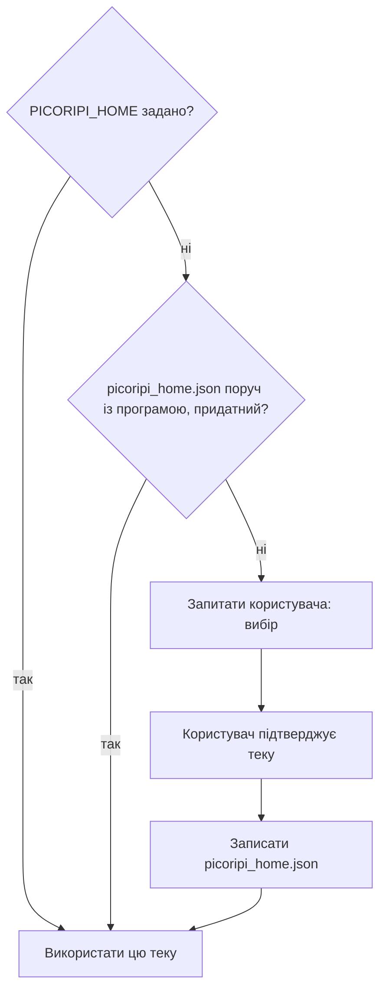

# Налаштування

**Мова:** [English](../4_Configuration_Guide.md) · Українська

Налаштування для користувача живуть у **Settings…** (`Ctrl+P`), `ui/settings_dialog.py`. На диску: `settings.json` у теці даних (див. [Де Picoripi зберігає ваші дані](#де-picoripi-зберігає-ваші-дані); не комітити). Необов’язковий `.env` читається на старті (`core/settings_manager.py` + `python-dotenv`) для змінних ключів API.

Тут — **контролі, як їх показує UI**, потім файли, куди вони зберігаються.

---

## Вкладки Settings

### Global

| Контроль | Нотатки |
|----------|---------|
| Theme (requires restart) | Auto, Light, Dark. Зміна показує “A restart is required to apply the new theme.” |
| Active Game Plugin | Знаходиться з `plugins/*/config.json`. Зміна потребує перезапуску |
| Application Font Size | 6–24, типово 10 |
| Tooltip Font Size | 6–32, типово 11 |
| External Tool/Script Path | `.bat` / `.cmd` / `.exe` — кнопка тулбара `>_` |
| Wiimms ISO Tool (wit.exe) Path | Необов'язковий шлях до `wit.exe` для автовилучення повідомлень з образів GameCube/Wii ISO |
| Show special spaces as dots | |
| Space Dot Color | |
| Restore unsaved session on startup | Якщо знято — незбережені зміни викидаються при закритті |
| Show prompt editor before AI requests | |
| Enable Live Preview (turn off to reduce lag) | Також **View → Preview** |
| Enable Real-Time Warning Scan (turn off to reduce lag) | |
| Enable Glossary System (turn off to reduce lag) | |
| Show archive size warnings | Запакований архів більший за оригінал |
| Auto-Sleep Idle Delay (minutes) | 1–60, типово 5. Простій після завершеної задачі перед сном |

### Project (лише з відкритим проєктом)

Підвкладки:

| Підвкладка | Роль |
|------------|------|
| File Paths | **Directory Mode (Load from folder)**, **Auto-generate translation path**, шляхи Original / Changes, Original Fonts Directory Path, Fonts Directory Path, **Reference Translation / ROM Path** (тека референсного патчу, розпакований ROM або образ `.iso`) |
| Display | Default Font for Project, wrap preview, wrap editors, Newline Symbol + стиль, Tag Style |
| Rules | Game Dialog Max Width (px), Editor Line Width Warning (px), Show guideline, Lines Per Page. Для `zelda_bmg`: **Window limit mode** — Shared for all windows vs Separate by window type (ліміти зберігаються в `plugins/<плагін>/window_layouts.json` у вашій теці даних; файл самого плагіна — типові значення) |
| Context Tags | Власні insert/wrap-теги для меню редактора |
| Tag Aliases | аліас ↔ оригінальний тег; **File → Reload Tag Mappings from Settings** |
| Font Map | Ширини гліфів |
| Detection | Чекбокси по id проблем з `get_problem_definitions()` |
| Auto-fix | Які з цих id може застосовувати Auto-fix |

Зміна Rules позначає rescan.

### Spelling

Enable spell checking · Dictionary Language · **Manage Dictionaries…** (завантажити/прибрати словники Hunspell; слова з Spellcheck → Add to Dictionary).

### AI Translation / AI Glossary

Див. [11. AI-переклад](11_AI_Translation.md). Ключі — у Settings або `.env`, ніколи в git.

Типовий конфіг (`build_default_translation_config`): provider `disabled`, workers `6`, OpenAI env `OPENAI_API_KEY`, Gemini env `GEMINI_API_KEY`, таймаут OpenAI 60 с, Gemini 120 с.

### Companion

Підключення до бекенда мобільного перегляду глосарія. Див. [12. Picoripi Companion](12_Picoripi_Companion.md).

| Контроль | Нотатки |
|----------|---------|
| Companion Server URL | Адреса сервісу Companion (наприклад `http://127.0.0.1:8000` або IP сервера) |
| API Token / PIN | Токен автентифікації (`companion_api_token`) |
| Test Connection | Перевірка доступності сервера та валідності токена |
| Automatically sync on project open and close | Фоновий авто-pull при відкритті проєкту; авто-push при збереженні/виході |

### Ключі консолей

Файл ключів кожної консолі: 3DS, Switch, Wii і бібліотека Oodle. Picoripi зберігає лише шлях до кожного файлу. Вона ніколи не показує, не записує в журнал і не копіює вміст ключів. **Огляд...** задає шлях, а **Очистити** його забуває. Рядок стану показує, чи збережений файл ще є. Майстер Менеджера проєктів питає файл ключа, якого немає, і зберігає його тут. Зміни діють одразу.

### Logging

| Контроль | |
|----------|--|
| Enable Console Logging | |
| Enable File Logging | |
| Log AI Traffic to File (`ai_traffic.log`) | Пишеться в теку даних (`ai_traffic.log`) у форматі JSON Lines: один запис на запит, відповідь чи помилку зі спільним `request_id`, номером фрагмента, спробою, розмірами й тривалістю, плюс підсумок на кожен запуск. При 8 МБ переноситься в `ai_traffic.log.1`, а не очищається |
| Log File Path | порожньо → `app_debug.txt` |

Категорії: general, lifecycle, file_ops, settings, ui_action, ai, scanner, plugins.

---

## Де Picoripi зберігає ваші дані

Коли Picoripi запускається вперше, він питає, де зберігати свої дані. Тека даних містить налаштування, список Менеджера проєктів, серійні глосарії, дані плагінів і кеші. Picoripi ніколи не обирає теку сам: теку підтверджуєте ви.

- Угорі вікна список **Language** обирає мову інтерфейсу. Спершу в ньому мова системи, якщо Picoripi її має, інакше англійська; вікно перемикається одразу. Вибір зберігається як `ui_language` у `settings.json` обраної теки; скопійовані старі налаштування зберігають свою мову, якщо ви не змінили список. Пізніше мову змінює меню **Language**.
- Запропонована тека — `data` поруч із програмою. Вона портативна: якщо перенести теку програми, дані переїдуть разом із нею.
- Можна обрати іншу теку. Можна також далі користуватися старим профілем `~/.picoripi`. Копіювання старих даних необов’язкове. Стара тека ніколи не змінюється і не видаляється.
- Змінити теку можна пізніше: **Settings → Global → Data folder → Data location…**. Picoripi копіює дані в нову теку. Щоб використати її, перезапустіть Picoripi.
- Є два явні перевизначення: змінна середовища `PICORIPI_HOME` і файл `picoripi_home.json` поруч із програмою (його записує вибір при запуску).
- Git: кожна тека даних отримує `.gitignore` з рядком `*`. Git тоді пропускає теку, навіть усередині репозиторію. Якщо обрана тека є в репозиторії Git, який її не ігнорує, вибір спершу запитає. Типова дія — **Записати .gitignore**. Файли поза текою даних не змінюються.

Журнал `app_debug.txt` лишається поруч із програмою, якщо **Log File Path** не вказує інший файл. Короткочасні тимчасові файли використовують системну теку тимчасових файлів.

---

## Файли поруч із програмою

| Файл | Роль |
|------|------|
| `settings.json` | Глобальні + останній плагін + пресети AI + `ui_language` + `companion_server_url`/`token`/`auto_sync`. Локальний; не в git |
| `locales/en.json` | Англійський каталог UI (ключ = англійське джерело) |
| `locales/uk.json` | Український каталог UI. Новий `tr("...")` у коді одразу додає сюди той самий ключ |
| `.env` | Необов’язково `OPENAI_API_KEY`, `GEMINI_API_KEY`, … |
| `session` / `.picoripi_session.json` | Фільтри UI, навігація, незбережені правки, undo. **Show Unsaved Only** при відновленні примусово вимикається |
| `session_state.json` у теці даних | Розгорнуті вузли дерева, вибір і курсор для кожного проєкту (старий `session_state.json` у теці програми читається один раз) |
| `project_manager.json` у теці даних | Список Менеджера проєктів: додані проєкти, їх папки, вибір групування і сортування, команда емулятора для кожної платформи (`emulator_command.<platform>`; `emulator_command` — давніша спільна команда). Записується атомарно. Файл, який не вдається прочитати, зберігається як `.unreadable` |
| `project_index.json` у теці даних | Кеш Менеджера проєктів: остання картка і підрахунок рядків кожного проєкту. Можна видалити; відновлюється при наступному відкритті |
| `project.uiproj` | Запис проєкту: ім’я, тека плагіна, шляхи source/translation, закладки, `reference_patch_path` |
| `config.json` плагіна | Типові значення для цієї гри, зокрема `default_tag_mappings` (аліас ↔ тег; плагіни Покемонів містять короткі аліаси, наприклад `{PLAYER}`) |
| `aliases.json` плагіна | Додаткові аліаси тегів |
| `translation_prompts/` | JSON промптів для Edit Prompts JSON / пайплайну глосарія |

---

## Чого не робити

- Не комітьте `settings.json`, `.env`, файли сесії чи ключі API.
- Не змінюйте **Active Game Plugin** і не чекайте завантаження BMG без перезапуску.
- Не спрямовуйте External Tool на збірку, яка читає незбережені буфери — спочатку Save.
- Не ставте в прикладах вікі чи README абсолютні шляхи машини.

Щоб заповнити український каталог (або пізніше інші мови): запустіть Gemini Web2API, потім `tools/i18n-translate/run.bat`. У вікні оберіть мови; **Ukrainian увімкнений типово**. Коли в каталозі вже є переклад, мова з’являється в **Language**; назва — з `@language_name` у тому JSON. Відсутні рядки лишаються англійськими.
