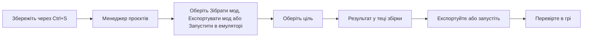

# Зібрати мод і перевірити його в грі

**Мова:** [English](../Build_and_Test.md) · Українська

Ця сторінка показує, як зробити мод із збереженого перекладу. Вона також показує, як перевірити мод. Читайте її, коли переклад збережено і ви хочете побачити його в грі.

Picoripi не встановлює емулятори. У програмі немає списку емуляторів. Ви встановлюєте емулятор і вказуєте Picoripi команду для його запуску.

## Терміни

| Термін | Значення |
|---|---|
| Збірка | Створення моду зі збережених файлів. Результат іде в `build\<ціль>` |
| Ціль | Один тип результату, який гра може створити. Кожна гра має свій список цілей |
| Експорт | Копіювання збірки в теку, яку ви вибираєте |
| Запустити в емуляторі | Зібрати мод і запустити емулятор із результатом |
| Команда емулятора | Рядок, який запускає емулятор, наприклад `"C:\Emu\emu.exe" {path}` |

## Перед збіркою

Збірка читає файли на диску. Вона не читає редактор. Спершу натисніть `Ctrl+S`. Рядок, який не збережено, не потрапляє в мод.

## Кроки: зібрати мод

1. Відкрийте Менеджер проєктів: **Файл → Менеджер проєктів...** (`Ctrl+Shift+M`).
2. Натисніть стрілку ліворуч від рядка вашого проєкту. Рядок розгорнеться.
3. Натисніть **Зібрати мод**. Меню покаже цілі гри.
4. Натисніть ціль. Рядок стану покаже **Працюю...**, потім відсоток.
5. Прочитайте результат. **Зібрано: <шлях>** означає успіх. **Помилка: <причина>** означає помилку.

Якщо для гри немає цілі, кнопка **Зібрати мод** вимкнена. Наведіть курсор на кнопку, щоб прочитати причину.

## Цілі

Список цілей визначає плагін гри. Ціль має один із трьох типів:

| Тип | Що ви отримуєте | Типове використання |
|---|---|---|
| **files** | Теку окремих файлів гри | Порт або гра, яка читає окремі файли |
| **patch** | Змінену копію файлу гри, наприклад образ диска або ROM | Dolphin, емулятор DS, диск |
| **layeredfs** | Теку моду для завантажувача | Atmosphere, Luma, Cemu, SDCafiine |

Результат іде в `build\<ціль>` у теці проєкту. Кожна ціль має свою теку. Нова збірка тієї самої цілі замінює старий результат. Щоб зберегти старий результат, спершу експортуйте його.

Приклади. Назва в колонці — це текст, який ви бачите в меню.

| Плагін | Назва цілі | Платформа | Тип |
|---|---|---|---|
| `zelda_tww` | Образ диска (ISO) | `gc` | patch |
| `zelda_tww` | Диск для BlueWake (оригінальний main.dol) | `bluewake` | patch |
| `super_mario_sunshine` | Образ диска GameCube (ISO) | `gc` | patch |
| `super_mario_sunshine` | Пакет для портів PC і Switch (mods/uk) | усі | layeredfs |
| `zelda_bmg` | Мод для Dusklight (.dusk, потрібен оригінальний диск) | `gc` | patch |
| `zelda_bmg` | Графічний пакет Wii U і тека SDCafiine (HD) | `wiiu` | layeredfs |
| `zelda_ww` | **Cemu graphic pack** | `wiiu` | layeredfs |
| `pokemon_nx` | Switch: мод LayeredFS для Atmosphere | `switch` | layeredfs |
| `pokemon_gen5` | Перекладений ROM DS | `nds` | patch |
| `zelda_las` | **LAS Recomp (romfs.bin)** | `switch` | files |
| `okami_wii` | Wii: змінені записи повідомлень (файли) | `wii` | files |

Деякі назви ще не мають українського тексту. Вони показані англійською.

## Експорт

1. Натисніть **Експортувати мод**. Оберіть ціль.
2. Оберіть теку. Використайте порожню теку або нову.
3. Дочекайтеся **Експортовано до <шлях>**.

Якщо в теці вже є файли, експорт зупиниться з повідомленням про непорожню теку. Оберіть іншу теку.

## Команда емулятора

Задайте команду один раз для кожної платформи.

1. У Менеджері проєктів натисніть **Емулятор...**. Вікно називається **Команди емуляторів**.
2. Введіть команду в рядку кожної платформи, яку ви використовуєте. Напишіть `{path}` там, куди має йти результат.
3. Натисніть **OK**. Порожній рядок означає, що для платформи немає команди.

Приклад: `"C:\Emu\emu.exe" {path}`. Візьміть шлях із пробілами в лапки.

- Picoripi замінює `{path}` на шлях до результату. Якщо `{path}` не написано, Picoripi додає шлях у кінець.
- Picoripi запускає емулятор і не чекає, поки той закриється.
- Емулятор стартує в своїй теці.
- Якщо рядок порожній, **Запустити в емуляторі** вимкнено для цієї платформи.

## Хід роботи, помилки й попередження

- Рядок стану в рядку проєкту показує роботу. Він показує **Працюю...**, потім крок і відсоток.
- **Помилка: <причина>** називає проблему. Виправте те, що названо в причині. Потім зберіть знову.
- Збірка може завершитися з попередженнями. Рядок стану показує **Зібрано: <шлях> (N попереджень: ...)** і перше попередження.
- Усі попередження є у файлі `BUILD_WARNINGS.txt` у теці результату.
- Повний журнал є в журналі програми. Шлях до файлу журналу — у **Налаштування → Журнал**.
- У Менеджері проєктів немає кнопки скасування збірки. Закриття Менеджера зупиняє збірку.

## Прапорці Зібрано і Перевірено в грі

У кожному рядку проєкту є два прапорці: **Зібрано** і **Перевірено в грі**. Їх ставите тільки ви. Picoripi їх ніколи не змінює. Це ваші власні позначки. **Зібрано** означає, що ви зібрали мод. **Перевірено в грі** означає, що ви перевірили його в грі.

## Кнопка «Зібрати ROM»

Кнопка **Зібрати ROM** на панелі інструментів збирає відкритий проєкт плагіном гри. Спершу вона зберігає ваші зміни. Якщо гра має кілька цілей збірки, кнопка питає, яку обрати. Рядок стану показує хід збірки. Повідомлення дає шлях до результату й перше попередження.

## Запустити зовнішній скрипт

Кнопка **>_** праворуч на панелі інструментів запускає вашу зовнішню утиліту або скрипт. Шлях до неї задається в **Налаштування → Загальні → Шлях до зовнішньої програми/скрипту**. Ця кнопка не збирає мод.

## Як перевірити для кожної платформи

Спершу перевірте в емуляторі. На реальному обладнанні перевіряйте тільки тоді, коли тест в емуляторі працює.

- **GameCube і Wii (Dolphin).** Зберіть ціль образу диска (patch). Задайте команду Dolphin для `gc` або `wii`. Натисніть **Запустити в емуляторі**. Перевірка на обладнанні: на цій сторінці не перевірено.
- **3DS (Azahar або Citra).** Зберіть ціль для 3DS (layeredfs). Задайте команду Azahar або Citra для `3ds`. На обладнанні потрібна тека LayeredFS для Luma на SD-карті. Шлях до теки перевірте в посібнику Luma. На цій сторінці не перевірено.
- **Switch (емулятор або обладнання).** Задайте команду вашого емулятора Switch для `switch`. На обладнанні скопіюйте мод layeredfs на SD-карту для Atmosphere. Структуру тек перевірте в теці результату. На цій сторінці не перевірено.
- **Wii U (Cemu і SDCafiine).** Зберіть ціль **Cemu graphic pack**. Скопіюйте результат до теки графічних пакетів Cemu. Для SDCafiine скопіюйте HD-теку на SD-карту, як сказано в його посібнику.
- **Порти для PC і рекомпіляції.** Зберіть ціль порту, наприклад **Пакет для портів PC і Switch (mods/uk)** або **LAS Recomp (romfs.bin)**. Скопіюйте результат до теки, яку читає порт. Прочитайте посібник порту.
- **Інші платформи.** Оберіть ціль з назвою вашої платформи. Задайте її команду емулятора. Перевірено не для кожної платформи.

## Типові ситуації

- **Зібрати мод вимкнено.** Для гри ще немає цілі. Наведіть курсор на кнопку, щоб прочитати причину.
- **Запустити в емуляторі вимкнено.** Задайте команду емулятора для цієї платформи через **Емулятор...**.
- **Збірка не вдалася.** Прочитайте **Помилка: <причина>**. Виправте те, що названо. Зберіть знову.
- **Моя остання зміна не в моді.** Збережіть через `Ctrl+S`. Зберіть знову. У збірку потрапляють тільки збережені файли.
- **Потрібні дві версії.** Експортуйте першу збірку в її власну порожню теку. Потім зберіть другу.
- **Емулятор не запустився.** Рядок стану показує "Емулятор не запустився". Перевірте шлях до програми в команді.
- **Збірка має попередження.** Відкрийте `BUILD_WARNINGS.txt` у теці результату. Виправте рядки, які там названо. Зберіть знову.
- **Збірка довга.** Велика гра збирається хвилинами. Відсоток показує хід роботи. Не закривайте Менеджер.
- **Мод працює в емуляторі, але не на обладнанні.** Порівняйте структуру тек із посібником вашого завантажувача. Picoripi записує файли моду. Завантажувач налаштовуєте ви.

## Пов'язані сторінки

- [Початок роботи](0_Getting_Started.md), розділ 17
- [Менеджер проєктів](Project_Manager.md)
- [Шрифти і текстури](Fonts_and_Textures.md)
- [Усунення несправностей](Troubleshooting.md)
- [Налаштування](4_Configuration_Guide.md)

<!-- wiki-nav -->
---

**Назад:** [Шрифти і текстури](Fonts_and_Textures.md) · [До змісту вікі](README.md) · **Далі:** [Спільна робота і прогрес](13_Working_Together.md)
