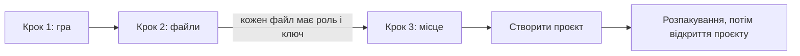

# Новий проєкт: усі види ігор

**Мова:** [English](../New_Project_Scenarios.md) · Українська

Ця сторінка описує майстер нового проєкту. Читайте її, коли додаєте гру вперше. Тут сказано, що потрібно
кожному виду файлів гри і що робити, якщо майстер зупинився.

## Майстер у три кроки

## Запуск майстра

1. Натисніть **+ Додати проєкт → Новий проєкт...** у [Менеджері проєктів](Project_Manager.md).
2. Або натисніть **Файл → Новий проєкт** (`Ctrl+N`) у головному вікні.

Майстер має кнопки **Назад**, **Далі** і **Скасувати**.

## Крок 1. Гра

1. Введіть частину назви гри в полі **Гра**.
2. Оберіть гру зі списку.
3. Перевірте **Назва проєкту**. Вона заповнюється сама. За потреби змініть її.
4. Натисніть **Далі**.

## Крок 2. Файли

1. Натисніть **Додати файли...** для файлів гри. Додайте базову гру, її оновлення і DLC у будь-якому порядку.
2. Або натисніть **Додати папку...** для гри, яку вже розпаковано. Виберіть теку.
3. Перевірте **Платформу** і **Роль** кожного файлу. Picoripi визначає їх сам. Якщо значення неправильні, змініть їх у списках.
4. Натисніть **Далі**, коли в списку немає проблем.

Ролі: **Base game** (базова гра), **Update** (оновлення) і **DLC** (додатковий вміст). Повторюватися може лише DLC.
Для Switch і 3DS роль визначає ідентифікатор гри у файлі.

Щоб дати роль багатьом файлам одразу:

1. Виділіть рядки (`Shift` або `Ctrl`).
2. Оберіть роль у полі **Роль для виділених файлів:**.
3. Натисніть **Застосувати**.

Кнопка **Прибрати вибрані** видаляє файл зі списку. Сам файл на диску не видаляється.

## Крок 3. Місце

1. Перевірте поле **Тека проєкту**. Picoripi пропонує `Документи\Picoripi\<назва проєкту>`.
2. Натисніть **Огляд...**, щоб обрати іншу теку.
3. Прочитайте підсумок. Він показує, куди піде файл проєкту, розпаковані файли і переклад.
4. Натисніть **Створити проєкт**.

У теці проєкту лежать `project.uiproj`, тека `unpacked`, тека `translation` і тека `build`.
Оригінальні файли гри не копіюються. Проєкт зберігає їхні шляхи.

## Джерела гри

| Джерело | Що додати | Що питає майстер |
|---|---|---|
| Образ диска GameCube або Wii (ISO, WIA, RVZ) | Файл образу | Файл Wii із зашифрованим вмістом потребує `keys.bin` |
| Гра Switch (NSP, NSZ, XCI) | Файли базової гри, оновлення і DLC | Зашифровані файли потребують `prod.keys` |
| Гра 3DS (CIA, 3DS, CCI, CXI та інші: див. [Образи 3DS](#образи-3ds)) | Файли | Зашифровані файли потребують `aes_keys.txt` |
| Розпакована гра | **Додати папку...** | Нічого, якщо теку можна прочитати |
| Гра для ПК | Тека гри через **Додати папку...** | Залежить від плагіна гри |

**Switch з оновленням і DLC:** додайте всі три види файлів. Перевірте кожну роль. Базова гра і оновлення мають
по одному файлу. DLC можна додати скільки потрібно.

**Switch XCI:** перевірено не для всіх випадків. Якщо майстер відхиляє зашифрований XCI, використайте розпаковану
теку або файл NSP чи NSZ.

**3DS, зашифрований:** ролі беруться з ідентифікатора. Файлу потрібен `aes_keys.txt`. Розшифровані файли ключа не потребують.

**Розпакована тека:** додайте тільки теку. Теку не можна змішувати з іншими джерелами. Спершу приберіть інші файли.

## Образи 3DS

Picoripi читає ці файли 3DS. Ідентифікатор гри у файлі визначає роль: `00040000` означає базову гру, `0004000E`
оновлення, `0004008C` DLC.

| Файл | Що це | Ключ | Результат |
|---|---|---|---|
| `.3ds`, `.cci` | Образ картриджа гри | Лише якщо зашифрований | Читається |
| `.cia` | Образ встановлення: базова гра, оновлення або DLC | Лише якщо зашифрований | Читається |
| `.cxi`, `.ncch` | Образ однієї програми | Лише якщо зашифрований | Читається |
| `.cfa` | Файл вмісту, наприклад посібник | Лише якщо зашифрований | Читається як програма. Посібник не є грою. |
| `.app` | Файл вмісту зі сховища консолі | Лише якщо зашифрований | Читається як `.cxi` |
| `.zcia`, `.zcci`, `.zcxi`, `.z3ds` | Стиснений образ Azahar або Citra (zstd) | Як у образі всередині | Читається розпакованим. Потрібен zstd: Python 3.14 або пакет `zstandard`. |
| `.3dsx` | Програма homebrew | Немає | **Відхиляється.** У ній немає ігрового тексту. |
| Тека | Розпаковані `exefs` і `romfs` | Немає | Використовується як є, якщо плагін її приймає |

**Оновлення і DLC.** Майстер читає їх як файли гри:

- Гра, чий плагін має власне розпакування, читає файли, які просить її плагін. Деякі плагіни читають оновлення, наприклад Pokémon Sun і Moon; інші читають лише базову гру.
- Гра без власного розпакування отримує увесь образ кожного файлу: спершу базову гру, потім оновлення, потім DLC. Пізніший файл замінює файл з тим самим шляхом. Тож файли оновлення замінюють файли базової гри так, як їх читає консоль.

**Відхиляється, причина видна в колонці Статус:**

- Файл `.3dsx`: homebrew, а не гра.
- Зашифрований файл без файлу ключів або файл ключів, який його не розшифровує.
- Титул із вбудованим ключем (його ключ вшито в програму): поки не читається.
- Стиснений образ, який пошкоджено, або якому потрібен пакет zstd, що його Picoripi не знаходить.

## Файли ключів

Деякі файли гри зашифровано. Тоді майстер просить файл ключів консолі. Типове джерело і файл ключів кожної консолі
описано в розділі [Ключі консолей](4_Configuration_Guide.md#ключі-консолей).

## Наявна тека перекладу

Використовуйте цю опцію, якщо тека перекладу вже є, наприклад з іншої копії проєкту.

1. Позначте **Використати наявну теку перекладу**.
2. Натисніть **Огляд...** і виберіть **Наявна тека перекладу**.
3. Створіть проєкт. Тека використовується як є. Picoripi не змінює її файли.

Гра з одного файлу не може використовувати цю опцію. Вимкніть її і створіть проєкт знову.

## Типові ситуації

**Кнопка Далі неактивна.**
- У списку файлів є проблема. Прочитайте червоний текст під списком. Виправте кожен рядок.

**Файл має статус Не читається: додайте папку.**
- Плагін гри не вміє розпакувати цей вид файлу. Приберіть файл. Розпакуйте гру самі, потім натисніть **Додати папку...**.

**Файл має статус Ця гра не розпізнає файл.**
- Плагін не знає цього файлу. Перевірте, чи ви обрали правильну гру на кроці 1.

**Два файли мають роль Base game.**
- Кожен файл потребує власної ролі. Повторюватися може лише DLC. Змініть роль в одному з файлів.

**Платформа показує Не визначено.**
- Оберіть платформу у списку в рядку файлу. Picoripi не зміг прочитати її з файлу.

**Створити проєкт каже: У цій теці вже є проєкт.**
- У теці проєкту вже є `project.uiproj`. Оберіть іншу теку. Щоб використати старий проєкт, натисніть **Додати наявний проєкт...** у Менеджері.

**Майстер показує Недостатньо вільного місця.**
- Диску бракує місця для розпакованих файлів. Повідомлення показує потрібний і вільний обсяг. Звільніть місце на цьому диску або оберіть іншу теку проєкту.

**Я натиснув Скасувати розпакування.**
- Майстер прибирає все, що встиг створити. Повідомлення каже: **Розпакування скасовано. Нічого не створено.** Почніть знову, коли будете готові.

**Розпакування не вдалося.**
- Повідомлення показує причину. Майстер прибирає створене. Усуньте причину і створіть проєкт знову.

**Розпакування триває довго.**
- Велика гра розпаковується кілька хвилин. Дочекайтеся завершення смуги прогресу. Не закривайте Picoripi.

**Я помилився на кроці 2.**
- Натисніть **Назад**. Змініть список. Натисніть **Далі** знову.

**Я обрав не ту гру.**
- Натисніть **Назад** до кроку 1 і оберіть правильну гру. Потім перевірте файли знову.

**У проєкту немає значка гри.**
- Picoripi читає значок лише для ігор 3DS і GameCube. Для інших ігор натисніть **Змінити значок...** у Менеджері проєктів.

**Скасувати весь майстер.**
- Натисніть **Скасувати**. Якщо розпакування триває, його спершу зупинять.

## Пов'язані сторінки

- [Менеджер проєктів](Project_Manager.md)
- [З чого почати](0_Getting_Started.md)
- [Підтримувані ігри](Supported_Games.md)
- [Посібник з налаштувань](4_Configuration_Guide.md)
- [Вирішення проблем](Troubleshooting.md)

<!-- wiki-nav -->
---

**Назад:** [Менеджер проєктів](Project_Manager.md) · [До змісту вікі](README.md) · **Далі:** [Переклад у редакторі](Editor_Basics.md)
