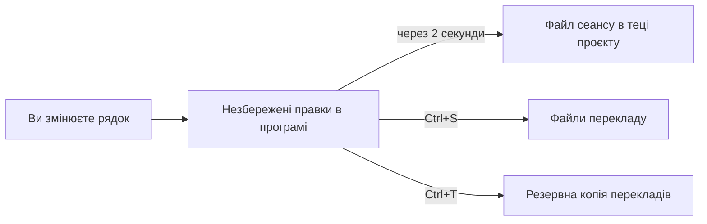

# Збереження, скасування, резервні копії та відновлення

**Мова:** [English](../Saving_and_Recovery.md) · Українська

Ця сторінка пояснює, куди йдуть ваші правки, як їх зберегти і як повернути. Прочитайте її перед тим, як відкочувати текст, закривати проєкт або переносити проєкт на інший комп'ютер.

## Що записує Ctrl+S

1. Натисніть `Ctrl+S` або виберіть **Файл → Зберегти зміни**.
2. Picoripi записує кожен блок, де є зміни. Питання не ставиться.
3. Якщо змін немає, нічого не відбувається.

| Режим | Куди пише Ctrl+S |
|---|---|
| Проєкт | Файл перекладу кожного блоку. Файли лишаються в теці перекладів проєкту. |
| Один файл | Файл `_edited` поруч з оригінальним файлом. Назва: `<назва>_edited.<розширення>`. |

Picoripi ніколи не змінює оригінальні файли. У режимі проєкту він пише лише в теку перекладів. В режимі одного файлу він пише лише у файл `_edited`.

Архіви: блок усередині архіву розпаковується у тимчасове сховище, редагується і пакується знову в теку перекладів. Якщо новий архів більший за оригінал, Picoripi показує попередження про розмір. Архів усе одно зберігається. Великий проєкт показує хід збереження для кожного файлу.

## Автозбереження сеансу

- Через дві секунди після правки Picoripi пише `.picoripi_session` у теку проєкту. У режимі одного файлу він пише поруч з файлом `_edited`.
- Файл містить незбережений текст і кроки скасування.
- Кожні п'ять хвилин Picoripi також пише копію у форматі JSON: `.picoripi_session.json`.
- Коли ви знову відкриваєте проєкт, Picoripi читає новішу копію. Незбережений текст повертається.
- Файл сеансу не є збереженням. Змінює файли перекладу лише `Ctrl+S`.
- Не редагуйте ці файли вручну і не переміщуйте їх.

**Відновлювати незбережений сеанс під час запуску** (**Налаштування → Загальні**) керує окремою копією. Ця копія лежить у налаштуваннях програми. Picoripi читає її під час запуску. Типове значення в коді: вимкнено. Вимкнення цього параметра не зупиняє відновлення тексту з файлу сеансу проєкту, коли ви відкриваєте проєкт.

## Скасування і повторення

- `Ctrl+Z` скасовує. `Ctrl+Y` або `Ctrl+Shift+Z` повторює. У меню **Правка** є пункти **Скасувати введення** і **Повторити введення**.
- Історія скасувань одна на весь проєкт. Вона містить 500 кроків. Найстаріші кроки видаляються першими.
- Введення тексту в одному рядку є одним кроком. Новий крок починається, коли ви вводите інший тип символу, наприклад пробіл після літери.
- Перехід до іншого рядка також є кроком. Перше `Ctrl+Z` може повернути вас лише до попереднього рядка.
- Масова дія є одним кроком. Приклади: відкат, відновлення, вставка блоку, імпорт перекладів, AI-переклад.
- Скасування не охоплює заміни, зроблені у [розширеному пошуку](Search_Bookmarks.md). Див. ту сторінку.
- Файл сеансу зберігає історію скасувань, тому вона переживає аварію.

## Резервна копія перекладів

**Зберегти переклад** (`Ctrl+T`, **Правка → Зберегти переклад**) копіює переклад поточного рядка в файл резервної копії.

- Режим проєкту: `saved_translations.json` у теці проєкту.
- Режим одного файлу: `<назва>_saved_translations.json` поруч з файлом.

**Відновити переклад** (`Ctrl+Shift+T`, **Правка → Відновити переклад**) повертає текст резервної копії в поточний рядок.

У дереві блоків клацніть блок правою кнопкою, щоб побачити **Відновити переклад для «<назва блоку>»**. Клацніть правою кнопкою порожнє місце в дереві, щоб побачити **Відновити всі переклади**. Ця дія перезаписує поточні правки. Picoripi спершу питає.

## Відкат

Перед кожним відкатом Picoripi робить резервну копію. Копія містить лише ті переклади, які відрізняються від оригінального тексту.

| Дія | Де | Результат |
|---|---|---|
| **Скинути рядок до початкового** | Правий клік на одному рядку | Відкочує цей рядок. |
| **Повернути початковий варіант** | Правий клік на вибраних рядках | Відкочує вибрані рядки. |
| **Скинути ... до початкового** | Правий клік на блоках у дереві | Відкочує всі рядки цих блоків. |
| **Скинути розділ ... до початкового** | Правий клік на розділі | Відкочує всі рядки розділу. |
| **Скинути всі блоки до початкових** | Правий клік на порожньому місці в дереві | Відкочує всі блоки. |

Кожен відкат питає підтвердження. Прочитайте питання. Для одного рядка типова відповідь — **No** (ні).

**Повернути файл змін до оригіналу...** (меню **Файл**) перезаписує файли перекладу оригінальним текстом:

- Режим одного файлу: перезаписує файл `_edited`.
- Режим проєкту: перезаписує файл перекладу кожного блоку.
- Усі незбережені правки зникають. Резервна копія в `saved_translations.json` не створюється. Якщо старий текст потрібен, спершу скопіюйте теку перекладів.

**Перезавантажити оригінал** (меню **Файл**) знову завантажує оригінальні файли. Якщо є незбережені правки, програма питає першою. Ці правки губляться. Файли на диску не змінюються.

## Закриття, вихід і відкриття

- **Закрити проєкт** (меню **Файл**) спершу записує файл сеансу. Питання про збереження не з'являється. Незбережений текст лишається у файлі сеансу. Щоб продовжити, відкрийте проєкт знову.
- **Вихід** також не питає про збереження. Файл сеансу зберігає незбережений текст.
- Якщо відкрити інший файл, програма питає: **Save before opening new file?** Виберіть **Save**, **Discard** або **Cancel**.

## Експорт та імпорт

- **Експортувати переклади в JSON...** (меню **Файл**) записує поточні переклади у файл JSON. Використовуйте його як копію.
- **Імпортувати переклади з JSON...** завантажує переклади з файлу JSON в редактор. Picoripi зіставляє кожен рядок за файлом, блоком і позицією рядка. Імпортований текст стає незбереженим, доки ви не натиснете `Ctrl+S`. Один `Ctrl+Z` скасовує весь імпорт. Імпорт замінює поточний текст зіставлених рядків.

## Пам'ять перекладу

- **Оновити пам'ять перекладу з контекстом** (меню **Файл**) додає контекст до кожного рядка пам'яті перекладу. Picoripi зберігає копію старого файлу поруч з новим.
- **Повернути пам'ять перекладу до оновлення контексту** повертає цю копію.
- Файл пам'яті називається `translation_memory.json`. Він лежить поруч з резервною копією перекладів.

## Типові ситуації

- **Ctrl+S нічого не робить.** Незбережених змін немає. Picoripi нічого не записує.
- **Я втратив переклад.** Перевірте такі місця по черзі:
  1. Натисніть `Ctrl+Z` на рядку. Історія скасувань може мати потрібний текст.
  2. Натисніть `Ctrl+Shift+T` на рядку. Це відновить текст із резервної копії.
  3. Знову відкрийте проєкт. Файл сеансу може містити незбережений текст.
  4. Відкрийте копію JSON з **Експортувати переклади в JSON...**, якщо ви її зробили.
- **Програма аварійно закрилася.** Відкрийте проєкт знову. Перевірте текст. Коли текст правильний, натисніть `Ctrl+S`.
- **Файл сеансу не можна прочитати.** Picoripi відкриває проєкт за його файлами. Незбережений текст із файлу сеансу губиться. Зберігайте копії теки проєкту.
- **Я помилково відкотив текст.** Використайте **Відновити переклад** на рядку. Для багатьох рядків використайте **Відновити всі переклади**.
- **Хочу переписати переклад із початку.** Спершу скопіюйте теку перекладів. Потім використайте **Повернути файл змін до оригіналу...**.
- **Хочу закрити проєкт і скопіювати його теку.** Спершу закрийте проєкт. Так записується файл сеансу і останній стан. Потім копіюйте теку.
- **Я переніс проєкт на інший комп'ютер.** Скопіюйте:
  - файл проєкту (`.uiproj`) і теку проєкту;
  - теку перекладів;
  - теку з оригінальними файлами.
  На іншому комп'ютері встановіть той самий плагін гри. Шляхи, які збережено в проєкті, мають існувати там. Якщо теки лежать в інших місцях, оновіть шляхи.
- **Я веду проєкт у Git.** Додавайте до Git:
  - файли перекладу;
  - файл проєкту;
  - `saved_translations.json` і `translation_memory.json`.
  Не додавайте `.picoripi_session`, `.picoripi_session.json`, `.picoripi_session.clean` і тимчасові файли `.tmp`. Перед великою заміною зробіть коміт. Тоді Git дасть точку, до якої можна повернутися.
- **Відкриття іншого файлу питає про мої зміни.** Натисніть **Save**, щоб їх зберегти, або **Discard**, щоб їх відкинути.

## Пов'язані сторінки

- [Пошук, заміна і закладки](Search_Bookmarks.md): пошук і заміна.
- [Основи редактора](Editor_Basics.md): редактор і список рядків.
- [Усунення несправностей](Troubleshooting.md): інші проблеми.

<!-- wiki-nav -->
---

**Назад:** [Пошук, заміна і закладки](Search_Bookmarks.md) · [До змісту вікі](README.md) · **Далі:** [Пайплайн локалізації](8_Localization_Pipeline.md)
