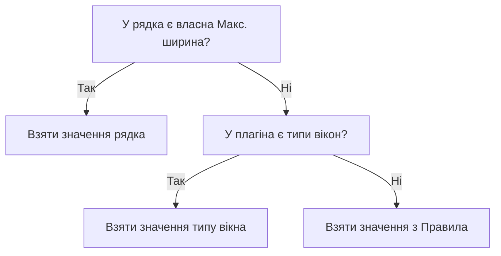

# Ширина рядків, шрифти й теги

**Мова:** [English](../Width_Fonts_Tags.md) · Українська

Ця сторінка пояснює, як Picoripi вимірює рядок. Тут сказано, як задати ширину й шрифт для одного рядка або для багатьох. Також тут описано теги. Читайте її, коли рядок занадто широкий або тег виглядає неправильно.

## Що означає ширина

Ширина — це кількість пікселів гри, які займає рядок. Picoripi вимірює кожну літеру за її власною шириною. Тому ширина не дорівнює кількості літер.

Рядок, ширший за вікно гри, виходить за межі вікна. Програма попереджає про це заздалегідь. Кожен видимий підрядок багаторядкового тексту вимірюється окремо.

## Де видно ширину

| Де | Що показує |
|---|---|
| Число праворуч від номера рядка в полі **Редагований** | Ширину цього рядка |
| Поле **Ширина** в рядку стану | Ширину тексту до курсора або виділеного фрагмента |
| **Макс. ширина** над полем **Оригінал** | Ширину найширшого рядка оригіналу |

## Задати ширину одного рядка

1. Виберіть рядок у списку **Рядки в блоці**.
2. У полі **Макс. ширина** введіть число пікселів. Нуль означає типове значення плагіна.
3. Натисніть **Застосувати**. Кнопка активна, лише коли є незастосована зміна.

Ширина, задана для одного рядка, встановлює і межу попередження, і жорстку межу.

Права кнопка миші на полі **Макс. ширина**:

| Пункт | Результат |
|---|---|
| **Скинути до типового значення плагіна** | Прибирає власну ширину рядка |
| **Встановити ширину як у оригіналі** | Вписує ширину найширшого рядка оригіналу. Потім натисніть **Застосувати** |

Клацніть число **Макс. ширина** над полем **Оригінал**, щоб скопіювати його в поле.

Щоб задати шрифт для одного рядка, виберіть його в полі **Шрифт** над **Редагований** і натисніть **Застосувати**. Шрифт діє лише на цей рядок.

## Задати ширину або шрифт для багатьох рядків

1. Виділіть кілька рядків у списку **Рядки в блоці**.
2. Натисніть правою кнопкою миші й виберіть **Встановити ширину для кількох рядків** або **Встановити шрифт для кількох рядків**.
3. Введіть значення. Позначте **Автоширина від оригіналу**, щоб взяти ширину кожного рядка з його оригіналу.
4. Натисніть **За замовчуванням**, щоб скинути значення.

## Межі для проєкту

Відкрийте **Файл → Налаштування (`Ctrl+P`) → Проєкт → Правила**. Вкладка **Проєкт** з'являється, лише коли відкрито проєкт.

| Поле | Що означає | Типове значення |
|---|---|---|
| **Game Dialog Max Width (px):** | Жорстка межа. Підрядок ширший за неї — проблема | 300 |
| **Editor Line Width Warning (px):** | Редактор позначає ширину як завелику, починаючи з цього значення | 280 |
| **Рядків на сторінку:** | Скільки рядків вміщує одне вікно гри | 4 |
| **Показати направляючу** | Малює у редакторі вертикальну лінію на межі ширини | Увімкнено |

Натисніть **OK**. Програма пересканує всі рядки. З'явиться повідомлення «Правила оновлено. Повторне сканування всіх проблем...».

## Типи вікон

Деякі плагіни мають кілька видів вікон повідомлень. Один із них — Zelda: Twilight Princess. На вкладці **Правила** для них є **Режим ліміту вікон**:

- **Спільне для всіх вікон** — одні значення на всю гру. Група називається **Спільні параметри за замовчуванням**.
- **Розділяти за типом вікна** — таблиця **Типові значення за типом вікна**. Її колонки: **Тип вікна**, **Попередження**, **Найбільша** і **Lines**.

Тип вікна береться з даних повідомлення. Значення **Попередження** не може бути більшим за **Найбільша**. Якщо так, програма показує помилку й не зберігає таблицю.

## Яке значення бере програма

Порядок такий:

1. Власна ширина рядка з поля **Макс. ширина**.
2. Значення для типу вікна, якщо плагін має типи вікон.
3. Значення з **Правила**.

## Карта шрифту

Ширини літер містяться в **Налаштування → Проєкт → Карта шрифту**.

- Таблиця має два стовпці: **Символ або послідовність** і **Ширина (пікселі)**.
- **Додати персонажа** додає порожній рядок. **Видалити персонажа** видаляє вибраний рядок.
- Поле **Фільтр персонажів:** шукає в таблиці. Змініть ширину й натисніть **OK**. Програма перерахує всі попередження.

Програма зберігає карту в теку даних. Файл плагіна в `plugins/` вона не змінює.

Літера, якої немає в таблиці, у редакторі вважається завширшки 8 пікселів. Додайте її з реальною шириною.

## Типовий шрифт

Перейдіть до **Налаштування → Проєкт → Відображення**. Поле **Типовий шрифт для проєкту:** вибирає файл шрифту для проєкту. Список містить файли шрифтів з теки плагіна та з вашої теки власних шрифтів. Перший пункт — **Немає**.

На цій вкладці є й інші налаштування:

| Налаштування | Значення |
|---|---|
| **Переносити рядки у панелі перегляду** | Переносить довгі рядки в перегляді |
| **Переносити рядки в панелях редактора** | Переносить довгі рядки в редакторах |
| **Символ нового рядка:** | Знак, яким показано розрив рядка |
| **Стиль символу нового рядка:** | Колір, **Жирний**, **Курсив**, **Підкреслений** для символу розриву |
| **Стиль тегів:** | Колір, **Жирний**, **Курсив**, **Підкреслений** для тегів |

## Літери, яких немає в шрифті

Нова літера може бути відсутньою в шрифті гри. Зробіть так:

1. Додайте літеру в **Карту шрифту** з її шириною. Інакше програма бере 8 пікселів.
2. Відкрийте редактор шрифтів з панелі інструментів. Намалюйте або змініть гліф літери.
3. Пересканувати все клавішами `Ctrl+Shift+R`.

Про файли шрифтів і текстури див. [Шрифти й текстури](../Fonts_and_Textures.md).

## Теги

Теги, наприклад `{boxatleast:30}`, керують грою. Вони задають колір, паузу й ім'я героя. Залишайте їх на місці. Редактор показує їх сірим або оранжевим кольором.

- **Сховати теги** (`Ctrl+Q` або **Вигляд → Сховати теги**) ховає теги в усіх панелях. Збережений текст не змінюється.
- Щоб вставити тег, клацніть правою кнопкою в полі **Редагований**. Без виділення меню вставляє один тег. З виділенням тег обгортає виділений текст.
- Теги для цього меню задаються в **Налаштування → Проєкт → Теги контексту**:
  - **Окремі теги (ПКМ без виділення)** має колонки **Вигляд (емодзі або код)** і **Тег**.
  - **Обернути тегами (ПКМ при виділенні)** має колонки **Вигляд (емодзі або код)**, **Початковий тег** і **Кінцевий тег**.
  - Кнопки: **Додати рядок** і **Видалити рядок**. Зміни діють після **OK**.
- **Псевдоніми тегів** дають тегові зрозумілу назву. Наприклад, `{F:Link}` замість `{escape:0:0000}`. Колонки: **Псевдонім (наприклад, {F:Link})** і **Справжній тег (наприклад, {escape:0:0000})**. Ширина рядка все одно рахується за справжнім тегом.
- Ширина рядка все одно рахується за справжнім тегом.

## Типові ситуації

**Рядок занадто широкий, хоча виглядає коротким.**
- Деякі літери ширші, ніж здається.
- Перевірте в **Карті шрифту** літери цього рядка.
- Додайте відсутню літеру з її реальною шириною.

**Попередження не зникає після зміни ширини або карти шрифту.**
- Натисніть **Пересканувати все** (`Ctrl+Shift+R`).
- Робіть це після змін шрифтів, тегів або ширини.

**Я ввів ширину, але нічого не змінилося.**
- Натисніть **Застосувати**. Кнопка активна лише за наявності незастосованої зміни.
- Нуль означає типове значення плагіна.

**Таблиця типів вікон не зберігається.**
- Значення **Попередження** більше за **Найбільша**.
- Зробіть **Попередження** не більшим за **Найбільша** і натисніть **OK**.

**Список шрифтів показує лише Немає.**
- У теці шрифтів плагіна немає файлів `.json` або `.bfn`.
- Програма також читає архіви з розширеннями `.arc`, `.rarc` і `.u8`.

## Пов'язані сторінки

[Перші кроки](0_Getting_Started.md) · [Основи редактора](Editor_Basics.md) · [Попередження й автовиправлення](Warnings_and_Autofix.md) · [Шрифти й текстури](../Fonts_and_Textures.md) · [Посібник з налаштування](4_Configuration_Guide.md)

<!-- wiki-nav -->
---

**Назад:** [Переклад у редакторі](Editor_Basics.md) · [До змісту вікі](README.md) · **Далі:** [Попередження й автовиправлення](Warnings_and_Autofix.md)
