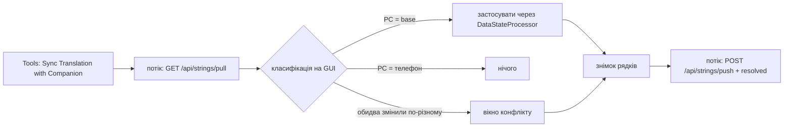

# План (поточна ітерація)

## Companion: редагування перекладу з телефону

Мета: веб-сторінка Companion показує блоки й рядки проєкту, оригінал поруч із перекладом.
Власник править переклад із телефону. Desktop забирає ці правки й надсилає свої.
Бюджет: ~30 правок, 4 прогони тестів.

### Модель даних (сервер)

- Новий файл `strings.json` у теці проєкту на сервері, поруч із `glossary.json`.
- Рядок: ключ збереженого перекладу (`файл::внутрішній_ключ::номер`), блок, номер, назва блоку, оригінал,
  `translation` (текст на сервері) і `base` (текст, який desktop надіслав останнім).
- `translation != base` означає: телефон змінив рядок, desktop ще не забрав правку.
- Стан живе на сервері. Файли проєкту й сесії не змінюються, тому сумісність зберігається.
- Запис атомарний (тимчасовий файл і `replace`), під замком.

### Синхронізація (desktop)

1. Потік забирає лише змінені на телефоні рядки (`translation != base`).
2. GUI порівнює кожен рядок із поточним текстом PC:
   - текст PC дорівнює `base` → правку телефону застосовує `update_edited_data(..., action_type="COMPANION_REMOTE")`;
   - текст PC дорівнює тексту телефону → нічого не треба;
   - обидва змінили по-різному → конфлікт. Вікно показує оригінал, текст PC і текст телефону.
     Користувач вибирає. «Скасувати» лишає конфлікт на сервері: жоден текст не губиться.
3. Знімок усіх рядків (ключі з `block_key_prefixes`, копія `edited_data`) робить GUI. Потік надсилає його.
4. Push: сервер ставить `translation = base = текст PC`. Виняток: рядок із правкою телефону, яку desktop
   ще не бачив. Такий рядок зберігає текст телефону і старий `base`; конфлікт виявить наступний pull.
   Рядок, для якого desktop надіслав `resolved[key] = текст телефону, який він бачив`, закривається.
   Правка, зроблена на телефоні між pull і push, не збігається з побаченим текстом і лишається.
5. Ключі, яких немає в поточному проєкті, desktop ігнорує.
6. Ті самі виклики працюють при відкритті проєкту й закритті (поруч із синхронізацією глосарію).

### Конфлікт на телефоні

- Телефон надсилає `PUT /api/strings/entry` із `base` = текст, який він показав.
- Якщо текст на сервері вже інший (desktop надіслав новий), сервер відповідає 409 з обома текстами.
- Сторінка показує обидва тексти. Власник вибирає: «Взяти текст PC» або «Зберегти мій».

### Сторінка

- Перемикач «Glossary / Strings» у заголовку.
- Список блоків → список рядків блоку (оригінал і переклад), пошук, фільтр «Untranslated», «Changed on phone».
- Редактор: оригінал, поле перекладу, «Save» і «Save & Next».
- Сервер віддає рядки одного блоку, не весь проєкт.

### Файли

- `companion/server/storage.py`, `models.py`, `api.py` — дані й API рядків.
- `companion/web/index.html`, `js/strings_view.js`, `css/app.css` — сторінка.
- `core/companion_strings.py` — клієнт, чиста функція класифікації, знімок і застосування.
- `components/companion/conflict_dialog.py` — показ конфлікту рядка (підпис замість терміна).
- Меню Tools, `locales/uk.json`, `docs/wiki/12_Picoripi_Companion.md` (EN/UK), `CHANGELOG.md`, тести.

Критерій: сторінка правує рядки; desktop забирає й надсилає правки; тести покривають синхронізацію й конфлікти;
`python tasks.py check` зелений; коміт на гілці. Без deploy і push без дозволу власника.

## Twilight Princess: точне прев’ю Item get

1. Luna звіряє рамку та іконку з `d_msg_scrn_item.cpp` і локальними ресурсами гри.
2. Sol незалежно перевіряє композицію панелі, геометрію та вибір іконки.
3. Codex виконує профільні перевірки, оновлює довідку й версію та готує окремий коміт.

Критерій: повна прямокутна панель Item get замість двох завитків; правильна іконка личинки у пляшці.
Початкову різницю збережено поза репозиторієм. Сторонні зміни зберігаються.
Перевірки Qt виконуються у Windows: у WSL немає PyQt6.

## Twilight Princess: вікно опису предмета

1. Luna звіряє меню предметів із локальним кодом гри та виправляє прев’ю.
2. Sol незалежно перевіряє вибір рамки, геометрію, текст і регресійні тести.
3. Codex виконує перевірки, оновлює довідку EN/UK, версію та створює окремий локальний коміт.

Критерій: опис предмета використовує власну панель меню замість чотирирядкової рамки Talk.
Сторонні незавершені зміни збережено. Початкову різницю записано поза репозиторієм.
Перевірки Qt виконуються у Windows: у WSL немає PyQt6.

## Пошук і подвійний клік: точний перехід до рядка

1. Luna виправляє навігацію Next/Prev, подвійний клік по номеру та вигляд поля пошуку.
2. Sol незалежно перевіряє відповідність фізичного рядка, видимої позиції та тексту редактора.
3. Codex виконує перевірки, оновлює довідку EN/UK, версію та створює окремий локальний коміт.

Критерій: вибраний рядок відповідає знайденому збігу або натиснутому номеру навіть після фільтрації.
Поле пошуку має читабельний текст із вертикальним центруванням.
Початкову різницю збережено поза репозиторієм. Сторонні зміни зберігаються.
WSL не має PyQt6; перевірки Qt виконуються у Windows.
Роботу зупинено: моделі Luna та Sol досягли ліміту. Незавершену різницю збережено поза проєктом.

## Глосарій: помірна прокрутка колесом

1. Luna задає малий піксельний крок таблицям термінів, варіантам і входженням.
2. Sol перевіряє різницю та реальні події колеса для високих карток і малих панелей.
3. Codex виконує профільні перевірки, оновлює довідку EN/UK і версію, створює окремий коміт.

Початкову різницю збережено поза репозиторієм. WSL не має PyQt6; перевірки Qt виконуються у Windows.

Sol схвалив реалізацію: один стандартний рух колеса зміщує списки на 60 пікселів за поточних налаштувань.
Повернення старих налаштувань у пам’яті спричинило провал усіх трьох регресійних тестів.

Паралельний коміт завершено. Пакет прокрутки підготовлено до окремого коміту.

## Глосарій: український переклад у входженнях

1. Luna додає поточний переклад повідомлення до картки входження без сканування проєкту.
2. Sol незалежно перевіряє код, незбережені правки, порожні значення та регресійні тести.
3. Codex виконує перевірки, оновлює документацію й версію та створює окремий локальний коміт.

Сторонні зміни збережено. WSL не має PyQt6; перевірки Qt виконуються у Windows.

Реалізацію Luna незалежно схвалила Sol. Версія пакета — `0.3.176-dev`.

## Швидкий пошук: правильний рядок після першого Next

1. Luna відтворює розбіжність між знайденим збігом і вибраним рядком та виправляє причину.
2. Sol незалежно перевіряє реалізацію, переходи Next/Prev та регресійні тести.
3. Codex виконує перевірки, оновлює довідку EN/UK і версію та створює окремий локальний коміт.

Сторонні незавершені зміни збережено. Перевірки Qt виконуються у Windows: WSL не має PyQt6.
Luna завершила реалізацію. Sol незалежно схвалив код і підтвердив провал старого коду на новій регресії.
94 профільні тести, 174 перевірки документації, smoke та deslop пройшли; lint змінених файлів чистий.
Повний набір зупинено на 98% після аварії процесу та відсутності прогресу понад дві хвилини.
У журналі були невдалі тести без підсумкового звіту; загальний успіх не заявляється.
Версія пакета — `0.3.174-dev`. Два старі дефекти пошуку записано до docs/OPEN_ITEMS.md.

## Власні кнопки запуску інструментів

1. Люна реалізує вкладку Tools зі списком інструментів і редактором текстових значків.
2. Перенести старий шлях без втрат; зберігати список і відразу оновлювати кнопки панелі.
3. Codex перевіряє різницю, міграцію, скасування, запуск, життєвий цикл кнопок і відсутність зайвого сканування.
4. Виконати профільні та загальні перевірки; оновити довідку EN/UK, версію й документи.
5. Створити окремий локальний коміт пакета без сторонніх змін. Оновити Graphify після фінальних правок.

Межі: глобальні налаштування, вкладка Tools, панель, запуск, локалізація, тести й довідка.
Сторонні незавершені зміни налаштувань пересканування та інших функцій зберігаються.
Критерії: кілька незалежних кнопок; значки з тексту/емодзі; Cancel без змін; порожній список лишається порожнім.

Реалізацію прийнято після перевірки Codex. Фінальні 87 профільних тестів і 52 тести окремої копії пройшли.
Після оновлення очікуваної схеми збереження пройшли ще 29 перевірок, включно з двома нестабільними сценаріями майстра.
Повний набір: 10822 passed, 1041 skipped, 2 xfailed, 4 failed. Загальний успіх не заявлено.
Відома помилка ШІ-рецензії залишається поза пакетом. Версія — `0.3.173-dev`.

## Налаштування: вибіркове пересканування

1. Luna виправляє запуск скану за фактичними змінами даних перевірки.
2. Sol незалежно перевіряє код і регресійні тести.
3. Codex виконує перевірки, оновлює довідку й версію та створює окремий локальний коміт.
4. Критерій: endpoint, вигляд, автовиправлення та OK без змін не запускають повний скан. Зміни правил запускають його один раз.

Завершено: Luna реалізувала, Sol схвалив. 68 профільних тестів і 174 перевірки документації пройшли.
Версія пакета — `0.3.172-dev`. Повний набір завис на 99% після чотирьох збоїв; загальний успіх не заявлено.

## Глосарій: підкреслення термінів оригіналу

Область: підкреслення термінів глосарія в Original та Editable.
Сторонні незавершені зміни збережено. Моделі обрано за прямим дорученням користувача.

1. Luna з високим рівнем міркування відтворює дефект і виправляє причину.
2. Sol 6.1 незалежно перевіряє реалізацію та регресійні тести.
3. Codex перевіряє результат, оновлює документацію й версію та створює окремий локальний коміт.
4. Критерій: `village` і `mayor` мають підкреслення в Original, відповідники зберігають підкреслення в Editable.

Завершено: Luna реалізувала, Sol 6.1 схвалила. Codex повторно підтвердив 82 профільні тести.
174 перевірки документації, lint, smoke та deslop пройшли. Версія — `0.3.171-dev`.
Повний набір: 10796 passed, 1041 skipped, 2 xfailed, 1 failed за 612.57 с.
Окремий повтор підтвердив відомий провал тесту ШІ-рецензії через буквальний `\\n` замість пробілу.
Пакет готовий до окремого локального коміту. Сторонні зміни збережено.

## Інтерфейс: обрізані елементи та меню

Область: спільні стилі, заголовок редактора та секції глосарія.
Наявні сторонні зміни збережено; вихідну різницю скопійовано поза репозиторієм.
Luna завершила реалізацію. Sol незалежно схвалив фінальний код: 107 тестів пройшли.
Codex підтвердив 131 профільний тест. Версія пакета — `0.3.170-dev`.

1. Luna із середнім рівнем міркування відтворює дефекти та виправляє причини.
2. Sol незалежно перевіряє різницю, виклики та регресійні перевірки.
3. Codex завершує перевірки, документацію, версію й окремий локальний коміт.
4. Критерії: цілі рамки кнопок, читабельні заголовки глосарія, відсутність перекриття після зміни шрифту й теми.

## Twilight Princess: візерунки діалогового прев’ю

Luna реалізував виправлення. Sol незалежно схвалив код. Регресію підтверджено на старій реалізації.
109 профільних тестів і 174 перевірки документації пройшли; один тест реального дампу пропущено.
Повний набір завершено: 10788 passed, 1041 skipped, 2 xfailed, 1 failed у відомому тесті ШІ-рецензії.
Версія пакета — `0.3.169-dev`. Пакет схвалено для окремого коміту; сторонні зміни збережено.

1. Відтворити різницю між Dialogue та Explain; перевірити кеш ресурсів і зміну проєкту.
2. Доручити мінімальне виправлення агенту GPT-6 Luna з високим рівнем міркування.
3. Перевірити результат агентом GPT-6.1 Sol із середнім рівнем міркування.
4. Виконати регресійні перевірки, оновити документацію та завершити окремим комітом.

## Глосарій: пошук словосполучення для заміни

Реалізацію перевірено: 97 профільних тестів, lint, smoke, 174 перевірки документації та deslop пройшли.
Версія пакета — `0.3.168-dev`. Пакет завершується окремим локальним комітом.
Повний запуск зупинено після зависання MemPalace. До зупинки: 10767 passed, 1041 skipped, 3 failed.
Окремий повтор підтвердив відому помилку ШІ-рецензії; перевірка ключа майстра пройшла.

Область: діалог заміни, його ШІ-обробник, допоміжний пошук фраз, тести та відповідна документація.
Повна фраза має збігатися без залежності від регістру. Окремі слова не є збігами.

## Менеджер проєктів: спільний глосарій групи

Реалізацію та виправлення аудиту перевірено. Профільні 162 тести, lint, smoke, docs-check і deslop пройшли.
Повний запуск: 9354 passed, 1027 skipped, 2 xfailed, 1 failed у раніше описаному AI review тесті.
У незалежній копії пакета пройшли 162 профільні тести та цей AI review тест.
Зміни поточного пакета Yo-kai Watch потрібно зберегти окремо.

## Yo-kai Watch 3DS: шрифти та мови референсу

Пакет прийнято після рев'ю Gemini. Завершення: версія `0.3.164-dev`, окремий коміт без сторонніх змін.
Перевірено 146 профільних тестів і 43 тести спільного прев'ю. Геометрія Switch залишається наближеною.

1. Відтворити втрату `data.json` і виміряти декодування реальних шрифтів.
2. Виправити чергу завдань, закриття редактора та перемикання шрифтів.
3. Показувати завантаження одразу. Прибрати важку синхронну підготовку таблиці символів.
4. Читати доступні мови гри у робочому потоці. Показувати лише непорожні тексти поточного рядка.
5. Перевірити реальні ресурси, регресії, документацію та сумісність. Завершити окремим комітом.

## Майстер нового проєкту: джерела та ключі 3DS

Реалізацію та перевірку пакета завершено. Обмеження повного набору тестів записано у `walkthrough.md`.

1. Перевірити причину відмови Yo-kai Watch CIA. Не прирівнювати непідтримуваний образ до відсутніх ключів.
2. Додати вибір розпакованої теки гри окремо від теки перекладу.
3. Додати пояснення та відновлення після помилки ключів у тому самому майстрі.
4. Перевірити збереження параметрів, повторне відкриття проєкту та захист оригіналів.
5. Оновити документацію, виконати тести, lint, deslop і Graphify. Після перевірки підготувати окремий коміт.

Попередній пакет WP7 закрито. Загальний порядок робіт — `docs/ROADMAP.md`.

## Пошук: повторний клік у полі

Luna виправляє повторне виділення. Sol незалежно перевіряє зміни.
Критерій: перший клік після отримання фокуса виділяє запит; наступний ставить курсор.
Перевірки Qt виконано у Windows: у WSL немає PyQt6.
